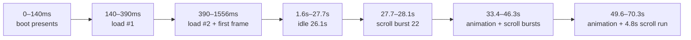

# `browser.trace` findings

Parsed the raw trace (`25,224` events, 3.0 MB, single line). Every number below comes from the file itself.

## 1. File / trace inventory

| Item | Value |
|---|---|
| Events | 25,224 |
| Span | 70.308 s (`1792634632078137` → end, µs epoch) |
| Processes / threads | 1 pid (`Browser`), 30 tids |
| Categories | `_` for all 25,223 events, `__metadata` for 1 → no grouping in a trace viewer |
| Metadata | only `process_name = Browser`; no thread names, no per-phase `M` events |

Event counts:

| Span | n | What it measures |
|---|---:|---|
| `composite_raster_and_draw` | 401 | frame scope: plan + raster + present |
| `present` (C) | 1,079 | |
| `view.apply` / `view.commit` | 1,079 / 1,079 | layer-tree commit |
| `view.updateSublayers` (C `view`) | 1,072 | layer diff |
| `BrowserTab.animFrame` | 422 | rAF tick |
| `BrowserTab.scrollAt` | 394 | input → scroll |
| `BrowserTab.layout` | 168 | |
| `BrowserTab.paint` | 166 | |
| `BrowserTab.style` | 23 | |
| `BrowserTab.load` | 2 | |
| `raster.worker` | 1,777 | strip tasks (== `strips` count, see §11) |
| `tiles` (C) | 401 | one per composite |
| `pool` (C) | 362 | `workers: 4` always, `strips` 1–11 |

## 2. Session timeline

Scroll bursts (input gaps > 250 ms split them):

| Burst | Events | Rate | Duration |
|---|---:|---:|---:|
| 27.75–28.09 s | 22 | 65.7/s | 0.33 s |
| 33.39–34.06 s | 38 | 56.7/s | 0.67 s |
| 38.07–38.39 s | 21 | 64.5/s | 0.33 s |
| 44.29–44.56 s | 17 | 61.4/s | 0.28 s |
| 59.05–63.88 s | 280 | 58.0/s | 4.83 s |
| 67.50–67.75 s | 16 | 64.7/s | 0.25 s |

Idle gaps: 1.67→27.75 s (26.08 s), 28.09→32.60 s (4.51 s), 46.32→49.19 s (2.87 s), 49.64→59.05 s (9.42 s).

## 3. Load

| Phase | Load #1 | Load #2 |
|---|---:|---:|
| `load` total | 249.7 ms | 1,166.5 ms |
| `.page` | 32.7 | 460.7 |
| `.parseHTML` | 143.0 | 21.3 |
| `.styles` | 2.5 | 17.7 |
| `.applyStyles` | 10.5 | **270.3** |
| `.scripts` | 0.9 | 57.4 |
| `.images` | 23.1 | 159.7 |
| `.iframes` | 4.5 | 0.4 |
| `.exec` | 13.1 | 178.6 |

`profile.load` counters (two samples):

| Counter | #1 | #2 |
|---|---:|---:|
| `load.parse.us` | 68,483 | 17,873 |
| `load.jsInit.us` | 57,647 | 1,316 |
| `jsc.context.us` | 43,649 | 580 |
| `jsc.runtime.us` | 12,094 | 503 |
| `jsc.runtimeEval.us` | 11,328 | 408 |
| `load.title.us` | 4,781 | 380 |
| `load.resources.us` | 5,615 | 1,345 |
| `load.checkboxes.us` | 4,815 | 370 |
| `load.defaultCss.us` | 1,479 | 0 |

First frame (inside load #2's `.page`, 390→666.5 ms):

| Phase | ms | Detail |
|---|---:|---|
| `style` | 81.1 | 7,398 nodes |
| `layout` | 133.1 | 994 blocks |
| `paint` | 31.2 | 12,266 nodes |
| `composite` | 30.7 | 80 tile misses, 8 strips |

## 4. Style (23 passes)

Timeline: 471 ms, 1,602, 32,673, 35,121, 35,835, 36,557, 37,171, 40,590, 41,054, 41,622, 42,031, 42,481, 42,902, 43,570, 49,336, 64,712, 65,138, 65,442, 65,806, 66,001, 66,312, 68,905, 69,222. Gaps 0.20–15.38 s.

| Pass | Nodes | Elements | Candidates | Universal | Applied | Cost |
|---|---:|---:|---:|---:|---:|---:|
| #1 | 7,398 | 3,065 | 7,044 | 6,130 | 7,398 | 81.1 ms |
| #2 | 513 | 264 | 640 | 2,640 | 513 | 44.8 ms |
| #3 | 513 | 264 | 640 | 2,640 | 513 | 17.9 ms |
| #4–#23 | 7,398 | 1,150 | 2,829 | 2,300 | 3,059 | 49.2–52.6 ms |

Pass #1 breakdown (ms): `apply` 59.1, `reset` 12.6, `flags` 9.8, `test` 5.4, `post` 4.5, `push` 4.4, `pop` 2.4, `inline` 0.6; plus `has` 4.9, `visited` 4.5, `diff` 3.5, `snapshot` 1.8, `rules` 1.4.

Matching workload pass #1: 3,065 elements, 7,044 candidates, 2,735 `matchesTrue`, 1,078 descendant candidates / 619 true. **6,130 of 7,044 candidate tests are universal-selector checks (87%).**

Steady passes carry `layout.staleNodes.count = 2,990`, `layout.staleText.count = 1,909`; ~50 ms each, roughly every 0.3–0.7 s during animation.

## 5. Layout (168 passes)

| Class | n | Cost |
|---|---:|---:|
| Initial full | 1 | 133.1 ms |
| Full 994-block rebuild | 165 | median 26.8, p95 53.6, max 133.1 ms |
| Small subtree (29 blocks) | 2 | 2.9 / 2.2 ms |
| Skip-only | 1 | 8 µs |

165 of 168 layouts rebuild **all 994 blocks**, even though text is cached: `text.words.count = 0`, `text.measureCalls ≈ 200–430`, `measureMisses = 0`, `lines.reused ≈ 1,243–1,372 / 1,511–1,586`, `line.moved ≈ 1,232`.

Animated-frame split (median, ms):

| Component | Median | p95 | Total over 165 |
|---|---:|---:|---:|
| `block.build` | 13.15 | 34.68 | **2.77 s** |
| `inline.place` | 9.24 | 13.26 | 1.56 s |
| `line.place` | 6.04 | 7.72 | 0.85 s |
| `line.prelaid` | 1.49 | 2.78 | 0.27 s |
| `text` | 1.19 | 1.34 | 0.16 s |
| `measure` | 0.00 | 0.00 | 0.03 s |

Initial pass: `block.build` 94.9, `text.font` 20.3, `text.measure` 19.3, `line.place` 9.7. Measure cache: **20,522 calls, 3,156 misses → 85% hit** on the first pass, ~100% afterwards.

## 6. Paint (166 passes)

| Metric | Initial | Animated steady | Final sample |
|---|---:|---:|---:|
| Duration | 31.2 ms | p50 24.9 / mean 23.3 | 24.9 |
| `paint.nodes` | 12,266 | 9,312–12,398 | 9,312 |
| `paint.own.items` | 9,774 | 6,561–9,780 | 6,800 |
| `paint.effect.check` | 10,739 (3.8 ms) | 7,793 (2.8 ms) | 7,793 |
| `paint.stored.lines` | 1,521 | 283 | 283 |
| `paint.cached.lines` | – | ~1,227 | 1,227 |
| `paint.cached.blocks` | – | 0–30 | 30 |

Incremental machinery exists, but steady-state frames still **re-record ~6,800 display items**; block cache is nearly unused (`cached.blocks = 30` of 990).

## 7. Rasterization / tiles

| Metric | Value |
|---|---|
| Composited frames | 401 (scroll-class 232, animation-class 169) |
| Layers / flat | 6 / 3 (constant) |
| Tile hits / misses | 28,375 / 13,888 |
| Animation frames | 10,124 misses vs 3,667 hits → **73.4% miss** |
| Scroll frames | 3,764 misses vs 24,708 hits → 13.2% miss |
| Pool | 4 workers, 1–11 strips/frame (82 frames at 11; mean 4.9) |
| Strip tasks | 1,777, mean 3.2 ms, p95 6.1, max 9.2 |
| Raster worker tids | 27 distinct |

Per-class spans (mean ms):

| Span | Animation | Scroll |
|---|---:|---:|
| `raster.plan` | 15.35 | 5.05 |
| `raster.plan.tiles` | 3.33 | 5.31 |
| `raster.composite` | 11.98 | 0.03 |
| `raster.install` | 3.26 | 2.13 |
| `raster.effect` | 0.14 | 0.03 |

## 8. Layer tree / present

| Metric | Value |
|---|---:|
| `view.apply` | 1,079, total 6.18 s |
| `view.commit` | 1,079, total 5.96 s, mean 5.5 ms, p95 30.8 ms, max 53.6 ms |
| `updateSublayers` | 1,072, total 152 ms |
| Sublayers added / removed | **5,239 / 5,104** |
| Frames that add layers | 275 |
| Sublayer counts per frame | 0–166 |
| Total placements | 123,674 |
| Presents dropped | 21 frames: 16×`1`, 5×`2` |
| Dropped during scroll | 0 |

Scroll frames add/remove **zero** layers (commit ≈ 0.1 ms) but still re-place 83–166 layers every frame. Animation frames are where layer churn and the 30–53 ms commits happen.

## 9. Frame pacing

`composite_raster_and_draw` is effectively the frame period: consecutive spans are 30–60 µs apart, and for animation frames it contains the next frame's `layout` + `paint` + `present`.

| Frame class | mean | p50 | p95 | max | Implied |
|---|---:|---:|---:|---:|---|
| Animation (169) | 63.4 ms | 56.2 | 143.1 | 157.4 | **7–18 fps** |
| Scroll (232) | 7.3 ms | 7.0 | 10.3 | 17.8 | ~60 fps |

Worst frames: 157.4 ms @35.07 s, 155.2 @64.64, 154.0 @43.50, 154.0 @49.27, 153.9 @40.99, 153.1 @65.07, 151.4 @35.77, 143.2 @36.51.

`present.main` (754): intervals p50 11.6 ms, p95 139.3 ms; 263/753 > 16.7 ms, 174 > 33 ms, 41 > 100 ms.

422 rAF ticks, but **247 do no work** (`raf` + `animScan` only); 175 carry style/layout/paint.

## 10. Cost ranking

| Span | Total | Share of 70.3 s |
|---|---:|---:|
| `composite_raster_and_draw` (frame scope) | 12.39 s | 17.6% |
| `animFrame` (style + layout) | 6.20 s | 8.8% |
| `view.apply` (commit 5.96 s) | 6.18 s | 8.8% |
| `raster.plan` | 6.06 s | 8.6% |
| `raster.worker` (sum over strips) | 5.68 s | 8.1% |
| `BrowserTab.layout` | 4.99 s | 7.1% |
| `raster.composite` | 4.70 s | 6.7% |
| `BrowserTab.paint` | 3.86 s | 5.5% |
| `BrowserTab.load` | 1.42 s | 2.0% |
| `BrowserTab.style` | 1.16 s | 1.7% |
| `BrowserTab.scrollAt` | 0.049 s | 0.07% |

## 11. Trace-quality / instrumentation anomalies

Span nesting and pairing:

1. **`composite_raster_and_draw` is not strictly after paint for animation frames.** At 35.223 s it opens, then `animFrame`/`layout`/`paint` run inside it, and it closes after the next `present.main` at 35.270 s. For the boot frame it opens *after* paint. Stack-pairing reports `scrollAt` mean 4.39 ms; FIFO pairing reports 0.12 ms — one of them is wrong depending on consumer.
2. **`load.page` overlaps style/layout/paint** (390–850 ms contains style 390–471, layout 471–604, paint 604–636), so it is not a leaf phase.
3. **presents outnumber composites 2.7:1** (1,079 vs 401), `present.main` 754, `view.apply` 1,079, `view` 1,072 — no shared frame ID to join them.
4. **`layout.skip.count = 4` is emitted on 165 frames that `block.build.count = 994`** — the name reads as "skipped layout", the value is not that.
5. **`text.measure.count == text.measureMisses.count == 3,156`** while `measureCalls = 20,522`; `count` here means "actual measurements", not calls.

Counter schema drift:

6. Pass #1 has `style.rules.count = 218`; later passes have no `rules.count`, only `style.scope.rules.count = 1`. Later passes add `layout.staleNodes/staleText`, `style.scope.*`, `layout.inline.refresh.us`, etc.
7. Pass #2 reports `universalCandidates = 2,640 > candidates = 640`; pass #1 reports 6,130 of 7,044. The two counters do not nest.
8. `nodes = 7,398` stays constant while `elements` jumps 3,065 → 1,150 and `applied` 7,398 → 3,059. Per-pass "nodes/elements/applied" are not comparable.
9. `profile.load` sums do not match spans: 68.5 ms counter vs 143.0 ms span (load #1); 17.9 vs 21.3 (load #2). Counters cover only part of the phase.
10. **`raster.worker` is one span per strip, not per worker**: the per-frame count matches the `strips` field exactly (1→1, 2→2, 8→8, 11→11), yet it is emitted on 27 distinct tids while `pool workers = 4`.
11. `tiles.scroll` is a scroll offset in px (0…4,217), not a count. Grouping by `scroll > 0` attributes 12,980 misses to "scrolling"; classified by frame span, only 3,764 belong to scroll frames and 10,124 belong to animation frames.
12. `present.dropped` takes values 0/1/2 but has no `dropped` event or reason attached.

Coverage:

13. 168 layouts vs 23 style passes → **145 layouts were not preceded by a style pass** (animation-driven relayout).
14. 401 composites vs 168 layouts vs 166 paints vs 422 rAF ticks vs 1,079 presents: no frame-level correlation ID.
15. Everything lands in category `_`, with one unnamed process → a trace viewer shows one flat flame graph; you cannot filter "layout" vs "raster" without name matching.

## 12. Bottom line

- Scrolling is healthy: 7.0 ms frames, 87% tile hit, no layer churn, 0 dropped presents.
- Animation is the problem: 56 ms median frames, and **every animated frame rebuilds all 994 blocks** (2.77 s of `block.build` across 165 frames), re-records ~6,800 paint items, and rerasterizes at a 73% tile-miss rate.
- Style passes contribute 23 × ~50 ms, dominated by universal-selector candidate tests (87%) and per-node reset/flags work.
- Layer churn (5,239 added / 5,104 removed) produces the 30–53 ms `view.commit` tail; commits are cheap when layers are stable.
- Before trusting per-phase attribution, fix the instrumentation issues in §11 — particularly the non-nested `composite`/`scrollAt`/`load.page` spans and the `raster.worker` naming, since both mis-size the cheapest and most expensive phases respectively.
