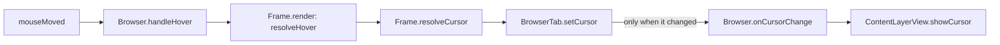

# Cursor pointer on links and `cursor: pointer`

## Goal

When the mouse is over `<a href>` or any element whose `cursor` is `pointer`
(declared on it or inherited from an ancestor), the macOS cursor turns into the
pointing hand. Everywhere else, including `<button>`, it stays the arrow.

## How it flows

## Files

| File | Why |
| --- | --- |
| `Sources/Engine/Style/CursorKind.swift` (new) | `auto` / `default` / `pointer`, keyword parsing, and the inherited lookup along the hover chain |
| `Sources/Engine/Core/Frame.swift` | `resolveCursor()` after `resolveHover()` at the end of `render()` and after `clearHover()` |
| `Sources/Engine/Core/BrowserTab.swift` | stores the tab's `cursor`, tells the browser only when it changes |
| `Sources/Engine/Core/Browser.swift` | `onCursorChange` callback; also fires when the active tab switches |
| `Sources/Engine/Resources/browser.css` | `a[href] { cursor: pointer }` |
| `Sources/ToyStack/NSCursor+Engine.swift` (new) | `CursorKind` -> `NSCursor` |
| `Sources/ToyStack/BrowserContentView.swift` | applies the cursor with a cursor rect plus `NSCursor.set()` |
| `Tests/ToyStackTests/Core/HoverCursorTests.swift` (new) | behavior tests |
| `www/cursor-pointer.html` (new) | manual demo page |

## Design decision

`cursor` is an inherited property (css-ui-4 §5.1.1, initial value `auto`).

- **Option A: a typed field in `ComputedStyle`.** Every group struct is already at
  four stored properties except `VisualStyle`, and inheritance today only copies
  `TextStyle`. The fast "re-inherit text only" path (`StyleFields.reapplyInherited`)
  would leave a child's cursor stale when an ancestor's `:hover` rule changes it.
- **Option B (chosen): read the declared value when it is needed.** The cascade
  already keeps undeclared-by-engine properties in `StyleFields.unknown`
  (same as `transition` and `animation`). The hover chain is the hit element plus
  all its ancestors, innermost first, so the first element in that chain with a
  supported value *is* the inherited value. It costs a handful of dictionary
  lookups per frame and has nothing to invalidate.

## Behavior notes

- `inherit`, `unset`, and unsupported values (`cursor: banana`) defer to the parent.
- A `:hover` rule that sets `cursor` takes effect one render after the hit test,
  the same frame its other `:hover` styles land.
- `<button>` keeps the arrow, as in Chrome, Safari, and Firefox: their default
  styles give buttons no `cursor`. Pages that want a hand add
  `button { cursor: pointer }` themselves.

## Limits

- Only `auto`, `default`, `pointer` are mapped. `auto` is always the arrow (no
  I-beam over text).
- Image cursors (`url(...) x y, pointer`) are not read: the CSS parser keeps only
  the first word of a non-shorthand value.
- Inside an `<iframe>` the cursor follows the iframe element, because hover
  hit-testing stops at the root frame.
