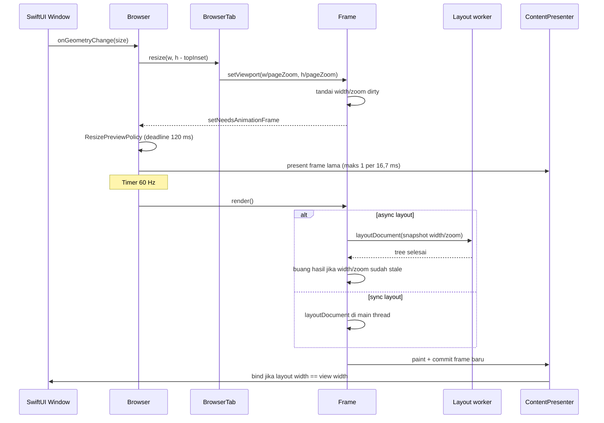

# Resize Flow ToyStack dan Perbandingan dengan Engine Nyata

Tanggal: 2026-11-07
Ruang lingkup: perilaku resize di ToyStack saat ini, dibandingkan dengan Blink,
WebKit, Gecko, Servo, dan LadyBird. Dokumen ini hanya analisis; tidak ada
perubahan kode.

## 1. Alur resize ToyStack



Urutan konkretnya:

1. **Entry.** `.onGeometryChange` di `Sources/ToyStack/ToyStack.swift:245`
   memanggil `app.resize(to:deferLayout:true)`.
2. **Browser.** `Browser.resize` (`Sources/Engine/Core/Browser.swift:155`)
   menyimpan `windowSize`, lalu meneruskan ukuran ke **semua tab**. Hanya tab
   aktif yang mendapat `setNeedsAnimationFrame`.
3. **Tab.** `BrowserTab.resize` (`Sources/Engine/Core/BrowserTab.swift:241`)
   early-return jika ukuran sama, mengubah ukuran viewport ke CSS piksel
   (`width / pageZoom`), lalu memanggil `rootFrame.setViewport(...)` dan
   `rootFrame.setNeedsViewportResize()`.
4. **Frame.** `Frame.setViewport` (`Sources/Engine/Core/Frame.swift:84`) hanya
   menandai document dirty jika **width** berubah.
   `Frame.setNeedsViewportResize` (`Sources/Engine/Core/Frame.swift:2058`)
   menandai geometry dirty. Jika media query berubah, style pass dijalankan;
   kalau tidak, cukup `setNeedsLayout()`.
5. **Frame clock.** Tidak ada reflow di handler resize. Flag
   `needsAnimationFrame` dibaca oleh `Timer` one-shot 60 Hz di
   `RunLoop.main` (`Sources/Engine/Core/Browser.swift:223-255`).
6. **Preview.** `ResizePreviewPolicy` memakai jendela 120 ms.
   `requiresPreview` bernilai true jika layout async aktif **atau** frame
   sebelumnya lebih lambat dari 2x frame budget. GUI selalu mengaktifkan async
   (`Sources/ToyStack/ToyStack.swift:266`), jadi setiap resize mem-preview
   frame lama. Preview dibatasi satu per frame
   (`Sources/Engine/Core/Browser.swift:189`).
7. **Layout.** `Frame.render` memilih `startAsyncLayout()`
   (`Sources/Engine/Core/Frame.swift:1264`) bila async aktif. Tree lama tetap
   dipakai untuk preview; worker menjalankan `layoutDocument`, lalu
   `finishAsyncLayout` (`Sources/Engine/Core/Frame.swift:1305`) hanya memasang
   hasil jika `LayoutJobKey` masih cocok dengan width/zoom saat ini. Hasil stale
   dibuang, style change dikembalikan, dan `setNeedsLayout()` dipanggil ulang.
8. **Present.** `PresentedFrame` membawa `paintedLayoutSize`.
   `ContentPresentationState` membandingkan lebar layout fisik dengan lebar
   view. Jika beda, frame lama dipresentasikan sebagai preview. Jalur layer
   memakai `PreviewFit` (uniform scale, **tidak pernah memperbesar**); jalur
   bitmap memakai `contentsGravity = .resize` (stretch). Frame baru baru
   di-bind ketika lebar layout sudah sama dengan lebar window.

## 2. Perilaku dan batasan yang perlu dicatat

- **Height-only resize murah untuk block layout.** Document pass tetap jalan,
  tetapi block subtree di-skip karena width tidak berubah. Test:
  `ViewportResizeTests.verticalResizeDoesNoBlockWorkAndClampsScroll`
  (`Tests/ToyStackTests/ViewportResizeTests.swift`).
- **Width change** memicu full document layout. Line/text reuse hanya dipakai
  untuk perubahan width yang tidak mengubah line break. Media query flip
  memicu style pass.
- **Inactive tab.** Viewport-nya sudah diperbarui, tetapi reflow menunggu tab
  tersebut aktif; `selectTab` memanggil `runAnimationFrame`
  (`Sources/Engine/Core/Browser.swift:809`).
- **Mode sync menunda reflow** sampai deadline 120 ms setelah event terakhir.
  Deadline diperpanjang oleh setiap event resize. Mode async tidak menunggu
  deadline untuk layout; preview dan layout boleh berjalan pada tick yang sama.
- **Zoom.** `pageZoom` mengubah ukuran viewport CSS dan memicu
  `setNeedsViewportResize` (`Sources/Engine/Core/Frame.swift:2099-2113`).
  Ini adalah browser zoom, bukan pinch-zoom visual.
- **iframe.** Layout menghasilkan `LayoutEffect.iframeViewport`
  (`Sources/Engine/Layouts/LayoutEffect.swift`). Width change memanggil
  `setViewport` + `setNeedsRender`; height-only memanggil `setViewport` +
  `setNeedsLayout` (`Sources/Engine/Core/Frame.swift:119-131`).
- **Canvas.** `LayoutEffect.canvasSize` mengubah ukuran backing context dan
  scale-nya (`Sources/Engine/Core/Frame.swift:131-136`).
- **Belum ada** `window.resize`, `ResizeObserver`, `window.innerWidth`,
  `window.innerHeight`, atau visual viewport di engine ini.
- Angka trace lama: reflow resize halaman berat 79-150 ms, sementara preview
  commit p95 beberapa milidetik. Rincian ada di
  `plans/issues/resize-flow-roadmap.md`.

## 3. Perbandingan dengan engine nyata

| Aspek | ToyStack | Blink (Chromium) | WebKit | Gecko | Servo | LadyBird |
|---|---|---|---|---|---|---|
| Batas proses | Satu proses; SwiftUI + engine | Browser process -> IPC -> renderer | UI process -> WebContent | Chrome process -> content process | Embedder -> constellation/script | UI process -> WebContent |
| Entry resize | `onGeometryChange` -> `Browser.resize` | `WebFrameWidgetImpl::Resize` -> `WebViewImpl::Resize`; subframe `LocalFrameView::SetLayoutSize` + `Resize` | `LocalFrameView::setFrameRect` -> `document->didChangeViewSize()` | `PresShell::ResizeReflow` / `ResizeReflowIgnoreOverride` | `ViewportDetails` dari embedder | `ConnectionFromClient::set_viewport` -> `PageClient::set_viewport` |
| Kapan reflow | Tick 60 Hz; async worker; sync fallback | Lifecycle update renderer, bukan di handler | Layout context; event resize hanya setelah `needsLayout()` false | Refresh driver; `ResizeReflow` bisa sinkron; reflow roots | Pipeline script/layout | Langsung; `hurry_outstanding_rendering_opportunity()` |
| Konten lama saat resize | `PreviewFit` + deadline 120 ms; tidak memperbesar | Compositor mempertahankan layer lama; resize lock di sebagian platform | Tiled backing store | Layer tree lama sampai refresh driver paint | WebRender/compositor | Display list lama sampai frame baru siap |
| Resize event | Tidak ada | `ResizeObserver` dan `resize` setelah layout | `scheduleResizeEventIfNeeded`, ditunda jika masih butuh layout | `ScheduleResizeEventIfNeeded` pada `RenderingPhase::ResizeSteps` | Event script | `Document` mengirim event ke `window` dan `VisualViewport` |
| Viewport | Satu layout viewport; `pageZoom` | Layout viewport + visual viewport | Layout + visual (iOS) | Layout + visual/MVM | Layout + visual (`ViewportDetails`) | Layout + visual viewport |
| Granularitas layout | Full document; reuse line untuk width-only | Relayout boundary, incremental | Relayout boundary | Reflow root, incremental | Parallel layout | Partial relayout boundary + invalidasi layout tree |
| DPR / zoom | `pageZoom` mengubah viewport CSS dan memicu reflow | Pinch-zoom visual tanpa reflow; browser zoom reflow | Sama | Sama | Visual viewport terpisah | Perubahan DPR menginvalidasi paint + hit test list |

## 4. Perbedaan yang paling menentukan

1. **ToyStack memakai preview sebagai kompensasi main thread.** Blink, WebKit,
   dan Gecko sudah punya compositor yang bisa mengubah ukuran viewport dan
   menampilkan frame lama tanpa menunggu renderer selesai. ToyStack melakukan
   hal serupa di layer aplikasi: `ResizePreviewPolicy` +
   `ContentPresentationState` + `PreviewFit`. Efeknya mirip, tetapi tetap
   bergantung pada main thread dan frame clock yang sama dengan layout.

2. **ToyStack belum memisahkan layout viewport dan visual viewport.**
   `FrameViewportState` hanya punya `width`, `height`, dan `zoom`. `pageZoom`
   mengubah ukuran layout CSS (`frameWidth = tabWidth / zoom`), jadi zoom
   memicu reflow. Di Blink, WebKit, dan Gecko, pinch-zoom mengubah visual
   viewport tanpa reflow; hanya browser zoom yang mengubah layout viewport.

3. **ToyStack tidak punya event resize.** Tidak ada `window.resize`,
   `ResizeObserver`, atau `innerWidth`/`innerHeight`. Engine nyata memakai event
   ini sebagai kontrak halaman: layout selesai dulu, baru event dikirim. Ini gap
   semantik, bukan sekadar optimasi.

4. **ToyStack reflow seluruh dokumen.** Engine nyata memakai relayout boundary
   (Blink, WebKit, LadyBird) atau reflow root (Gecko) untuk membatasi subtree
   yang dihitung ulang. ToyStack sudah punya reuse line/text dan guard width,
   tetapi belum punya boundary eksplisit; width change tetap menyentuh document
   pass dan seluruh block yang bergantung pada width.

5. **ToyStack menunda reflow di mode sync selama 120 ms.** Deadline
   diperpanjang setiap event baru. Ini membuat drag tetap menampilkan konten
   lama, tetapi bisa menunda layout sampai pointer berhenti. Mode async
   menghindari ini karena layout boleh jalan selama preview. WebKit hanya
   menyesuaikan tile coverage saat live resize; Blink dan Gecko umumnya tetap
   reflow per frame dan mengandalkan compositor.

6. **Guard async ToyStack adalah versi mini dari generation check engine
   nyata.** `LayoutJobKey(width, zoom)` membuang hasil worker yang sudah stale.
   Blink, WebKit, dan Gecko memakai mekanisme serupa dalam skala frame tree dan
   compositor, termasuk penanganan iframe dan DPR.

## 5. Posisi ToyStack

Secara arsitektur, **LadyBird adalah yang paling dekat**: sama-sama menerima
ukuran viewport, menginvalidasi style untuk perubahan viewport, lalu
menginvalidasi layout. Bedanya, LadyBird sudah punya proses terpisah, visual
viewport, event resize, DPR handling, dan partial relayout. **Gecko** paling
dekat untuk perilaku reflow sinkron (`ResizeReflow`), sedangkan **Blink dan
WebKit** paling matang dalam pemisahan layout/visual viewport dan
compositor-driven resize.

ToyStack saat ini bisa dilihat sebagai engine satu-proses dengan model:

```text
viewport berubah -> dirty -> frame clock -> async full reflow
                 -> preview sampai layout width cocok
```

Jalur itu benar secara konsep, tetapi belum punya tiga hal yang membuat engine
nyata terasa mulus: compositor loop independen, relayout boundary, dan
event/viewport API untuk halaman.

## 6. Compositor

### Apa fungsinya?

Compositor adalah tahap yang menyusun layer hasil raster menjadi satu frame
akhir.

```text
style -> layout -> paint (display list) -> raster (piksel/layer) -> composite -> present
```

`paint` menghasilkan perintah gambar, belum piksel. `raster` mengubah perintah
itu menjadi bitmap. `composite` menyusun bitmap/layer menjadi gambar akhir.

Fungsinya:

1. **Menggabungkan layer.** Setiap layer punya posisi, ukuran, transform,
   opacity, blend mode, dan urutan tumpuk sendiri. Compositor menempatkan
   semuanya ke koordinat viewport.
2. **Menerapkan efek tanpa repaint.** Animasi `transform`/`opacity`, scroll,
   dan fixed/sticky element cukup mengubah properti layer. Isi layer tidak perlu
   digambar ulang.
3. **Menentukan area yang berubah.** Damage rect / dirty region membatasi
   pekerjaan ke bagian yang benar-benar berubah, bukan seluruh halaman.
4. **Mengatur waktu presentasi.** Compositor biasanya punya frame clock sendiri
   dan bekerja dekat dengan vsync/display; di engine nyata ia bisa berjalan di
   thread terpisah dari main thread.
5. **Menyerahkan hasil ke layar.** Setelah komposisi selesai, hasilnya menjadi
   texture/framebuffer yang dipresentasikan ke window system.

Jadi compositor bukan penggambar ulang halaman; ia **perakit** hasil gambar.

### Mengapa namanya "compositor"?

Dari kata **compose**: menyusun atau menggabungkan beberapa bagian menjadi satu
kesatuan. Dalam grafika dan film, *compositing* berarti menggabungkan beberapa
layer/shot menjadi satu gambar akhir. Objek yang melakukan itu disebut
**compositor**.

Nama itu menekankan perbedaan pekerjaan dengan *painter*:

- **Painter** menggambar isi suatu area.
- **Compositor** mengambil hasil gambar yang sudah ada dan menyusunnya.

Analogi: painter membuat potongan-potongan gambar; compositor menempelkan
potongan itu di kanvas sesuai posisi, urutan, dan efeknya.

### Di ToyStack

- `RasterCompositor.compute`
  (`Sources/Engine/Raster/RasterCompositor.swift:4`) memecah display list
  menjadi `RasterLayer` berdasarkan effect scope.
- `Browser.scheduleRasterAndDraw` (`Sources/Engine/Core/Browser.swift:375`)
  memutuskan kapan composite, raster, dan draw dijalankan.
- `compositeGeneration` dan `compositeInFlight`
  (`Sources/Engine/Core/Browser.swift:439-442`) menjaga agar hasil composite
  yang sudah stale tidak dipakai.
- `ContentPresenter` memasang layer/tile ke `CALayer` untuk ditampilkan.
- Metric `composite_raster_and_draw` (`Sources/Engine/Core/Browser.swift:682`)
  mencatat biaya tahap ini.

Batasnya: di ToyStack, composite masih dipicu dari main thread dan belum punya
thread/loop compositor independen. Itulah sebabnya resize dan scroll masih bisa
tertahan oleh layout di main thread, berbeda dari Blink/WebKit/Gecko yang
compositor-nya bisa mengubah viewport dan menampilkan frame lama tanpa menunggu
renderer selesai.

## 7. Visual Viewport vs Layout Viewport

**Layout viewport** adalah ruang koordinat CSS tempat halaman di-layout.
**Visual viewport** adalah bagian dari ruang itu yang benar-benar terlihat di
layar.

```svg
<svg viewBox="0 0 720 330" xmlns="http://www.w3.org/2000/svg" role="img" aria-label="Perbedaan layout viewport dan visual viewport">
  <rect x="20" y="20" width="680" height="290" rx="8" fill="none" stroke="var(--border)"/>
  <text x="36" y="46" fill="var(--muted)" font-size="13">Dokumen / ruang koordinat layout</text>

  <rect x="60" y="70" width="520" height="200" fill="none" stroke="currentColor" stroke-width="2"/>
  <text x="72" y="94" fill="currentColor" font-size="14">Layout viewport — 980 CSS px</text>
  <text x="72" y="114" fill="var(--muted)" font-size="12">dipakai CSS, %, vw, media query, scroll range</text>

  <rect x="320" y="150" width="260" height="100" fill="none" stroke="var(--accent)" stroke-width="2" stroke-dasharray="6 4"/>
  <text x="332" y="174" fill="var(--accent)" font-size="14">Visual viewport</text>
  <text x="332" y="194" fill="var(--muted)" font-size="12">yang terlihat; scale 2x</text>

  <line x1="60" y1="270" x2="320" y2="250" stroke="var(--muted)" stroke-width="1" stroke-dasharray="3 3"/>
  <text x="130" y="292" fill="var(--muted)" font-size="12">offsetLeft / offsetTop</text>
  <text x="60" y="316" fill="var(--muted)" font-size="12">Pinch zoom memperkecil visual viewport; layout viewport tidak berubah dan tidak reflow.</text>
</svg>
```

| Aspek | Layout viewport | Visual viewport |
|---|---|---|
| Menentukan | Batas layout CSS | Bagian yang terlihat di layar |
| Ukuran | CSS px hasil window, meta viewport, atau browser zoom | CSS px yang terlihat setelah pinch-zoom/UI browser |
| Dipakai oleh | `width`, `%`, `vw`, `vh`, media query, scroll range | Compositor, `VisualViewport` API, posisi kamera |
| Pinch zoom | Tidak berubah | Mengecil dan bergeser; `scale` naik |
| Browser zoom | Berubah, memicu reflow | Ikut berubah karena layout berubah |
| URL bar / keyboard | Umumnya tidak berubah | Tinggi berubah |
| Event | `resize` pada window, media query | `visualViewport.resize`, `visualViewport.scroll` |
| API | `window.innerWidth`, `documentElement.clientWidth` | `visualViewport.width`, `scale`, `offsetLeft`, `offsetTop` |

Contoh mobile:

- Tanpa `<meta name="viewport">`, layout viewport sering default **980 CSS px**,
  sedangkan layar fisik misalnya 390 px. Halaman tampil zoom-out; visual
  viewport kira-kira 980 px pada scale sekitar 0,4.
- Dengan `width=device-width`, layout viewport menjadi 390 CSS px.
- Saat pinch-zoom ke scale 2, layout viewport tetap 390 px, tetapi
  `visualViewport.width` menjadi sekitar 195 CSS px. Tidak ada reflow; teks
  tidak berubah posisi, hanya kamera yang diperbesar.

Konsekuensinya:

- `getBoundingClientRect()` memakai koordinat layout viewport, bukan koordinat
  layar.
- `position: fixed` diikat ke layout viewport, sehingga saat pinch-zoom
  perilakunya bisa terasa aneh dan sering dikoreksi manual dengan
  `VisualViewport`.
- `100vh` di mobile historis mengacu ke viewport besar (URL bar
  disembunyikan), bukan tinggi yang terlihat. Inilah alasan ada `svh`, `lvh`,
  dan `dvh`.
- Compositor dapat menggeser/menskalakan visual viewport tanpa menunggu main
  thread reflow. Ini yang membuat pinch-zoom dan URL bar collapse terasa mulus
  di engine nyata.

Di ToyStack, hanya ada layout viewport, yaitu
`FrameViewportState.width/height` dalam CSS px. `pageZoom` membagi ukuran tab
dengan zoom, sehingga zoom mengubah layout viewport dan memicu reflow —
perilakunya seperti browser zoom desktop, bukan pinch-zoom visual. Tidak ada
state, event, atau API visual viewport di engine ini.

## 8. Rujukan

Kode ToyStack:

- `Sources/ToyStack/ToyStack.swift:245` - entry `onGeometryChange`.
- `Sources/Engine/Core/Browser.swift:155` - `Browser.resize`.
- `Sources/Engine/Core/Browser.swift:189` - throttle preview.
- `Sources/Engine/Core/Browser.swift:223` - frame timer.
- `Sources/Engine/Core/Browser.swift:256` - `animationTick`.
- `Sources/Engine/Core/BrowserTab.swift:241` - `BrowserTab.resize`.
- `Sources/Engine/Core/Frame.swift:84` - `setViewport`.
- `Sources/Engine/Core/Frame.swift:2058` - `setNeedsViewportResize`.
- `Sources/Engine/Core/Frame.swift:1264` - `startAsyncLayout`.
- `Sources/Engine/Core/Frame.swift:1305` - `finishAsyncLayout`.
- `Sources/Engine/Core/LayoutJobKey.swift` - guard hasil async.
- `Sources/Engine/Core/ResizePreviewPolicy.swift` - kebijakan preview.
- `Sources/Engine/Presentation/ContentPresentationState.swift` - bind vs preview.
- `Sources/Engine/Presentation/PreviewFit.swift` - skala preview.
- `Sources/Engine/Raster/RasterCompositor.swift` - pembentukan layer.
- `Sources/Engine/Core/Browser.swift:375` - `scheduleRasterAndDraw`.
- `Sources/Engine/Presentation/ContentPresenter.swift` - binding layer ke CALayer.
- `Tests/ToyStackTests/ViewportResizeTests.swift` - perilaku resize.
- `Tests/ToyStackTests/ResizePreviewPolicyTests.swift` - kebijakan preview.

Source engine nyata yang dicek:

- Blink: <https://github.com/chromium/chromium/blob/main/third_party/blink/renderer/core/frame/web_frame_widget_impl.cc>
- WebKit: <https://github.com/WebKit/WebKit/blob/main/Source/WebCore/page/LocalFrameView.cpp>
- Gecko: <https://github.com/mozilla-firefox/firefox/blob/main/layout/base/PresShell.cpp>
- Servo: <https://github.com/servo/servo/blob/main/components/shared/embedder/lib.rs>
- LadyBird: <https://github.com/LadybirdBrowser/ladybird/blob/master/Services/WebContent/PageClient.cpp>
- LadyBird: <https://github.com/LadybirdBrowser/ladybird/blob/master/Libraries/LibWeb/DOM/Document.cpp>
