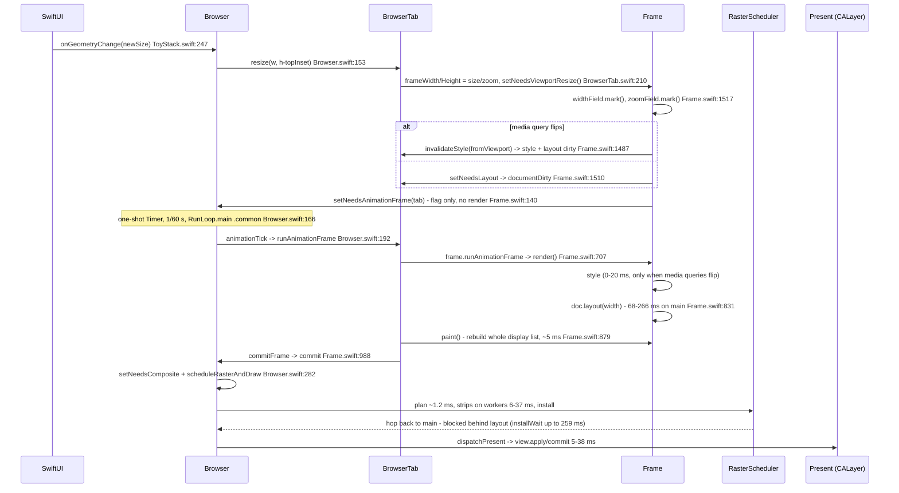

# Window Resize Flow

Trace: `browser.trace` (frames 31–92, three drag bursts).

## Diagram

## Flow notes

1. Resize only sets dirty flags. `BrowserTab.resize` (`BrowserTab.swift:210`) early-returns when the size is unchanged, updates `frameWidth`/`frameHeight`, and calls `setNeedsViewportResize()`.
2. `setNeedsViewportResize` (`Frame.swift:1517`) marks `widthField`/`zoomField` on the document. If a media query flips it calls `invalidateStyle(fromViewport:)` for a style pass; otherwise only `setNeedsLayout()`.
3. Rendering is tick-driven. `requestAnimationFrame` sets `needsAnimationFrame` (`Browser.swift:920`); a one-shot `Timer` on `RunLoop.main` in `.common` mode (`Browser.swift:166`) runs `animationTick` -> `activeTab.runAnimationFrame()`. `nextFrameTime = max(nextFrameTime + 1/60, now)`, so a slow frame makes the next tick fire immediately.
4. Resize events coalesce. `onGeometryChange` runs on the main thread, so events arriving during a long frame collapse into one layout at the latest size. Trace: 32 resize events produce 46 layouts; two events land on frame 33 and two on frame 57.
5. Per tick: style (only if invalidated) -> full tree layout -> `paint()` builds a fresh display list -> `commitFrame` -> `Browser.commit` stores it and requests composite/raster -> present.
6. Raster is signature-gated (`Browser.swift:330`). Resize always changes viewport size, so raster re-runs every tick.

## Measured cost per stage

| Stage | Where | Time |
|---|---|---|
| Layout | main | 68–266 ms, median ~170 ms during drag |
| Style | main | 1.3–20 ms, only 18 passes (media-query flips) |
| Paint (display-list rebuild) | main | ~5 ms (5.0–15.2) |
| Raster plan | compositor | ~1.2 ms |
| Raster strips | 3–10 workers | 6–37 ms total |
| `installWait` (raster done -> main hop) | main | up to 259 ms |
| `view.commit` | present thread | 5–38 ms |
| Frame interval | — | 83–267 ms -> 4–12 fps |

Raster is not the bottleneck: `raster.plan` stays around 1.2 ms, strips take 6–37 ms, tile stats show 0–99 stale misses and mostly hits. The long `composite_raster_and_draw` spans are dominated by the main-thread hop (`installWait`), not raster work.

## Why it degrades while dragging

| Metric | Frame 32 | Frame 92 |
|---|---|---|
| `layout.visit.us` | 50.7 ms | 144.9 ms |
| `layout.text.us` | 25.4 ms | 102.6 ms |
| `layout.inline.place.us` | 38.2 ms | 123.2 ms |
| `layout.inline.refresh.us` | 4.9 ms | 13.4 ms |
| `text.font.us` | 0.33 ms | 0.21 ms |
| `text.measureMisses` | 0 | 0 |
| `layout.visit/rebuilt/text/line` counts | 113 / 113 / 336 / 123 | identical |
| `layout.field.set/mark` counts | ~3.7k / ~1.2k | ~3.8k / ~1.4k |

Same boxes and words, no text-measure misses, no extra field writes, yet per-text cost grows about 4×. `layout.inline.refresh.us` is the tell: `refreshInlineItems` (`BlockLayout.swift:639`, `addTextNode` at `:700`) only reads styles and builds items, does no layout, and still triples.

[INFERENCE] Leading cause: every inline pass discards the old `LineLayout`/`TextLayout` objects and creates new ones (`placeInlineItems`, `BlockLayout.swift:621`). Each new `TextLayout.init` calls `fontField.setDependencies([zoomField] + fontInputs(for: node))` (`TextLayout.swift:50`), registering a weak `FieldRef` in the persistent `StyleFields.dependents` array of the element (`StyleFields.addDependency`, `StyleFields.swift:113`). `addDependency` dedupes with a linear `contains` scan (`StyleFields.swift:116`). Dead refs are pruned only by `notifyDependents`, i.e. only when a style value is written (`StyleFields.swift:99`). During resize the font style keys do not change, so the arrays grow by about 4 refs × 336 words per tick and every style read scans them. That gives O(frames²) layout cost per drag, matching the monotonic 68 -> 266 ms growth with flat font/measure counters.

## Culprits

Ranked by measured impact. Confidence is labeled because one link is inferred, not measured.

| # | Culprit | Evidence | Cost | Confidence |
|---|---|---|---|---|
| 1 | Full-tree layout every resize tick | 113/113 nodes rebuilt, 101 inline blocks, 336 words, 123 lines every tick | 68–266 ms on main, median ~170 ms | Measured |
| 2 | Inline layout throws away and recreates all line/text objects | `placeInlineItems` starts with `children = []` (`BlockLayout.swift:621`), then builds new `LineLayout`/`TextLayout` per word | Part of #1; also allocates every tick | Measured code path |
| 3 | Layout degrades during the drag | `layout.visit.us` 50.7→144.9 ms, `layout.text.us` 25.4→102.6 ms, `inline.refresh.us` 4.9→13.4 ms, all with flat counts | +100–200 ms by end of drag | Measured growth; cause inferred |
| 4 | Stale style-field dependents never pruned | New `TextLayout.init` registers weak refs on persistent `StyleFields` (`TextLayout.swift:50`); `addDependency` scans linearly (`StyleFields.swift:113`); pruning only happens on style writes (`:99`), and font keys do not change during resize | Makes #1 grow O(frames²) | Inference |
| 5 | Full display-list rebuild every tick | `paint()` allocates a new list and calls `paintTree` (`Frame.swift:879-889`) | ~5 ms (max 15.2) on main | Measured |
| 6 | Paint revision bump forces raster re-plan every tick | `paintRevision += 1`, signature changes, so `scheduleRasterAndDraw` never skips | ~1.2 ms plan + 6–37 ms strips | Measured |
| 7 | Main thread blocks raster completion | `installWait` = raster finished → main hop | up to 259 ms | Measured |
| 8 | Present/commit work per frame | `view.commit` 5–38 ms; 96–132 sublayers placed per frame; up to 99 stale tile misses on width change | 5–38 ms on present thread | Measured |
| 9 | Style pass on media-query flips | 18 passes, 1.3–20 ms | 1.3–20 ms on main | Measured |
| 10 | Timer keeps frames back-to-back | `nextFrameTime = max(nextFrameTime + 1/60, now)` (`Browser.swift:166`), so a 200 ms frame is followed immediately | Keeps main at 100% and every resize event waits behind a frame | Measured code |

**Not culprits**

- Raster work: plan ~1.2 ms, strips 6–37 ms total across workers.
- Text measurement/font cache: `text.font.us` flat at ~0.2–0.3 ms, zero measure misses.
- Layout field graph: `layout.field.set/mark` counts flat (~3.7k/1.2k).

**Practical picture:** one tick's work (layout ~170 ms + paint ~5 ms + present/install backpressure) is 2–3× the resize event interval (~90–100 ms). Every tick lays out a size that is already stale when it presents, and #3 makes each successive tick slower. The dominant fix is layout (#1–#4); paint caching alone (#5–#6) removes ~5 ms from a ~200 ms frame.

## Follow-up: component ownership and resize-burst re-measurement (2026-10-31)

The earlier inference in "Why it degrades while dragging" can be reproduced deterministically with `ToyStackHeadless` and `--resize-at`.

Setup: temporary page with 100 paragraphs of 13 words each, 60 resize events one frame apart (width 800 → 1036, height fixed). Profiler counters are identical on every pass; only duration grows.

| Resize step | visited | text | lines | `inline.place.us` | `inline.refresh.us` | `layout.text.us` |
|---|---|---:|---:|---:|---:|---:|
| 1 | 207 | 1402 | 205 | 45,185 | 10,385 | 31,049 |
| 30 | 207 | 1402 | 205 | 470,222 | 6,812 | 370,984 |
| 60 | 207 | 1402 | 205 | 826,459 | 5,352 | 663,520 |

This upgrades culprit #3/#4 from inference to measured behavior: the same number of words and lines costs about 18× more by the end of the burst, and every pass adds another cost step. The exact array length is still inferred, but persistent edge accumulation is the only structure in this path that grows while the counters stay flat.

### What owns the rebuild

| Component | Role in the resize problem | Relevant code |
|---|---|---|
| `BlockLayout` | The trigger and the orchestrator. Width is an input of `childrenField` for any block that lays out inline content, so every resize dirties the child list. The inline branch then refreshes items and rebuilds lines unconditionally. | width in `childrenInputs()` `BlockLayout.swift:101-107`; inline branch `:291-300`; `children = []` in `placeInlineItems` `:621-623`; itemization `:639-646`; per-word style/font reads `:694-698`; line construction `:801-806` |
| `LineLayout` | Recreated per pass. Each new line registers itself on parent/previous fields and recomputes inline inputs for its children; it is the parent that the text/embed edges attach to. | `previous` is `let` `LineLayout.swift:9`; dependency setup `:26-35`; `setInlineInputs` every layout `:119-129` |
| `TextLayout` | The measured leak. Every word's initializer registers font inputs on the node's persistent `StyleFields`; resize does not write those style keys, so dead weak refs are never pruned. | per-word `fontField.setDependencies([zoomField] + fontInputs(for: node))` `TextLayout.swift:38`; style registry `StyleFields.swift:121-135`; pruning only in `notifyDependents` `:104-112` |
| `ImageLayout` and the other embeds | The same pattern at a smaller scale: `placeEmbed` constructs a new embed object per pass, and the embed initializer registers style/layout edges. Cost scales with the number of embeds, not with words, so it is invisible on the traced text page. | `placeEmbed` `BlockLayout.swift:735-745`; `addImage` `:838-850`; `EmbedLayout.init` `EmbedLayout.swift:24-44`; `ImageLayout.init` `ImageLayout.swift:13-24` |
| `ButtonLayout` | A second inline layout implementation. Its `layout()` clears its own children, creates new lines, and creates `TextLayout`s. Fixing `BlockLayout` alone would leave buttons churning. | `ButtonLayout.layout()` `ButtonLayout.swift:70-85`; local `newLine` `:88-92`; local `addWord` `:98-115` |

Block-only containers do not pay the inline rebuild: their `childrenField` does not depend on width, and fixed-width subtrees already skip. The expensive visits are the inline formatting contexts.

### Direction

Treat an inline formatting context as persistent state owned by `BlockLayout` (and eventually shared with `ButtonLayout`), not as something rebuilt on every width change:

1. **Content inputs** (DOM, font, white-space, zoom, display) invalidate itemization and font resolution.
2. **Width** invalidates only line breaking and placement.
3. **Text/embed objects** are reused by item index while itemization is unchanged; line ranges are reconciled, and unchanged lines are kept.
4. **Dependency edges** can be detached as well as attached, so reused objects do not accumulate edges to old lines or old predecessors.

`ImageLayout` is not the dominant measured cost here, but it belongs in the same reuse model. A page with many images or buttons will reproduce the same growth through the embed path or through `ButtonLayout`'s private inline loop.

## Preview plan (pending approval)

Goal: make a width-only resize a reflow, not a content rebuild. Culprit #3 is fixed first because it is independent and low-risk; #1/#2 require the inline ownership change.

| Phase | What | Files | Exit condition |
|---|---|---|---|
| 0 | Freeze the repro | `www/bench/` resize page, `scripts/run-scenarios.sh`, trace reader | 60 resize steps reproduce flat counts + growing cost |
| 1 | Dependency hygiene | `StyleFields.swift`, `LayoutFieldStore.swift`, `LayoutFieldHandle.swift`, `FieldRef.swift` | Repeated layouts do not grow dependency arrays; inline timings flat across resizes |
| 2 | Split content from line geometry | `BlockLayout.swift`, `LayoutField.swift`, `LayoutFieldStore.swift`, new `InlineContent` owner | Width changes skip `refreshInlineItems`; font/white-space/zoom still rebuild it |
| 3 | Reuse line/text/embed objects | `BlockLayout.swift`, `LineLayout.swift`, `TextLayout.swift`, `EmbedLayout.swift`, `InlineTextItem.swift`, `InlineTextRun.swift` | Text/embed identity stable across width-only resizes; unchanged lines kept |
| 4 | Unify button inline layout | `ButtonLayout.swift` | Buttons reuse the same context instead of re-creating lines/texts in `layout()` |

### Phase 1 details

- Prune dead weak refs on registration/search.
- Add `removeInvalidation` / `removeDependency` so reused objects can detach from old lines and predecessors.
- Decide whether to keep the linear array or move to a keyed registry. Recommendation: prune + keep array first; keyed registry only if live-array scans still show up in the trace.
- This alone should stop the 18× growth; it will not stop per-tick allocation.

### Phase 2 details

- Add an explicit inline-content field/state: content inputs include font, white-space, zoom, display, DOM changes; width is excluded.
- Cache `inlineItems` and measured word/embed widths.
- Width marks only the line-layout side.
- Keep `childrenInputs()` sound: no frozen-field assertion may read an undeclared width.

### Phase 3 details

- Line breaking becomes a pure step over cached items, producing line ranges.
- Equal ranges: keep the existing line tree.
- Changed ranges: rebuild only affected lines; reuse `TextLayout`/`ImageLayout`/other embeds by item index.
- Attach/detach parent, previous, and line-baseline edges.
- Change `LineLayout.previous` from `let` if lines are reused; otherwise keep line recreation and reuse only text/embeds first.

### Phase 4 details

- `ButtonLayout` currently has its own `children = []` + `newLine()` + `TextLayout` loop. Either port it onto the shared inline context or persist its internal lines/texts. Recommendation: port it; a second inline implementation will drift.

### Verification

- Resize-burst trace: `inline.place`, `layout.text`, and `layout.visit` must be flat across 60 resizes, with identical counts.
- `ViewportResizeTests` plus `LayoutOracle`: incremental result must equal `--force-full-layout` geometry and screenshots.
- New regression: text/line identity stable across width-only resizes; font/style change rebuilds.
- Existing scenarios A–D must not regress.

### Main risks

- Edge removal can under-invalidate if an old dependency is dropped while still read; test with the oracle.
- Line-break edge cases: hard breaks, `white-space: nowrap/pre`, soft hyphens, `<abbr>`, embeds affecting line width.
- Image intrinsic size/load changes must invalidate item widths, not just line geometry.
- `ButtonLayout` and anonymous inline runs are easy to miss; they need the same treatment.
