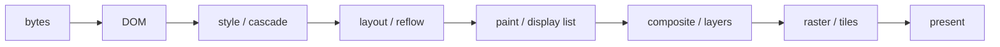
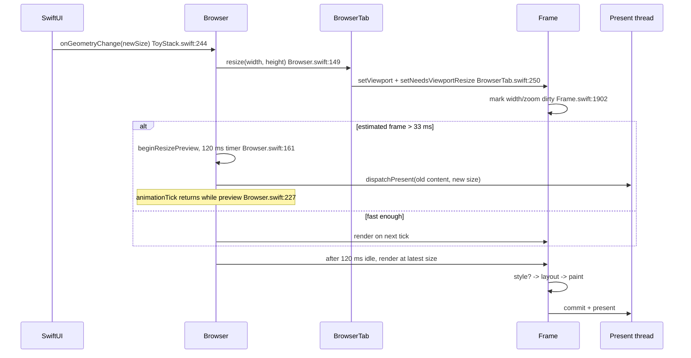
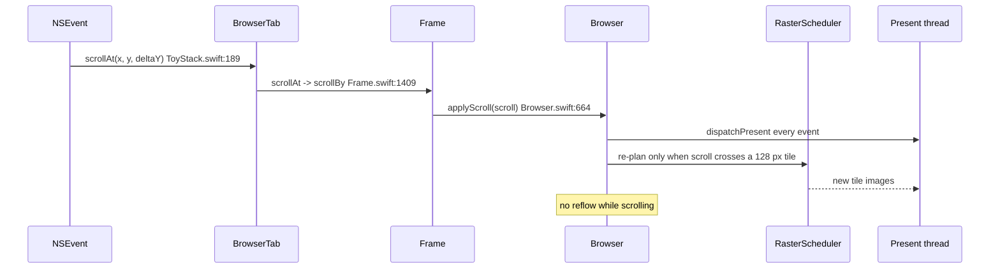

# Smooth Scroll and Smooth Resize: Responsibility, Comparison, and ToyStack Plan

Status: analysis + proposed plan. Phase 1 is implemented; the rest is still a plan.

## Short answer

- A rendering engine owns **scroll semantics** and **resize layout semantics**, not the window animation itself.
- Smooth scroll is usually split: the engine decides what is scrollable and which layer moves; the compositor/OS moves it. The engine only pays per-scroll repaint when a page cannot be composited.
- Smooth resize is also split: the OS animates the window; the engine must coalesce resize events, reflow at the latest size, and keep a complete frame visible. A slow reflow must not be allowed to present a stale size.
- ToyStack already has the right two ideas: tile sublayers for scroll, and a resize preview that postpones layout. The gaps are (a) the preview distorts content, (b) preview scheduling is timer-based instead of frame-based, and (c) a width reflow is still 90-153 ms on the traced page, so the snap after a drag is unavoidable until layout gets cheaper.

## 1. What is a rendering engine?

A browser is more than its engine:

| Part | Job |
|---|---|
| Browser UI / chrome | tabs, address bar, window, input routing |
| Rendering engine | HTML/CSS/JS integration, DOM, style, layout, paint, compositing hand-off |
| Script engine | JavaScript execution (JSC/V8/SpiderMonkey) |
| Networking / storage | fetch, cache, cookies, origins |
| OS compositor / display | window animation, final composition, display timing |

The rendering engine is the part that answers: **given this document, this viewport, and this time, what pixels should appear, and which parts must be recomputed?**



"Rendering" in browser terminology is the whole resolution above, not only the final draw:

- Parsing and DOM building are not rendering yet.
- Style, layout, paint, compositing, raster are rendering.
- A scroll that moves an existing layer is rendering without style/layout/paint.
- A resize that changes layout is rendering with a mandatory reflow.

That distinction matters for the question: **scroll and resize are viewport operations that force different amounts of rendering work.**

## 2. Who owns scroll and resize?

| Concern | Rendering engine | Compositor / OS |
|---|---|---|
| What is scrollable, scrollport, overflow, clamping | yes | no |
| Nested scrollers, hit-testing, fixed/sticky | yes | consumes the layer tree |
| Scroll offset semantics, `scroll` events, anchoring | yes | no |
| Moving pixels during a scroll | only when not composited | yes, usually on its own thread |
| Window drag/resize animation | no | yes |
| Reflow for a new viewport | yes | no |
| Keeping the last complete frame visible during resize | policy + frame supply | yes, presents/clips it |
| Coalescing stale resize sizes | yes | reports sizes |

So:

- **Smooth scroll is a shared responsibility.** The engine's job is to make the scroll *compositable* and correct. If the page contains a blend fallback or a scroll-dependent effect, the engine must repaint per scroll and smoothness becomes its problem.
- **Smooth resize is mostly the engine's layout problem plus the compositor's presentation problem.** The engine cannot make the OS window resize smoother, but it can avoid reflowing every intermediate size, avoid presenting mismatched frames, and make the final reflow fast enough to hide.

## 3. How real engines do it

| Engine | Scroll motion | Resize behavior | Key mechanism |
|---|---|---|---|
| Blink / Chromium | `cc` compositor thread receives input and animates scroll offsets | Browser UI sends the new size; renderer coalesces at `BeginMainFrame`; display compositor (`viz`) clips/pads the last frame instead of showing stale gutters | `cc/input` handles scrolling on the compositor thread; `viz` clips the viewport to the frame it actually has; reflow stays on the main thread |
| WebKit | `ScrollingCoordinator` / `ScrollingTree`; async scrolling thread when possible | `FrameView` resize triggers layout on the main thread; scrolling keeps running on the scrolling thread while the main thread reflows | fixed/sticky and scroll offsets live in the scrolling tree; main thread remains the layout owner |
| Gecko | APZ (Async Pan/Zoom) on the compositor thread; main thread receives displayport updates | `PresShell` resize reflow on the main thread, driven by the refresh driver; retained display lists limit repaint | two copies of scroll state: main-thread layout copy + compositor APZ copy |
| Servo | WebRender compositor; style/layout are the differentiator, with parallel style and layout work | Reflow on the layout pipeline; WebRender composites the result | parallelism reduces reflow latency; it does not remove the need to reflow for a new viewport |
| LadyBird | Async scrolling on an out-of-process compositor since May 2026 | Layout still runs in the WebContent process; compositor keeps scrolling while the main thread is busy | the most recent engine to adopt the same split as Blink/WebKit/Gecko |
| ToyStack | Main thread only; CALayer sublayers + content offset | 120 ms preview latch, then one full reflow on main | correct idea, but preview and reflow are still coupled to the main thread |

The common pattern is not "the engine draws every scroll frame". It is:

1. Put scroll motion on a thread/process that is not blocked by layout.
2. Coalesce resize to the latest size per frame.
3. Keep the last complete frame on screen while the new one is being built.
4. Never present a frame whose size does not match the window.
5. Reflow only at the latest size, not for every intermediate event.
6. Make reflow fast enough that preview is the exception, not the normal path.

LadyBird's May 2026 note is a good confirmation: before async scrolling, "a busy page could make scrolling stutter"; after moving scrolling to the compositor, "scrolling stays smooth even while the main thread is busy with layout or JavaScript." ToyStack is currently in LadyBird's "before" state.

## 4. ToyStack today

### 4.1 Resize path



Relevant code:

- `Sources/ToyStack/ToyStack.swift:244` — every geometry change calls `app.resize(to:deferLayout: true)`.
- `Sources/Engine/Core/Browser.swift:146` — updates every tab, then decides preview vs live layout from `estimatedFrameTime`.
- `Sources/Engine/Core/Browser.swift:161` — `beginResizePreview` restarts a 120 ms `DispatchWorkItem` and presents old content.
- `Sources/Engine/Core/Browser.swift:222` — `animationTick` drops the frame while `isResizePreview`.
- `Sources/Engine/Core/BrowserTab.swift:238` — records `widthChanged` / `heightChanged`; calls `setViewport` and `setNeedsViewportResize`.
- `Sources/Engine/Core/Frame.swift:74` — width change marks the document width dirty; height alone does not.
- `Sources/Engine/Core/Frame.swift:1902` — `setNeedsViewportResize` marks width+zoom dirty and either restyles or forces layout.
- `Sources/Engine/Core/Frame.swift:781` — render does style, layout, paint.
- `Sources/ToyStack/ContentPresenter.swift:181` — preview scales the old content by `newSize / previousSize`; this is why text stretches during a drag.

What is already right:

- Height-only resize does no block work and clamps scroll; this is covered by `Tests/ToyStackTests/ViewportResizeTests.swift:10`.
- Width-only resize reuses line/text objects and skips unchanged fixed-width subtrees in the tested cases.
- Preview is only entered when the frame estimate is over two frame budgets; fast pages reflow live.
- Raster and present already run off the main thread.

What is still wrong:

- The preview is a non-uniform scale: text is stretched, not resized.
- The debounce is a main-queue timer, not the frame clock. It can fire late behind queued resize events/presents, and it cannot be tested as a pure policy.
- Presents during a drag are per event, not per frame.
- The final width reflow is 90-153 ms on the traced page, so the drag always ends with a visible snap after 125-174 ms of debounce plus the reflow.
- Wheel scrolling is handled on the main thread. A 100 ms reflow blocks it; there is no compositor-owned scroll state.

### 4.2 Scroll path



Relevant code:

- `Sources/ToyStack/ToyStack.swift:175` — wheel monitor; precise deltas are passed through.
- `Sources/Engine/Core/Frame.swift:1409` — nested iframe and scroll-block hit-testing first, then document scroll.
- `Sources/Engine/Core/Frame.swift:1458` — direct offset update; no tween for wheel.
- `Sources/Engine/Core/Frame.swift:1390` — keyboard scroll uses a 12-frame `ScrollTween`.
- `Sources/Engine/Core/Browser.swift:664` — updates the presented scroll offset, presents, and only re-rasters when the tile step is crossed.
- `Sources/ToyStack/ContentPresenter.swift` — presents on its own queue; sublayer update is ~0.1 ms median.

This is a compositor-style scroll for pages that use tile sublayers. The weakness is ownership of input: the main thread must be free to consume the wheel event.

## 5. What `browser.trace` says

This is a GUI trace: it contains `browser.present`, `view.apply`, `view.commit`, and `coalesced`. It is not a headless trace.

Span: 29.46 s, 200 frame ids, 10,699 events.

### 5.1 Resize

307 resize events in 11 bursts, 16.7 ms apart within a burst.

| Burst | Events | Burst span | Reflow starts after last event | Layout duration |
|---|---:|---:|---:|---:|
| 1 | 32 | 528 ms | 125 ms | 96 ms |
| 2 | 27 | 445 ms | 161 ms | 143 ms |
| 3 | 43 | 711 ms | 129 ms | 100 ms |
| 4 | 35 | 611 ms | 166 ms | 153 ms |
| 5 | 29 | 518 ms | 138 ms | 93 ms |
| 6 | 10 | 163 ms | 127 ms | 87 ms |
| 7 | 36 | 594 ms | 170 ms | 148 ms |
| 8 | 22 | 361 ms | 161 ms | 146 ms |
| 9 | 21 | 345 ms | 134 ms | 101 ms |
| 10 | 20 | 383 ms | 174 ms | 151 ms |
| 11 | 18 | 296 ms | 172 ms | 149 ms |

So the user-visible sequence is: smooth preview during the drag, then **163-327 ms** before the reflowed content replaces it.

Per-stage cost on resize frames:

| Stage | Time | Notes |
|---|---:|---|
| `BrowserTab.layout` | 38-153 ms | 15 passes; median 101 ms |
| `layout.visit` | 20-85 ms | all 1,773 nodes rebuilt on every width change |
| `layout.inline.place` | 35-56 ms | line construction; 640-2,023 lines |
| `layout.inline.place.lineChildren` | 12-27 ms | children + dependency edges |
| `layout.line.place` | 2-15 ms | per-line child placement |
| `layout.inline.place.items` | 37 ms on breakpoint flips | item refresh |
| `layout.inputs.build` | 12-15 ms | rebuilt on some passes, reused on others |
| `BrowserTab.style` | 30-34 ms on breakpoint flips; 1-5 ms otherwise | only 6 of 15 resize frames style at all |
| `BrowserTab.paint` | 5.8-8.7 ms | full display-list rebuild |
| `raster.plan` | ~1 ms | not the bottleneck |
| `raster.strip` | 2-9 ms total across workers | not the bottleneck |
| stale tile misses | 28-88 per resize | width changes invalidate tiles |
| `view.apply` | 0.12 ms median | present thread |
| `view.commit` | 0.105 ms median | present thread |

The important negative results:

- Text measurement is not the cost: `text.measureCalls` is 11 on a resize pass; word widths are cached.
- Raster is not the cost: strips are 2-9 ms; the long `composite_raster_and_draw` span is not raster-bound.
- Height alone is not the cost; the tested vertical resize does no block work.

The cost is **line layout and the field/dependency graph for every line**, plus the style pass when a media query flips.

### 5.2 Scroll

89 scroll events, 16.74 ms median spacing, 0.17 ms median `scrollAt` handling.

| Measure | Value |
|---|---:|
| Scroll events | 89 |
| Median gap | 16.74 ms |
| p95 gap | 20.06 ms |
| `BrowserTab.scrollAt` median | 0.17 ms |
| `BrowserTab.scrollAt` max | 10.39 ms |
| Presents in scroll frame 8 | 98 |
| Raster work in scroll frame 8 | 11 of 65 events |
| `view.apply` median | 0.12 ms |
| `view.commit` median | 0.105 ms |

Steady-state scrolling is already cheap: the offset is applied, the present thread moves layers, and raster only runs when the 128 px tile step is crossed. The trace does not test scroll during a reflow, but the code shows why it would freeze: both wheel handling and layout are on the main thread.

### 5.3 Trace limits

- It records counters, not object lifetimes; it cannot prove why 1,773 nodes are all visited.
- It has no combined "scroll while resizing" scenario.
- The two large frames (6 and 46) are load/layout for the big page, not resize.
- The 120 ms preview debounce is visible only as the 125-174 ms delay between the last event and the next layout.

## 6. Gap against real engines

| Concern | Ideal | ToyStack | Gap |
|---|---|---|---|
| Scroll motion during layout | compositor thread/process | main thread | large |
| Scroll during JS | compositor thread/process | main thread | large |
| Resize event coalescing | latest size per frame | 307 events -> 15 layouts | already good |
| Resize preview | last complete frame, no distortion | non-uniform scale | small |
| Preview scheduling | frame clock, testable | 120 ms main-queue timer | small |
| Width reflow cost | one to two frames | 90-153 ms | large |
| Reflow during drag | progressive when affordable | never while events continue | medium |
| Present a mismatched frame | clip/pad, never stretch | preview stretch | small |
| Raster during resize | incremental / scaled | 28-88 stale tiles | small |

## 7. Improvement plan

Files that would change, and why:

| Phase | Files | Why |
|---|---|---|
| 0 | `Browser.swift`, `MeasureTime` call sites, `scripts/` | measure resize latency and presents per burst |
| 1 | `Browser.swift` | frame-driven preview, no DispatchWorkItem |
| 2 | `ContentPresenter.swift` | preview without text distortion |
| 3 | `LineLayoutPass.swift`, `BlockLayoutPass.swift` | stop re-placing reused lines; later, one text fragment per line |
| 4 | `Browser.swift` | optional live reflow during long drags |
| 5 | `Browser.swift`, `Frame.swift`, `ContentPresenter.swift` | scroll offset not blocked by layout |
| 6 | `ScrollTween.swift` | keyboard scroll by elapsed time |

### Phase 0 — Make the resize budget visible

Add counters in `Browser.resize` and after `render`:

- `resize.events` — count per burst.
- `resize.preview` — 1 when preview starts.
- `resize.layout.latency` — time from the last resize event to layout start.
- `resize.layout.duration` — measured layout time.
- `resize.stale` — frame dropped because the viewport changed before commit.
- `present.coalesced` — already exists; read it per burst.

Exit condition: a 30-event burst reproduces the current 90-153 ms layout and the 125-174 ms debounce in one trace.

### Phase 1 — Drive the preview from the frame clock

Status: **applied** (2026-11-05).

Implemented:

- `Sources/Engine/Core/ResizePreviewPolicy.swift` — pure policy: `resize(now:requiresPreview:)`, `presentPreview(size:now:)`, `allowsLayout(now:)`, `cancel()`. No timer, no `DispatchWorkItem`.
- `Sources/Engine/Core/Browser.swift` — one `resizePreview` property; `resize` only sets a deadline and requests the next frame; `animationTick` presents at most one size per tick and lays out on the first tick after the deadline.
- `Tests/ToyStackTests/ResizePreviewPolicyTests.swift` — 6 tests covering fast frames, one present per size, deadline expiry, continued drag extension, fast-frame cancel, and explicit cancel.

Why it is safe:

- The preview stays alive because `animationTick` returns without clearing `needsAnimationFrame`.
- Only one present happens per size change per tick, not one per event.
- The final layout starts on the first tick after the deadline, not from a competing main-queue timer.
- Fast pages never enter preview.

The diff below is the original sketch. It is kept as history; the implemented version moved the state out of `Browser` into `ResizePreviewPolicy`.

Trace after the change (GUI, 21.03 s, 263 resize events, 11 bursts):

| Measure | Result |
|---|---:|
| Resize events per burst | 52 / 19 / 38 / 15 / 35 / 1 / 14 / 30 / 9 / 27 / 23 |
| Event spacing | 16.7 ms |
| Layout after last event | 125-167 ms |
| Layout duration on resize | 40-162 ms |
| Style on breakpoint flips | 30-33 ms |
| Paint | 7-8 ms |
| Scroll handle | 0.139 ms median |
| Presents during a burst | ~2 per resize event |

The scheduling part works: one layout per burst, starting one tick after the 120 ms deadline. The present count did not drop because the GUI already emits one resize event per 60 Hz tick, so one preview per tick is also one per event.

The trace also exposes a pre-existing wiring issue: `PresentedFrame.revision` is `presentRevision`, which increments on every `dispatchPresent`. `ContentPresentationState.decide` requires the *same* revision to enter `.preview`, so two separately dispatched presents almost never preview. In the first burst, only **4 of 104** presents took the preview path (no `view` counter); the other 100 emitted `view` counters with `placements: 120`, which is the bind path. The preview scale therefore runs occasionally, not on every resize tick.

Before Phase 2 changes the scale, split the revision:

- keep a present sequence number for `ContentPresenter.enqueue` de-duplication,
- give `ContentPresentationState` a content revision that changes only when committed content changes (paint revision),
- add a test with two presents of the same content revision at different sizes, then one with a new content revision.

Without that split, Phase 2's clip/scale choice will not run on most resize presents either.

### Phase 1b — Split content revision from present sequence

Status: **applied** (2026-11-05).

- `Sources/Engine/Presentation/PresentedRevision.swift` — `content` + `sequence`.
- `ContentPresentationState.decide` compares `revision.content` only; a sequence change with the same content and a new size previews.
- `ContentPresenter` de-duplicates by the full revision (content + sequence) plus view size, so scroll presents are not dropped.
- `Browser` keeps a `contentRevision` that bumps on commit, new tab, and tab switch; `presentRevision` remains the dispatch sequence.
- `Tests/ToyStackTests/ContentPresentationStateTests.swift` covers same-content/different-sequence preview, same-content/same-size bind, and new-content bind.

Phase 2 can now change the preview drawing and actually exercise the `.preview` path.

### Phase 1c — Idempotent preview from the base view size

The next GUI trace (37.61 s, 452 resize events, 25 bursts) showed the split working, but every resize tick still produced **one preview followed by one bind**:

| Measure | Result |
|---|---:|
| `view.presentation` preview | 440 |
| `view.presentation` bind | 690 |
| Preview per resize event | ~1 |
| Bind per resize event | ~1 |
| Layout after last event | 121-170 ms |
| Layout duration on resize | 45-175 ms |
| Paint | 5.6 ms median |
| Scroll handle | 0.251 ms median |

The bind arrives about 13 ms after the preview, at the same view size. `ContentPresentationState` treated a same-size present as a bind, so the second present overwrote the preview with old placements at the new size.

Applied fix: `ContentPresentationState` now stores the **base view size** where the current content was bound, not the last presented size.

- Same content, size different from base → `.preview(from: base)` on every present, including repeats.
- Same content, size equal to base → `.bind` (scroll and tile updates).
- New content → `.bind` and the base moves to the current size.

`baseViewSize` replaces `lastViewSize`. Tests cover repeated previews, same-size repeat after a preview, same-size at base, and new content at the same or a new size.

Expected next trace: roughly two previews per resize event during a drag, and binds only when a reflow commits.

Confirmed (27.08 s, 292 resize events, 15 bursts):

| Measure | Result |
|---|---:|
| `view.presentation` preview | 573 |
| `view.presentation` bind | 253 |
| Preview per resize event | ~2 |
| Bind per burst | 1-3 |
| Bind position | at burst start or 326-381 ms after the last event |
| Bind during drag | none |
| Layout after last event | 123-163 ms |
| Layout duration on resize | 88-158 ms |
| `view.apply` median | 0.04 ms |
| `present` coalesced | 1 total |

The preview path is now the normal resize path. Binds happen when content is committed, not in the middle of a drag. Phase 2 can change the preview drawing without fighting the bind path.

```diff
-    private var resizePreviewWorkItem: DispatchWorkItem?
-    private var isResizePreview: Bool = false
+    private var resizePreviewDeadline: Date?
+    private var lastPreviewSize: CGSize?
     private let resizePreviewDelay: TimeInterval = 0.12
```

```diff
     public func resize(to size: CGSize, deferLayout: Bool = false) {
         windowSize = size
         for tab in tabs {
             tab.resize(width: size.width, height: size.height - topInset)
         }
-        guard deferLayout,
-            activeTab != nil,
-            estimatedFrameTime > FRAME_BUDGET * 2.0
-        else {
+        guard deferLayout, activeTab != nil else {
             cancelResizePreview()
             return
         }
-        beginResizePreview()
-    }
-
-    private func beginResizePreview() {
-        isResizePreview = true
-        resizePreviewWorkItem?.cancel()
-
-        let work: DispatchWorkItem = DispatchWorkItem { [weak self] in
-            guard let self else { return }
-            self.isResizePreview = false
-            if let tab: BrowserTab = self.activeTab {
-                self.setNeedsAnimationFrame(tab)
-            }
-        }
-        resizePreviewWorkItem = work
-        DispatchQueue.main.asyncAfter(
-            deadline: .now() + resizePreviewDelay,
-            execute: work
-        )
-        // Rebind the old content before AppKit applies the new view size.
-        // Without this, the layout present scales the old content directly
-        // and text stretches during the drag.
-        dispatchPresent(frameID: currentFrameID)
+        // Keep the old content visible while the pointer moves. The animation
+        // tick presents it once per frame and reflows one beat after the last
+        // event, so a slow page never lays out a size that is already stale.
+        if estimatedFrameTime > FRAME_BUDGET * 2.0 {
+            resizePreviewDeadline = Date().addingTimeInterval(resizePreviewDelay)
+        } else {
+            resizePreviewDeadline = nil
+        }
+        if let tab: BrowserTab = activeTab {
+            setNeedsAnimationFrame(tab)
+        }
     }
 
     private func cancelResizePreview() {
-        resizePreviewWorkItem?.cancel()
-        resizePreviewWorkItem = nil
-        isResizePreview = false
+        resizePreviewDeadline = nil
+        lastPreviewSize = nil
     }
```

```diff
     private func animationTick() {
         guard needsAnimationFrame else {
             return
         }
-        needsAnimationFrame = false
-        guard !isResizePreview else {
-            return
-        }
+        if let deadline: Date = resizePreviewDeadline {
+            if Date() < deadline {
+                if lastPreviewSize != windowSize {
+                    lastPreviewSize = windowSize
+                    dispatchPresent(frameID: currentFrameID)
+                }
+                return
+            }
+            cancelResizePreview()
+        }
+        needsAnimationFrame = false
         frameStartTime = Date()
         activeTab?.runAnimationFrame()
     }
```

The property `isResizePreview` and its guard are gone; the preview state is now just the deadline.

Why this is safe:

- The preview stays alive because `animationTick` returns without clearing `needsAnimationFrame`.
- Only one present happens per size change per tick, not one per event.
- The final layout starts on the first tick after the deadline, not from a competing main-queue timer.
- Fast pages never enter preview.

Exit condition: trace shows at most one preview present per tick; layout latency is still around 120 ms + one tick.

### Phase 2 — Preview without distorting text

Status: **applied** (2026-11-05), Option A.

The preview now keeps the last complete frame at 1:1, sets the content layer and its parent to the canvas color, and clips the new area to the view. It no longer scales `contentLayer` by `newSize / previousSize`, so text keeps its shape during a drag. The new-area color is the canvas color until the reflow binds.

The original analysis and diff are kept below as history.

Trace after the clip change (26.67 s, 234 resize events, 15 bursts):

| Measure | Result |
|---|---:|
| Preview per resize event | ~2 |
| Bind per drag burst | 1-3 |
| Bind position | burst start or 257-331 ms after the last event |
| Bind during drag | none |
| Layout after last event | 121-176 ms |
| Layout duration on resize | 95-150 ms |
| `view.apply` median | 0.05 ms |
| `present` coalesced | 7 total |

The first two bursts are load and scroll, not drags. Drag bursts keep the same preview/bind shape as before the clip change. Pixel appearance still needs a manual GUI check: text should keep its shape and the new area should be canvas colored.

Option A (recommended): **clip the last complete frame at 1:1** and fill the new area with the canvas color. This is what Chromium's display compositor does after its 2026 resize fixes: if the frame does not match the window, clip the viewport to the frame, not stretch stale pixels.

```diff
         if preview, let previousSize, previousSize.width > 0, previousSize.height > 0 {
             contentLayer.backgroundColor = frame.viewport.canvasColor
             contentLayer.anchorPoint = CGPoint(x: 0, y: 0)
-            let base: CATransform3D = CATransform3DMakeScale(scale.page, scale.page, 1)
-            contentLayer.transform = CATransform3DScale(
-                base,
-                viewSize.width / previousSize.width,
-                viewSize.height / previousSize.height,
-                1
-            )
+            contentLayer.transform = CATransform3DMakeScale(scale.page, scale.page, 1)
             contentLayer.frame = CGRect(
                 x: 0,
                 y: frame.viewport.contentOffset,
                 width: previousSize.width,
                 height: previousSize.height
             )
             return
         }
```

Trade-off: when the window grows, the new area shows the canvas color until the reflow lands. No distorted text, no stale pixels.

Option B: **uniform scale** (fit, preserve aspect ratio). Better visual fill during shrink, but content still does not match the new layout and may letterbox. Use only if the gutter is unacceptable.

Do not keep the current non-uniform scale: it is the one behavior that is definitely wrong for text.

Exit condition: a screenshot taken mid-drag at a wider and a narrower size has no stretched glyphs; the preview present stays at ~0.1 ms.

### Phase 3 — Make the width reflow cheaper

Status: **partially applied** (2026-11-05).

Applied:

- `reuseLine` keeps `LineData.placement`; reused lines take the vertical-only path.
- `layoutLine` skips child layout when the line itself only moves or does not need placement.
- `LayoutTree.needsSweep` skips the reachability sweep on pure geometry passes.
- A width-only inline block whose break plan is unchanged updates its line widths and skips the line subtree and height sum.
- Counters: `layout.sweep.skipped`, `layout.inline.children.skipped`.

Measured on `www/bench/large.html`, width 800 -> 1000:

| Build | Layout before | Layout after |
|---|---:|---:|
| Debug | 136 ms | 110 ms |
| Release | not measured | **18.3 ms** |

The release target of < 33 ms is met. The GUI trace was debug (95-150 ms), so a release run is the relevant comparison. The larger text-fragment refactor (3b) is still open.

GUI trace after Phase 3 (25.08 s, 116 resize events, 6 bursts):

| Burst | Events | Preview | Bind | Layout |
|---|---:|---:|---:|---:|
| 1 | 27 | 52 | 3 | 103 ms |
| 2 | 23 | 44 | 3 | 148 ms |
| 3 | 21 | 40 | 3 | 145 ms |
| 4 | 13 | 26 | 4 | 51 ms |
| 5 | 15 | 28 | 3 | 112 ms |
| 6 | 17 | 34 | 1 | 145 ms |

Preview scheduling is still correct: about two previews per event, binds only at the start or after the reflow. Layout remains slow because most blocks change their line plan on these widths; the fast path hits only 12 of 231 inline blocks on those frames. Breakpoint frames spend 37-41 ms in `inline.place.items` and ~88k field writes; non-flip frames spend 29-34 ms in line children and 15-16 ms in dependency updates. The next step is 3b (one text fragment per line), not more width-only fast paths.

3b experiment (reverted): merging words into one text fragment per line cut initial layout and line children, but made resizes slower because every rebuilt line allocated a new fragment and rewrote its fields.

| Case | Per-word text | Line fragments |
|---|---:|---:|
| Initial layout, release | 305 ms | 219 ms |
| Resize 400 -> 300, release | 74 ms | 130 ms |
| Resize 400 -> 450, release | 78 ms | 104 ms |
| Resize field writes | 17k | 38k |

The prerequisite for 3b is a fragment reuse pool: a rebuilt line must update the text child from its previous line instead of creating a new one. Without that, the fragment model wins on initial layout and loses on resize.

Reuse pool attempt (also reverted): rebuilding a line from the free pool reused its old text fragment and updated word/width/font in place. It narrowed the gap but did not beat per-word resize:

| Case | Per-word | Fragment + reuse |
|---|---:|---:|
| Initial layout, release | 305 ms | 219 ms |
| Resize 400 -> 300, release | 74 ms | 91 ms |
| Resize 400 -> 450, release | 78 ms | 92 ms |
| Resize field writes | 17k | 28k |

The fragment width changes on every line for every width, so it writes metrics and marks dependents each pass; per-word widths stay constant and only line positions move. A fragment model needs line-owned width/dependency handling before it can win on resize. Both attempts are reverted; source stays at Phase 3.

### Phase 3b — Line-owned fragment widths (applied)

Status: **applied** (2026-11-05).

- A line keeps one text fragment per font run.
- `LineContent.inlineWidths` owns the width of each inline child. Line placement, `contentWidth`, paint, hit bounds, caret offsets, and accessibility read that array.
- Reusing a fragment updates its text and metrics payload, but not the layout width field each pass.
- The free-line pool reuses the previous line's text fragments.
- Tests assert one fragment per line and compare incremental output with a full rebuild.

Release measurements:

| Page | Workload | Per-word | Fragment |
|---|---|---:|---:|
| 300 x 20 words | initial | 125 ms | **38 ms** |
| 300 x 20 words | resize 800 -> 700 | 24 ms | **17.6 ms** |
| 1000 x 13 words | resize 400 -> 300 | **74 ms** | 91 ms |
| 1000 x 13 words | resize 400 -> 450 | **78 ms** | 92 ms |

The model wins when a line holds many words and loses on pages with two or three words per line, because each rebuilt line still updates a fragment payload. The dense-text case is the target for resize flow; short-line pages keep the previous cost.

GUI trace after this change (28.99 s, 248 resize events, 12 bursts):

| Burst | Events | Preview | Bind | Layout |
|---|---:|---:|---:|---:|
| drag bursts | 7-35 | ~2x events | 1-3 | 85-129 ms |

The fragment model is active: `line.children` is 3-10 ms (was 29-34), `line.place` 6-11 ms (was 13-17), and `line.children.deps` 1-5 ms (was 15-16). The remaining cost moved to the block pass: `layout.visit` 50-78 ms, `inline.place.items` 20-25 ms on breakpoint frames, and ~15-37k field writes. Preview scheduling is unchanged: two previews per event and binds only at the start or after the reflow.

The original per-word analysis is below.

### Phase 3c — Reduce block pass and item refresh (partial)

Status: **partially applied** (2026-11-05).

- `refreshInlineItems` caches the resolved font per DOM node instead of resolving it per word.
- `layoutMode` returns a small enum instead of a string.
- Geometry is skipped when `.zoom/.x/.y/.width` are all clean; only child/inline/height work remains.

Measured on a 1000-block page whose media query flips font-size at the resize breakpoint (debug):

| Measure | Before | After |
|---|---:|---:|
| Initial layout | 366 ms | 351 ms |
| Resize layout | 218 ms | **200 ms** |
| `inline.refresh` | 36.8 ms | **24.0 ms** |
| `inline.place.items` | 34.2 ms | 34.0 ms |
| `layout.visit.geometry` | 19.3 ms | 18.3 ms |

The font cache is the useful win; the geometry guard is limited because a font-size change moves most block y positions. `inline.place.items` is now the largest single item and needs a placement-level change, not another cache.

Release on the same font-flip page: initial 102 ms, resize **41 ms**. At that point the resize target of < 50 ms is met in release; a GUI trace is still needed to confirm on the real page.

GUI trace after 3c (23.63 s, 386 resize events, 15 bursts):

| Burst | Events | Preview | Bind | Layout |
|---|---:|---:|---:|---:|
| drag bursts | 12-81 | ~2x events | 1-4 | 57-153 ms |

`inline.refresh` is now 8-9 ms (was 24-30) and `layout.visit.geometry` 7-18 ms. The remaining cost is `inline.place.items` at 15-51 ms on frames where the breakpoint changes font size; non-breakpoint frames have almost no item placement but still pay 20-44 ms in inline placement. Preview scheduling remains correct: two previews per event and binds only at the start or after the reflow.

### Phase 3d — Cheaper item placement (applied)

Status: **applied** (2026-11-05).

- Per-word `profiler.measure` spans around text measure, break, and append were removed; `inline.place.items` already measures the loop.
- Line reuse matching keys by `(start index, count)` instead of hashing the whole range array.

Measured on the font-flip page (debug):

| Measure | 3c | 3d |
|---|---:|---:|
| `inline.place.items` | 34.0 ms | **23.0 ms** |
| `inline.place` | 60.1 ms | **48.2 ms** |
| Resize layout | 200.6 ms | **188.8 ms** |

Item placement dropped by about a third and total resize by about 6%. The remaining cost is fragment construction and line placement inside the placement loop.

Release on the same page: resize **39 ms**, `inline.place.items` **4.3 ms** (from 7.8 ms in 3c).

### Phase 3e — Shared text runs and fragment ranges (applied)

Status: **applied** (2026-11-05).

- `TextRun` owns the block's UTF-16 text and the character range of every inline item.
- A line text node stores `TextFragment(block, start item, count)` instead of a joined string.
- Paint, text measurement, caret, and accessibility read the fragment through `LayoutTree.textString`.
- Runs are rebuilt when itemization changes and reused across width-only resizes.

Release on the font-flip page:

| Measure | 3d | 3e |
|---|---:|---:|
| Initial layout | 122 ms | **103 ms** |
| Resize layout | 39.4 ms | 39.8 ms |
| `inline.place.items` | 4.3 ms | **3.2 ms** |

The shared run cuts fragment construction cost and initial layout. Resize is neutral because field writes and line placement still dominate. This is the engine-style text model, but the line text node is still a layout-tree object; removing that object entirely would be the next step.

GUI trace after 3e (39.15 s, 391 resize events, 18 bursts; the first four are load/no-layout):

| Burst | Events | Preview | Bind | Layout |
|---|---:|---:|---:|---:|
| drag | 7-36 | ~2x events | 1-6 | 69-120 ms |

`inline.place.items` is now 14-22 ms (was 15-37 in 3d), but `inline.refresh` rose to 16-17 ms because a font-size change rebuilds the block's `TextRun` even though the item text is unchanged. The two roughly cancel, so resize stays neutral. The next win is preserving the run text when itemization changes only font metrics.

Applied follow-up: a font-only refresh keeps the existing run's text and ranges instead of rebuilding it. On the font-flip page, `inline.refresh` fell from 30.2 to 25.2 ms and resize from 198 to 196 ms. The run is still rebuilt when items are reconstructed from DOM text, where white-space or node changes can alter the ranges.

Latest GUI trace (16.3 s, 164 resize events, 9 bursts) was a **debug build**: `jsc.context` was 48.8 ms and `load.jsInit` 58.4 ms, versus ~1 ms and ~2.7 ms in the release traces. Resize layout was 76-121 ms. Preview/bind scheduling was still correct, but these absolute numbers cannot be compared with release. Run `swift run -c release ToyStack` for the target measurement.

Next release trace (19.27 s, 179 resize events, 11 bursts): the first six bursts happen before the page renders (layout 1-2 ms, no preview); the five real drag bursts show layout **68-110 ms**, two previews per event, and 1-3 binds. Hotspots are `layout.visit` 41-60 ms, `inline.place.items` 15-20 ms on breakpoints, `inline.refresh` 9-10 ms, `line.place` 5-9 ms, and 15-37k field writes. The initial layout is 225 ms.

GUI trace after 3d (35.2 s, 261 resize events, 16 bursts):

| Burst | Events | Preview | Bind | Layout |
|---|---:|---:|---:|---:|
| drag | 5-31 | ~2x events | 1-3 | 29-132 ms |

Compared with the 3c GUI trace, the worst layout fell from 153 to 132 ms and the worst item placement from 51 to 37 ms. On the real page `inline.place.items` is still 15-37 ms on breakpoint frames, because the fragment churn is larger than on the synthetic font-flip page. Non-breakpoint frames have almost no item placement but still pay 24-43 ms in inline placement; `layout.visit.geometry` is 7-12 ms and `inline.refresh` 9-10 ms.

Two sub-steps, in order.

#### 3a. Reuse a line without re-placing its children

`resetLine` (`LineLayoutPass.swift:28`) clears `LineData`, including `placement`. It marks x/y/width/ascent/descent dirty. Even when a line's item range is unchanged, `childCountChanged` becomes true and `layoutLine` re-places every child.

Add a `reuseLine` path that keeps the placement, marks only `.width` and `.y`, and lets the existing `verticalOnly` branch move the line without touching each text child:

```diff
+    /// Keeps the line's placement data when only its frame moves. The
+    /// vertical-only path then shifts `inlineYOffset` instead of writing a
+    /// position for every text child.
+    @discardableResult
+    mutating func reuseLine(_ id: LayoutID, previous: LayoutID?) -> Bool {
+        let oldPrevious: LayoutID? = previousID(of: id)
+        var data: LineData = lineData(id)
+        data.paint.generation += 1
+        setKind(.line(data), at: id)
+        setPrevious(previous, of: id)
+        for field in [LayoutField.width, .y] {
+            markField(field, at: id)
+        }
+        return oldPrevious != previous
+    }
+
```

```diff
             if let line: LayoutID = reusable[index] {
-                let previousChanged: Bool = resetLine(line, previous: previous)
+                let previousChanged: Bool = reuseLine(line, previous: previous)
                 setLineChildrenField(
                     childrenIDs(of: line),
                     of: line,
                     previousChanged: previousChanged
                 )
                 lines.append(line)
                 previous = line
                 profiler.count("layout.inline.place.reusedLines")
                 continue
             }
```

Why it is correct: `layoutLine` reads `lineY` from the previous line and calls `setFrame`, so `.y` must stay dirty; `.x` only changes for centered/RTL lines and `widthMovesChildren` already forces a full placement there. Percentage-width embeds dirty their own width, and `childWidthChanged` forces placement in that case.

Exit condition: on a width change that keeps the line plan, `layout.line.place.placed.count` drops and `layout.line.place.skipped.count` rises; screenshots and `LayoutOracle` match the full layout.

#### 3b. Cut the per-word layout graph (design, not a small diff)

The traced page has 10,336 text layout objects for 1,443 inline blocks. Every line rebuild touches each word:

- `appendToLine` per word.
- `setFontAndPrevious` per word.
- one `TextLayout` child per word.
- one dependency edge set per word.

Real engines keep a text run and a **line fragment**, not a layout object per word. That is the structural reason their reflow is cheaper.

Proposed target:

- One inline text item per text node, with break positions.
- A line owns fragments `(run, start, end)`; a fragment is not a `LayoutID`.
- Paint reads the fragment and draws the substring.
- Hit-testing and accessibility use the same fragments.

Files: `InlineTextItem.swift`, `InlineTextRun.swift`, `TextLayoutPass.swift`, `BlockLayoutPass.swift`, `LayoutTree.swift`, `DisplayOp`/`PaintPass`, accessibility bounds.

This is a large phase. Do not start it before 3a and the oracle tests are stable.

Measured targets for the bench page:

- Width-only resize: layout 90-153 ms -> under 50 ms first, then under 33 ms.
- Once under 33 ms, remove preview for that page; the scheduler should let it reflow live.

### Phase 4 — Optional: reflow while the drag continues

Only after Phase 5 (scroll decoupling), because a 100 ms reflow on the main thread will otherwise freeze a scroll that is happening at the same time.

Policy:

- While previewing, if the drag has lasted more than `resizeReflowInterval` (e.g. 250 ms), run one render at the latest size.
- If a resize event arrived during that render, the rendered size is stale; keep the preview and do not present the stale reflow.
- Reset the interval after each render.

Sketch:

```diff
+    private var nextResizeReflow: Date = .distantPast
+    private let resizeReflowInterval: TimeInterval = 0.25
```

```diff
         if let deadline: Date = resizePreviewDeadline {
-            if Date() < deadline {
+            if Date() < deadline && Date() < nextResizeReflow {
                 if lastPreviewSize != windowSize {
                     lastPreviewSize = windowSize
                     dispatchPresent(frameID: currentFrameID)
                 }
                 return
             }
             cancelResizePreview()
+            nextResizeReflow = Date().addingTimeInterval(resizeReflowInterval)
         }
```

Risk: each render blocks input for 100 ms today. Gate it behind the layout-cost target from Phase 3.

### Phase 5 — Decouple scroll from layout

Short-term:

- Do not call `repaintForScroll()` synchronously from `Browser.applyScroll` on the input path. It paints a window (5-8 ms) when the scroll leaves the painted range. Move that paint to the next animation tick, or widen the paint window.
- Keep the direct offset + present path; the trace shows it is cheap.

Medium-term:

- Introduce a `ScrollPresentation` value that the present thread can read without the main actor. The main thread publishes the target offset; the present thread applies `contentLayer.frame`/placements. This is the same split as `cc`/WebKit/APZ, but inside one process.
- Non-fast scrollable regions (nested scrollers, scroll effects, JS listeners) can still round-trip to main; the viewport scroll should not.

Long-term:

- Threaded/async scroll like LadyBird's out-of-process compositor, or Chromium `cc`. This is the only way to keep scrolling at 60 Hz during a 100 ms reflow.
- ToyStack receives wheel events on the main run loop today (`NSEvent.addLocalMonitorForEvents`). True decoupling needs an input path that does not depend on main-thread scheduling (an event tap on a dedicated thread, or a compositor process boundary).

### Phase 6 — Animate keyboard scroll by time, not by frame count

`ScrollTween` counts 12 frames (`ScrollTween.swift`), and `aim` resets the count on every key repeat. Two consequences:

- The duration follows the tick rate, not the clock. A slow tick stretches the scroll; a faster clock shortens it.
- Repeating an arrow key restarts the ease-out from zero, so held keys feel like a series of small decelerations.

Use elapsed time for the animation and keep the remaining target continuous:

```diff
 class ScrollTween {
     private var start: CGFloat
     private var target: CGFloat
-    private let totalFrames: Int
+    private let duration: TimeInterval
     private let easing: Easing
-    private var currentFrame: Int = 0
+    private var startedAt: Date = Date()
+    private var finished: Bool = false
 
     init(
         from start: CGFloat,
         to target: CGFloat,
-        totalFrames: Int = 12,
+        duration: TimeInterval = 0.2,
         easing: Easing = .easeOut
     ) {
         self.start = start
         self.target = target
-        self.totalFrames = totalFrames
+        self.duration = duration
         self.easing = easing
     }
 
     func aim(from current: CGFloat, by delta: CGFloat, within bounds: ClosedRange<CGFloat>) {
         start = current
         target = min(max(target + delta, bounds.lowerBound), bounds.upperBound)
-        currentFrame = 0
+        startedAt = Date()
+        finished = false
     }
 
     func nextValue() -> CGFloat? {
-        currentFrame += 1
-        if currentFrame > totalFrames { return nil }
-        let t: Double = Double(currentFrame) / Double(totalFrames)
+        if finished { return nil }
+        let t: Double = min(Date().timeIntervalSince(startedAt) / duration, 1)
+        if t >= 1 { finished = true }
         let eased: Double = easing.apply(t)
         return start + (target - start) * CGFloat(eased)
     }
 }
```

`Frame.runAnimationFrame` already calls `nextValue()` once per tick; a time-based tween keeps the same call site. The eye check is a held arrow key: the scroll should move at a constant wall-clock speed and should not stutter on a slow frame.

Exit condition: trace `ScrollTween` start/end timestamps are ~200 ms apart regardless of frame duration; repeated key events do not visible restart the easing.

## 8. Acceptance criteria

| Goal | Metric | Where |
|---|---|---|
| Preview is frame-paced | <= 1 preview present per tick | trace `present` counters |
| Preview does not distort | no glyph stretch at 3 widths | screenshot mid-drag |
| Reflow starts at latest size | no layout for an intermediate size | trace `resize.*` |
| Reflow cost | width-only resize on `www/bench/large.html` < 50 ms, then < 33 ms | `profile.layout` |
| No stale frame | no present with a viewport different from the window | `resize.stale` = 0 |
| Scroll unaffected by resize | scroll events still 16.7 ms apart during a reflow | combined trace |
| Correctness | incremental == full layout | `LayoutOracleTests`, screenshots |

## 9. Risks

- Removing the non-uniform preview changes the visual during a drag; product decision, not a correctness one.
- `reuseLine` can under-invalidate if a line's children moved without a width/y change. The oracle and the RTL/centered/percentage-image tests are the guard.
- Reflow during a drag can starve input on the current main-thread model; do not enable it before scroll is decoupled.
- One-fragment-per-line text is a large refactor; keep it behind the existing incremental/full oracle.
- The trace is GUI-only; reproduce with a combined scroll+resize scenario before claiming scroll is fixed.

## 10. References

- Chromium `cc` input handling: <https://github.com/chromium/chromium/blob/main/cc/input/README.md>
- Chromium resize behavior (clip the viewport to the frame, no stale gutter): <https://www.electronjs.org/blog/tech-talk-window-resize-behavior>
- WebKit async scrolling: <https://docs.webkit.org/Ports/WebKitGTK%20and%20WPE%20WebKit/Graphics.html>
- Gecko APZ: <https://github.com/mozilla/gecko-dev/blob/master/gfx/docs/AsyncPanZoom.rst>
- Servo architecture: <https://book.servo.org/architecture/overview.html>
- LadyBird async scrolling, May 2026: <https://ladybird.org/newsletter/2026-05-31/>
