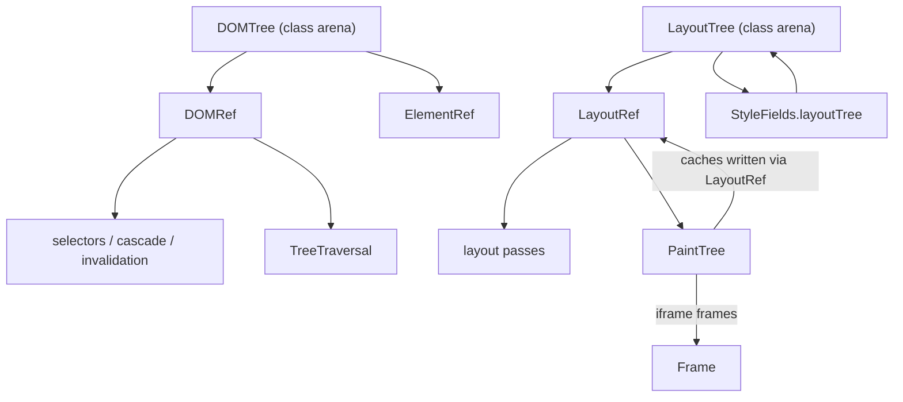

# Shrinking the Main Actor: Plan for the Inherited Annotations

Follows [main-actor-audit.md](./main-actor-audit.md). That file separates the 115 remaining
annotations in `Sources` into **roots** (own unlocked mutable state) and **inherited** (~99 that
are isolated only because they take a ref into a root). This file is the plan for the inherited
half.

## Verdict

Do **not** schedule the 99 inherited annotations as a work item. They cannot be removed one at a
time; each one is isolated by its *input*. There are exactly three ways to make one nonisolated:

| Mechanism | Effect on annotation | Cost |
|---|---|---|
| Give it a value input (snapshot) | annotation disappears | copy the data the pass reads |
| Give it exclusive ownership (`inout`/borrow) | annotation disappears | state must be a value, not a class |
| Move it to another actor (e.g. `@EngineActor`) | annotation **stays** | relocates the boundary, does not shrink it |

Only the first two reduce the main actor. Both need the same prerequisite: **the arenas stop being
classes that anyone can hold**. That is the part item 6 deferred, and it is the reason the plan
below gates the big phases behind a trigger instead of a date.

Two things are worth doing before that gate, because they are defects independent of threading:

1. The style↔layout back-edge — a cycle that makes the two subsystems isolated *together*.
2. Paint mutates the layout tree through a read reference — a "getter" writes node data today.

## Blocker map



Every arrow into a pass is why that pass is `@MainActor`. Cutting an arrow is the only way to
remove the annotation; deleting the annotation while the arrow stays is how the safety claim
disappears — a stripped `Engine` compiles under Swift 5 mode (audit §2, last row).

## Stage 0 — done

Four verified removals, net −11 annotations: `BlockStyle` family, `StyleFields` (10 → 1),
`DOMBase.init`, `BrowserView`. Commit `3f6b2c1`.

## Stage 1 — break the style↔layout cycle (done)

Applied in the working tree: style no longer references layout. Annotation count is unchanged
(182 total; 115 in `Sources`) because this stage removes a dependency, not an isolation marker.

**What was wrong.** Style writes marked layout fields directly:

- `StyleFields` held `weak var layoutTree` and `notifyLayout` pushed `DependencyIndex.mark` from
  inside `apply` / `set` / `mutate`; every style write was a layout mutation.
- `DOMTree` mirrored that pointer into every node (`attachLayoutTree`), so a new `LayoutTree` had
  to walk the whole document to re-install it.
- `StyleFields.owner` existed only so `notifyLayout` could key its marks.

**What changed (applied).** The push is gone; layout pulls. Each style store keeps the properties
that changed since layout last asked, and the tree consumes them when it starts a pass:

```diff
 // Sources/Engine/Style/StyleFields.swift
-    weak var layoutTree: LayoutTree?
+    private var layoutChanges: Set<StyleProperty> = []
+
+    func takeLayoutChanges() -> Set<StyleProperty> {
+        let changes: Set<StyleProperty> = layoutChanges
+        layoutChanges.removeAll(keepingCapacity: true)
+        return changes
+    }
```

`apply`, `set`, and `mutate` add to the set. Layout marks the fields `LayoutInputTable` declares:

```diff
 // Sources/Engine/Layouts/LayoutTree.swift
+    func consumeStyleChanges() {
+        dom.forEachNode { node in
+            consumeStyleChanges(for: node)
+        }
+    }
+
+    func consumeStyleChanges(for node: NodeID) {
+        for property in dom.style(of: node).takeLayoutChanges() {
+            dependencies.mark(.style(node, property), in: self)
+        }
+    }
```

called from `layoutDocument` before `documentLayoutNeeded`, so a style change is what makes the
guard pass. Two places need the per-node entry point:

- `LayoutTree.append` consumes the node's pending set, because a freshly built node already
  reflects the current style.
- `Frame.runAnimationFrame` consumes for the animated node right after `style.set`, so
  "did this animation dirty layout?" is answered without a full pass.

**Deletes:** `StyleFields.layoutTree`, `notifyLayout`, `StyleFields.owner`, `attachOwner`,
`DOMTree.attachLayoutTree` and its per-node install, the `styleRevisions` draft that keyed on
`NodeID` revisions. `DOMLinks.layoutTree` / `DOMRef.layout` stay: that pointer resolves DOM → layout
refs and moves in Stage 5, not here.

**Two bugs found while landing it, both now covered:**

- Iterating *layout* nodes misses an inline child: it has no node of its own, yet its `display`
  decides the parent's `children`. The pull walks DOM nodes.
- A node rebuilt with the parent's node kind reuses the parent's `NodeID`, so marking all style
  properties of a changed node over-invalidates. The pending set keeps the per-property precision
  `notifyLayout` had (`paintOnlyChangeDoesNotMark` still passes).

**Checkpoint (passed):** `swift test` — 209 tests in 33 suites; `www/ch16/granular-style.html`
render is pixel-identical to the pre-change screenshot; a 10 s width animation relayouts 3 nodes per
frame (`layout.visited.count = 3`, 584 of 600 frames) with no animation fallback.

**Why first:** it removes the only behavioural cycle between style and layout, and it is what makes
`StyleFields` a self-contained value later. Risk: a missed style write shows up as stale geometry,
not a crash — hence the four suites and the screenshot diff.

## Stage 2 — take paint caches out of the layout tree (done)

**What was wrong.** `PaintTree` is written as a read pass, but it wrote through a `nonmutating set`
on `LayoutRef`, so it mutated `BlockData`/`LineData` while walking — a "getter" changing node data.

- `PaintTree.swift` defined `blockPaintCache` / `linePaintCache` with `nonmutating set`
- `BlockData.paint.cache` and `LineData.paint.cache` held the storage
- the cache is paint scratch, not a layout input: a hit changes nothing about geometry

**What changed (applied).** Both caches live in a store owned by the display state, one per frame:

```swift
// Sources/Engine/Display/PaintCacheStore.swift
struct PaintCacheStore: Sendable {
    private var blocks: [LayoutID: PaintCache] = [:]
    private var lines: [LayoutID: LinePaintCache] = [:]
}
```

`paintTree` takes it as its fourth parameter (`obj`, `ops`, `session`, `caches`); the two mutating
accessors are gone, `BlockPaint`/`LinePaint` keep only their layout-side fields (`style`,
`styleRevision`, `generation`, `paintedChildCount`).

Per-frame scoping matters: `LayoutID` is only unique inside one tree, so an iframe paints with its
own frame's store (`caches: &childFrame.paintCaches`). `Frame.render` prunes removed ids after
`sweepUnreachable`, so the store cannot grow with dead nodes.

`PaintCache`, `LinePaintCache`, `PaintKey`, `LinePaintKey` gained `Sendable` because the store lives
in `FrameDisplayState`, which is `Sendable`.

**Deletes:** the `nonmutating set` accessors, the cache fields in `BlockPaint`/`LinePaint`, and the
node write path in paint. **No annotation changes yet.**

**Checkpoint (passed):** `swift test` — 209 tests; `www/ch16/granular-style.html` pixel-identical to
the pre-change render; a 10 s animation shows the same cache hits as before (`paint.cache.hit.blocks=3`
on 584 frames, identical line-hit distribution) and the same 3 visited layout nodes per frame.

## Gate — the three phases that actually remove annotations

None of these starts without one of these triggers being true:

- relayout of a real page exceeds the frame budget and we want the pass off-main;
- the package adopts `.swiftLanguageMode(.v6)` and the warnings must become zero;
- a pass must be unit-tested without a live `Browser`.

### Stage 3 — paint from a value input (5 of 13 done, rest blocked on payloads)

**3a — paint leaf helpers take values (applied).** Five factories only needed one style read and
were isolated because they took a `DOMRef`/`LayoutRef`:

| Function | New input | Removed |
|---|---|---|
| `DisplayOp.fromStyle` / `fromBorderStyle` | `ComputedStyle` | 2 |
| `paintEffectStyle` | `ComputedStyle` + `animated` | 1 |
| `focusRingColors` | `forcedColors: Bool` | 1 |
| `drawCursor` | `Point`, `height`, `offset` | 1 |

Callers already hold the style, so nothing new is computed. Engine annotations: 100 → 95.

**3b — the walk itself (`PaintTree`, 8 annotations): not a copy, a payload rewrite.** Inventory of
what a node's paint actually reads, measured from the painters:

- `CanvasRenderingContext2D` is a `final class`; `paintCanvas` calls `ctx.image()` and
  `ctx.revision` at draw time (`EmbedLayoutPass.swift:419-424`).
- Images come from `DOMSideTables.images: [NodeID: CGImage]` (`DOMSideTables.swift:26`) and paint
  reads them per node (`EmbedLayoutPass.swift:108`).
- Iframes recurse into a live `Frame` (`PaintTree.swift:58-64`): `childFrame.document`,
  `childFrame.paintEpoch`.
- Caret and scrollbar read DOM flags and unknown style (`BlockLayoutPass.swift:1257-1281`).

So a `PaintInput` is not a flat copy of the layout tree; it is a *frame-tree* paint contract with a
canvas-image payload, an image table, and per-frame recursion. Rewriting the four per-kind painters
(`BlockLayoutPass` 125 lines, `EmbedLayoutPass` 123, `LineLayoutPass` 40, `TextLayoutPass` 30) plus
`PaintTree` (350) is the cost, and every line of it changes render output if it is wrong.

**Recommendation:** defer 3b until the payloads are values — the canvas context and iframe `Frame`
are exactly the class references item 6's value-state rewrite removes. Doing 3b first means writing
the frame-tree paint contract twice.

### Stage 4 — style over a value document (≈30 annotations)

`DOMTree` becomes a value (or an `inout` parameter threaded through the pass), `DOMRef`/`ElementRef`
become IDs plus a borrow. Selectors, cascade, invalidation and `TextDirectionResolver` become plain
functions over `NodeSnapshot`. Removes the `style` group (24, including `ApplyStyle` and
`ForcedColor`), `TreeTraversal`'s DOM variant (1), `BrowserFont.fontInputs`/`fontForElement` (2),
`ImageLoading` (1), `BrokenImage` (2). `HTMLParser` stays on main: it mutates.

### Stage 5 — layout ownership (≈24 annotations)

Layout mutates persisted fields, so it needs exclusive ownership, not a snapshot: pass
`inout LayoutTree` (value arena) through the pass, or run the pass on a dedicated serial actor.
Removes the `layout` group (11), the ref wrappers (8: `LayoutRef`, `InlineItem`, `InlineTextRun`,
`InlinePlacement`), `LayoutInvalidation`, `LayoutInputTable`, `DependencyIndex`.

This is the largest step (372 `LayoutRef` occurrences across 78 files) and the one the last
refactor deliberately left out. It is also the least valuable for a toy engine: Blink keeps style,
layout, and paint on the main rendering thread and only raster/composite moves off-thread. The win
here is testability and Swift 6 readiness, not throughput.

### Tests (67 annotations)

Not a stage. They follow the API: every suite drops `@MainActor` when the engine types it touches
stop being isolated. 30 suites, mostly one annotation each.

## Projection

| Stage | Removes | Remaining in `Sources` |
|---|---|---|
| now (1 done) | 0 (structural) | 115 |
| 2 (done) | 0 (structural) | 115 |
| 3a (done) | 5 | 110 |
| 3b (deferred) | 8 | — |
| 4 | ~30 | ~72 |
| 5 | ~24 | ~48 |
| roots and UI boundary | — | ~37 floor |

The floor is the roots in audit §4 plus the boundary that owns them: Engine roots 22
(`DOMTree`, `LayoutTree`, `StyleCascade`, `Frame` 3, `Browser` 2, `BrowserTab`, `JSRuntime` 5,
`CanvasBridge` 6, `RasterScheduler` 2) and app shells 15 (`ToyStack` 9, `ToyStackHeadless` 6).

## What not to do

- **Strip annotations to lower the count.** The Engine compiles with zero `@MainActor` under Swift 5
  mode; a green build proves nothing.
- **Move the engine to a custom global actor.** The annotations stay; the 12 `Task { @MainActor in }`
  hops become cross-actor awaits, and AppKit still requires main.
- **Annotate a mixed type wholesale.** `StyleFields` was `nonisolated` + 10 members for one real
  dependency; the fix is to state the dependency once (done), not to widen it.

## Order if it is scheduled

```
1 (done) → 2 (done) ─┬─> 3 (paint)
              └─> 4 (style) → 5 (layout)
```

1 and 2 are independent of each other and can land in either order. 3 and 4 are independent once 2
lands. 5 needs 4 because layout reads typed style values.
