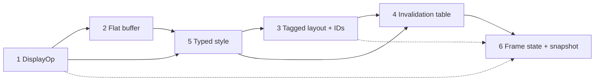

# OOP Refactor: Ordering

Companion to [oop-findings.md](./oop-findings.md). This file fixes **only the order** of the six changes. It is not the implementation plan; each item still needs its own step-by-step plan before code changes.

## Verdict

Start with **item 1 (draw commands → `DisplayOp`)**.

Full sequence:

```
1 → 2 → 5 → 3 → 4 → 6
```

Plan shape: items 1 and 2 share **one plan file with two phases** (seven build-green steps), not two plans: [oop-refactor-1-2-display-op.md](./oop-refactor-1-2-display-op.md).



Solid arrow = hard prerequisite. Dashed arrow = item 6 consumes the result but can start its non-snapshot parts earlier.

## Rationale per position

| Order | Findings item | Target shape | Why this position | Anchor evidence |
|---|---|---|---|---|
| 1 | 1. Draw commands | `enum DisplayOp` | Smallest closed-set conversion. Items 2, 5, and 6 all consume its output type. Sets the enum precedent the later items copy. | `DisplayItem.swift:4`, `DisplayCommand.swift:5`, `BrowserVisualEffect.swift:3`; 38 command constructors, 111 display-list references under `Sources/Engine` |
| 2 | 2. Paint output | flat buffer with `beginEffect`/`endEffect` | Literally requires item 1's `EffectKind`. Removes tree→flatten→cast and subtree copies. | `PaintTree.swift:54-72`, `Browser.swift:612-637`, `PaintCache.swift:20-31` |
| 3 | 5. Style and animation | typed `ComputedStyle` + `AnimatedValue` | Must follow 1/2: `Draw*` types are gone and `Frame.runAnimationFrame` rebuilds composited effects from the new display ops. Must precede 4 so invalidation keys are typed properties, not strings. | `StyleFields.swift:4`, `DrawText.swift:8`, `Frame.swift:978-990`; 55 style reads across 16 files |
| 4 | 3. Layout and DOM | tagged nodes + `NodeID` | Largest blast radius. Rewrite each pass only after its inputs (display ops, typed style) are final. Prerequisite for item 4's field keys and item 6's ownership. | `LayoutObject.swift:5`, `LayoutInvalidation.swift:11-27,64-82`; 35 layout downcasts, 121 DOM/layout existential casts |
| 5 | 4. Invalidation | static input table + versions | Needs `NodeID` from item 3 and typed `StyleProperty` from item 5's refactor. Doing it last on a stable tree avoids redoing invalidation semantics twice. | `FieldRef.swift:22`, `LayoutFieldStore.swift:17`, `StyleFields.swift:6` |
| 6 | 6. Frame state | grouped value state + snapshots | Consumes all of the above: value display list for a real `Sendable` snapshot, `NodeID` for ownership/side tables, typed runtime state. | `Frame.swift:13-93` still owns `displayList` at `Frame.swift:33`; `Browser.swift:30-35` groups only part of the state |

## Why not item 3 first

Item 3 looks like the biggest win, but it is the middle:

- Every pass it rewrites also consumes display output and style values. Running it before items 1, 2, and 5 means rewriting the same paint/layout passes again afterward.
- `BlockLayout.swift` (1,195 lines) and `Frame.swift` (1,766 lines) are the two largest files. Migrating them while their input types are still shifting is the highest-risk order.
- Item 4's target signature `inputs(for:field:in:) -> [FieldKey]` with `FieldKey = (NodeID, FieldID)` cannot be written before item 3.

## Why 5 before 3

- Item 5 changes what layout and paint *read*. Item 3 rewrites every one of those reads. Doing 5 first means the item 3 rewrite lands once, against the final typed API.
- Item 5's animation half depends on items 1/2: `Frame.runAnimationFrame` calls `paintBrowserVisualEffects` and writes `compositedUpdates` (`Frame.swift:978-990`), both of which items 1/2 replace.
- Item 5's only overlap with item 3 is transform parsing in `hitTest` / `absoluteBounds` (`LayoutObject.swift:166-170,199-203`). Those two functions are rewritten by item 3 anyway, so the duplicated edit is small.
- Item 5 before item 4 keeps string keys out of the version table. Otherwise invalidation is built on `[String: String]` and rewritten when style becomes typed.

## What item 1 must absorb so it is not rewritten twice

1. **Typed color payload.** `DisplayOp.text` / `.rect` carry `BrowserColor`, not `String`. Resolve style color once at op construction (`TextLayout.swift:106`, `BlockLayout.swift:1062`, `InputLayout.swift:95`) instead of parsing in `DrawText.execute` (`DrawText.swift:38`). This is the paint slice of item 5, pulled forward, not extra scope.
2. **Identity in the composited path.** `LayerID` is keyed by `ObjectIdentifier(effect)` (`Browser.swift:666-673`) and composited updates by `ObjectIdentifier(node)` (`Browser.swift:697-700`, `814`). Effect identity cannot survive flattening. Key by a scope ID emitted in the op stream plus a temporary node key, so item 4 only changes the alias to `NodeID`.

## Plan structure

Items 1 and 2 get **one plan file with two phases**, not two plans. Each phase is a sequence of build-green commits, not a separate document.

- **Overlapping file set.** Item 1 rewrites the leaf types and all 38 constructors; item 2 rewrites where those leaves are stored and how they are walked. Both touch `PaintTree.swift`, `PaintCache.swift`, `CompositedLayer.swift`, and the `Browser.swift` paint loop. Two plans would restate that context twice and could set different intermediate shapes.
- **One seam decides both.** `Browser.swift:515-519` walks the draw list and casts each item to `DisplayCommand` or `BrowserVisualEffect`. Item 1 changes the cast target; item 2 deletes the loop. Designing that seam in two separate plans means designing it twice, in opposite directions.
- **Phases are commits, not plans.** Phase A ends at a build-green commit (enum ops still inside the effect tree) that stays bisectable. Phase B ends at the commit that deletes the effect tree. The "do not park between them" rule lives inside the plan as a gate, not as a dependency between two documents.
- **Items 3–6 each get their own plan.** Item 3 and item 4 share one plan for the same reason: `NodeID` must be threaded through `FieldRef` and `LayoutInvalidation` in one move, because both files depend on node identity. That plan is [oop-refactor-3-4-layout-dom.md](./oop-refactor-3-4-layout-dom.md). Item 6's plan is [oop-refactor-6-frame-state.md](./oop-refactor-6-frame-state.md).

## Decision deferred to item 5

Item 5's invalidation choice is not settled here: push invalidation with one tree-wide reverse index, or pull/version checks. For a toy engine the findings recommend pull/version as simpler and fast enough. Decide when planning item 5, not before.

## Already done

The README premise correction from the findings is already committed (`8e7b784`). No work remains in that section.
