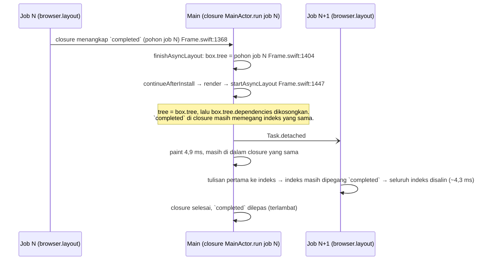

# Resize flow: apa yang menahan di bawah 60 fps, dan rencana optimasinya

Lanjutan dari [resize-flow-bbee952-to-head.md](./resize-flow-bbee952-to-head.md) §8.

Data:
- `browser.trace-fast` (build HEAD `1072def`, GUI, drag window di halaman 1.773 blok).
- Ukur ulang dengan `ToyStackHeadless` di halaman yang sama. Halaman itu adalah `https://browser.engineering/reflow.html` (satu-satunya bab dengan `layout.visited.count = 1773`; halaman pertama di trace, 113 blok, adalah `https://browser.engineering/`).

Tidak ada kode di repo yang diubah. Semua diff di §4 sudah diterapkan dan dijalankan di salinan sementara (`/tmp/ts-verify`, hasil `rsync` dari `1072def`); hasilnya ada di §3, bagian "Verifikasi di salinan sementara".

## 1. Ringkasan

| | Angka | Sumber |
|---|---:|---|
| Event resize dari AppKit selama drag | 268 dalam 4,83 s = **55,5/s** | `BrowserTab.resize` |
| Gambar baru yang tampil | 226 = **46,8 fps** (84% dari event resize) | `view.staging completed = 1` |
| Event resize yang tidak pernah dapat layout sendiri | 27 | 268 resize, 241 job |
| Siklus layout (selesai → selesai) saat drag cepat | median **18,2 ms** (> 16,7 ms) | `layout.async.finish` |
| Job layout yang dimulai dari install job sebelumnya | 204 job, median **16,5 ms** | `layout.async.document` |
| Job layout yang dimulai dari tick | 37 job, median **10,6 ms** | `layout.async.document` |
| Upload tile per gambar baru | median 3 present, **13 ms** | `view`, `view.staging` |
| Tile yang di-upload ulang padahal gambarnya sama | median 55 dari 81 | `tiles.hits` |

Empat hal yang menahan, dari yang paling besar:

1. **Job layout kehilangan ~5,8 ms karena indeks dependency disalin.** Job berikutnya dimulai di dalam closure yang masih memegang pohon hasil job sebelumnya. Jadi indeks dependency punya dua pemilik, dan tulisan pertama di job baru menyalin seluruh indeks. Pekerjaan layout-nya sendiri hanya ~10 ms.
2. **Upload tile mengirim ulang tile yang tidak berubah.** Setiap gambar baru membuat 77–121 layer tersembunyi dan mengisi semuanya, termasuk ~2/3 tile yang gambarnya sama persis dengan yang sudah tampil. Dengan budget 2 MP per present, satu gambar butuh 3 present (median 13 ms, p90 18 ms).
3. **Saat input lebih lambat dari layout, job menunggu tick 60 Hz**, 4–7 ms setelah event resize.
4. **Batas atas dari input**: AppKit hanya mengirim ~55,5 resize/s dalam drag ini (60/s saat tangan bergerak stabil, 33–50/s saat melambat). Engine tidak bisa melewati angka ini.

Yang **bukan** penyebab utama: profiler (+13%), paint dan raster (jalan bersamaan dengan job berikutnya), dan perpindahan hasil ke main thread (0,13 ms).

## 2. Analisa

### 2.1 Batas atas dari input

Per jendela 300 ms selama drag:

| Mulai (ms) | resize/s | install/s | tampil/s | Job median (ms) | Job dari tick |
|---:|---:|---:|---:|---:|---:|
| 300 | 60,0 | 56,7 | 56,7 | 16,4 | 0 |
| 600 | 60,0 | 56,7 | 56,7 | 15,9 | 0 |
| 1200 | 33,3 | 36,7 | 33,3 | 10,7 | 7 |
| 1500 | 50,0 | 36,7 | 36,7 | 12,7 | 7 |
| 2400 | 50,0 | 43,3 | 50,0 | 10,8 | 11 |
| 2700 | 60,0 | 46,7 | 43,3 | 19,6 | 0 |
| 4800 | 60,0 | 50,0 | 50,0 | 17,4 | 0 |
| 5400 | 60,0 | 60,0 | 60,0 | 15,2 | 0 |

Ada dua keadaan:
- **Tangan bergerak stabil (60 resize/s)**: layout yang membatasi. Job berantai ~16 ms, install 50–57/s.
- **Tangan melambat (33–50 resize/s)**: input yang membatasi. Job selesai sebelum resize berikutnya datang, lalu job baru dimulai dari tick.

Dari 46,8 fps ke 60 fps, ~8,7 fps hilang di engine (268 → 226) dan ~4,5 fps hilang di input (55,5 < 60).

### 2.2 Satu siklus layout saat drag cepat

| Bagian | Thread | Median | p90 |
|---|---|---:|---:|
| `layout.async.start` selesai → `layout.async.document` mulai | main → `browser.layout` | 1,33 ms | 1,54 ms |
| `layout.async.document` | `browser.layout` | 16,52 ms | 19,7 ms |
| `layout.async.document` selesai → `layout.async.finish` mulai | → main | 0,13 ms | 0,39 ms |
| `layout.async.finish` | main | 0,04 ms | 0,05 ms |
| `layout.async.finish` selesai → `layout.async.start` berikutnya | main | 0,01 ms | – |
| **Selesai → selesai** | | **18,2 ms** | 23,1 ms |

Paint (4,9 ms) dan raster (3,5 ms) berjalan **bersamaan** dengan job berikutnya (`Frame.swift:1447-1453` memulai job dulu, baru `tab?.paintAndCommit()`). Jadi keduanya hanya menambah jeda tampil, tidak menurunkan fps. Yang menentukan fps saat drag cepat adalah job layout.

### 2.3 Job berantai vs job dari tick

Job "berantai" dimulai oleh `continueAfterInstall()` (`Frame.swift:1447`), di dalam `MainActor.run` milik job sebelumnya (`Frame.swift:1369-1374`). Job "dari tick" dimulai oleh `render()` di `BrowserTab.animFrame`, saat job sebelumnya sudah lama selesai.

| | Berantai (204) | Dari tick (37) | Headless, main thread |
|---|---:|---:|---:|
| `layout.async.document` / `BrowserTab.layout` | 16,52 ms | 10,56 ms | 8,4 ms |
| `layout.line.children.previous` per panggilan | **19,4 µs** | 2,5 µs | 1,8 µs |
| `layout.line.children.previous` per job | **4,95 ms** | 0,44 ms | 0,32 ms |
| Job tanpa `previous` (`document.root − previous`) | 11,2 ms | 10,0 ms | 8,1 ms |
| `layout.line.place` per panggilan | 0,785 µs | 0,735 µs | 0,6 µs |

Di rentang lebar yang sama (900–1300 px): berantai 15,7 ms (n = 82), dari tick 9,9 ms (n = 4).

Kenapa ini menunjuk ke salinan indeks, bukan CPU yang sibuk:
- Pekerjaan lain (`layout.line.place`, `layout.height`, `layout.mode`) per panggilan hampir sama di kedua kelompok. Kalau CPU direbut paint/raster, semua bagian akan melambat rata.
- Yang melambat 8× hanya `layout.line.children.previous` (`LayoutTree.swift:804-814`), dan isinya hanya `dependencies.replaceDependent`. Itu tulisan ke indeks dependency.
- Biayanya hampir **tetap per job**, tidak ikut jumlah panggilan: 160 panggilan → 4,64 ms, 471 panggilan → 5,54 ms. Jadi ada biaya sekali bayar ~4,3 ms di tulisan pertama, ditambah ~2 µs per panggilan.

### 2.4 Kenapa indeks disalin

Struct Swift yang berisi `Dictionary` boleh dipegang beberapa variabel sekaligus tanpa menyalin. Salinan baru dibuat saat salah satu pemilik menulis **dan** masih ada pemilik lain. Indeks dependency (`DependencyIndex.swift:6-7`) berisi dua dictionary besar yang memetakan field ke field yang bergantung padanya. Menyalinnya berarti menyalin semua edge.

`startAsyncLayout` sudah berusaha supaya job jadi satu-satunya pemilik (`Frame.swift:1332-1336`: `box.tree.dependencies = DependencyIndex()`). Masalahnya ada pemilik ketiga:



Dokumentasi `LayoutTreeHandoff` (`LayoutTreeHandoff.swift:1-5`) sudah menjelaskan masalah persis ini: "A value in a task's capture list lives as long as the task, so a captured tree is never the only owner of its storage." Handoff sudah dipakai untuk pohon yang masuk ke job dan untuk pohon yang dibuang, tapi **belum** untuk pohon hasil job yang kembali ke main.

Job dari tick tidak kena masalah ini, karena closure job sebelumnya sudah lama selesai.

### 2.5 Mulai job menunggu tick

Kalau job selesai sebelum resize berikutnya datang, `setNeedsViewportResize` (`Frame.swift:2164-2176`) hanya menandai layout kotor. Job baru mulai di `render()` (`Frame.swift:962-966`) saat tick 60 Hz berikutnya (`Browser.swift:259-294`). Di trace, 37 job menunggu seperti ini, dengan jeda event resize → mulai job 4,4–7,3 ms di bagian drag yang stabil.

Setelah §2.4 diperbaiki, job (~12 ms per siklus) akan lebih cepat dari jarak event resize (16,7 ms). Jadi hampir **setiap** job akan menunggu tick. Preview sudah dikirim langsung dari event resize (`Browser.swift:171-185`), tapi layout belum.

### 2.6 Upload tile

| | Median | p90 |
|---|---:|---:|
| Tile per gambar (`view.placements`) | 77–121 | – |
| Tile yang digambar ulang oleh raster (`tiles.misses`) | 26 | 54 |
| Tile yang dipakai ulang oleh raster (`tiles.hits`) | 55 | 88 |
| Present untuk upload satu gambar | 3 | 5 |
| `raster.install` selesai → `view.staging completed = 1` | 13,0 ms | 18,1 ms |
| `view.commit` untuk 30 tile | 0,19 ms | 0,35 ms |

`stageGeneration` (`ContentPresenter.swift:429-453`) mencari layer di `pendingLayers`. Untuk gambar baru, `pendingLayers` masih kosong, jadi semua tile dapat layer tersembunyi baru dan semuanya perlu di-bind (`needsBind`, `ContentPresenter.swift:411-413`). Padahal untuk tile hit, compositor mengembalikan **objek `CGImage` yang sama** (`TileStore.swift:17`, `case hit(CGImage)`), dan objek itu sudah tampil di `layersByPlacement` dengan posisi yang sama.

Akibatnya budget 2 MP (`PresentUploadBudget.swift:5`, ~30 tile) habis untuk tile yang tidak berubah. Satu gambar baru butuh 3 present, padahal tile yang benar-benar baru (median 26) muat dalam satu present.

Saat siklus layout masih 18 ms, upload 13 ms masih sempat selesai. Setelah §2.4 diperbaiki, gambar baru akan datang tiap ~16,7 ms. Upload p90 18 ms lalu jadi batas berikutnya.

### 2.7 Yang bukan penyebab utama

- **Profiler**: headless, `reflow.html`, lebar 1415 → 815 (6 px per tick), 3 kali jalan. Layout 8,45 ms dengan profiler vs 7,4 ms dengan `--no-profile` (+13%). Angka `9ac37fe` (14,7 vs 8,6 ms) di §8 dokumen sebelumnya kemungkinan besar sudah termasuk salinan indeks dari §2.4. [INFERENCE]
- **Hop ke main**: `layout.async.document` selesai → `layout.async.finish` median 0,13 ms.
- **Paint + raster**: berjalan bersamaan dengan job berikutnya (§2.2).
- **`view.commit`**: 0,19 ms untuk 30 tile.

### 2.8 Sisa biaya yang tidak masuk rencana ini

- **1,1–1,3 ms sebelum `layout.async.document` mulai**, juga di job dari tick. Penanganan `Task.detached` biasanya puluhan µs. Yang tersisa adalah salinan array node di tulisan pertama job (`markDocumentGeometryDirty`, `LayoutTree.swift:150`), karena pohon yang terpasang sengaja tetap berbagi node supaya bisa di-paint (`Frame.swift:1325-1327`). [INFERENCE] Saat lebar berubah, hampir semua node ditulis, jadi menyalin per bagian tidak banyak membantu.
- **Job dari tick di GUI (~10 ms) vs headless di main thread (8,4 ms)**. Kemungkinan karena prioritas `.userInitiated` vs main thread, atau core yang berbeda. [INFERENCE]
- **Lompat breakpoint 800 px**: job 34,5–35,9 ms, 2 kali per drag. Ini membuat jarak 2 frame display dua kali.

## 3. Perkiraan efek

| Setelah | Siklus layout | Resize → gambar baru tampil | Konten baru |
|---|---:|---:|---:|
| HEAD | 18,2 ms | median 38 ms | 46,8 fps (54,6 di drag stabil) |
| Langkah 1 | ~12 ms (1,3 + ~10,6 + 0,2) | ~33 ms | layout tidak lagi membatasi; upload p90 18 ms membatasi |
| + Langkah 2 | sama | −4 sampai −7 ms | job mulai saat resize datang, tidak terikat tick |
| + Langkah 3 | sama | −~11 ms (13 → 1–2 ms) | ≈ jumlah event resize (≤ 60 fps) |

Baris "Langkah 1" sudah diukur di salinan sementara (di bawah): siklus job berantai 14,4 → 9,3 ms. Angka lain masih [INFERENCE] dari job dari tick di trace yang sama dan dari `tiles.misses`. Angka GUI harus diukur ulang (§5).

### Verifikasi di salinan sementara

Semua langkah diterapkan di `/tmp/ts-verify` (bukan di repo), lalu dijalankan:

| Langkah | Sebelum perbaikan | Sesudah perbaikan |
|---|---|---|
| 1a–1b `DependencyIndexTests` | gagal compile (`hasNoOtherOwner` belum ada) | 2 tes lolos |
| 1c `chainedJobOwnsTheDependencyIndex` | **gagal: `[0, 1]`** (job kedua berbagi indeks) | lolos: `[0, 0]` |
| 2 `ResizeLayoutStartTests` | 2 gagal ("the pass waited for the animation tick", lebar tetap 800), tes sinkron lolos | 3 lolos |
| 3 `ShownLayerTests` | gagal compile (`ShownLayer` belum ada) | 7 lolos |
| 3 `ContentPresenter` | – | `swift build --product ToyStack` berhasil |
| Semua | – | `TOYSTACK_BACKGROUND_LAYOUT_TEST=1 swift test --no-parallel`: 419 tes lolos |

Ukur langsung di halaman yang sama dengan layout async dan release build. Tes sementara memuat `https://browser.engineering/reflow.html` lalu mengirim resize tiap 4 ms. Itu lebih cepat dari layout, jadi setiap job setelah yang pertama berantai. Tiga kali jalan; untuk kolom "sebelum", hanya Langkah 1d yang dibalik:

| | Sebelum 1d | Sesudah 1d |
|---|---:|---:|
| Job berantai per jalan | 76 / 91 / 83 | 163 / 142 / 137 |
| `layout.async.document` median | 13,9 / 12,3 / 13,0 ms | **7,5 / 8,0 / 7,9 ms** |
| `layout.line.children.previous` per panggilan | 37–38 µs | 2,1–2,3 µs |
| Job yang menyalin indeks (`layout.dependencies.copy`) | semua | 0 |
| `layout.async.handoff.sharedIndex = 1` | semua job berantai | 0 |
| Install → install median | 15,5 / 13,6 / 14,4 ms | **8,8 / 9,3 / 9,3 ms** |

Dalam 0,8 s drag yang sama, jumlah job yang selesai hampir dua kali lipat. Tes ini berjalan tanpa `ContentPresenter` dan tanpa GUI, jadi angkanya lebih kecil dari trace GUI, tapi arahnya sama dengan §2.3.

Verifikasi juga menemukan satu kesalahan di draf rencana: `#expect` tidak bisa memanggil method `mutating` (`cannot use mutating member on immutable value`). Tes 1a di bawah sudah diperbaiki: hasilnya disimpan ke variabel `let` dulu.

## 4. Rencana

### File yang berubah

| File | Langkah | Kenapa |
|---|---|---|
| `Sources/Engine/Core/DependencyIndex.swift` | 1 | Isi indeks disimpan di class, supaya penyalinan terjadi di satu tempat, bisa dihitung, dan pemiliknya bisa dicek |
| `Sources/Engine/Core/Frame.swift` | 1, 2 | Counter handoff, pohon hasil job dikembalikan lewat handoff, dan mulai job dari event resize |
| `Sources/Engine/Core/LayoutTreeHandoff.swift` | 1 | Dokumentasi: handoff sekarang juga dipakai untuk mengembalikan hasil job |
| `Sources/Engine/Core/BrowserTab.swift` | 2 | Teruskan "mulai layout sekarang" ke semua frame |
| `Sources/Engine/Core/Browser.swift` | 2 | Panggil dari `resize(to:deferLayout:)` |
| `Sources/Engine/Presentation/ShownLayer.swift` (baru) | 3 | Keputusan "layer di layar boleh dipakai generasi baru" sebagai tipe Engine yang bisa dites |
| `Sources/ToyStack/ContentPresenter.swift` | 3 | Pakai `ShownLayer` saat staging |
| `profiling.md` | 1, 3 | Counter baru `layout.async.handoff`, `layout.dependencies.copy`, dan arti baru `view.kept` |
| `Tests/ToyStackTests/Core/DependencyIndexTests.swift` (baru) | 1 | Indeks tetap berperilaku seperti nilai setelah disimpan di class |
| `Tests/ToyStackTests/Diagnostic/AsyncLayoutTraceTests.swift` | 1 | Job berantai tidak berbagi indeks (dibaca dari trace) |
| `Tests/ToyStackTests/Core/ResizeLayoutStartTests.swift` (baru) | 2 | Resize memulai job tanpa tick; resize saat job jalan tidak mengganggu job itu; mode sinkron tetap menunggu tick |
| `Tests/ToyStackTests/Presentation/ShownLayerTests.swift` (baru) | 3 | Kapan layer di layar boleh dan tidak boleh dipakai |

### Keputusan desain

**Langkah 1, cara mengetes "indeks tidak berbagi pemilik"**

- **Option A (rekomendasi)**: dua dictionary disimpan di `private final class DependencyStorage`. Salinan dibuat sendiri di `makeUnique()` (dengan `isKnownUniquelyReferenced`) dan dihitung sebagai `layout.dependencies.copy`. Tes bisa memeriksa pemilik secara pasti saat handoff. Trace juga mendapat metrik permanen untuk masalah jenis ini. Trade-off: setiap tulisan ke indeks melewati satu cek atomik (murah), dan tulisan yang lupa memanggil `makeUnique()` akan merusak salinan lain. Karena itu semua tulisan lewat `_modify` dari dua properti, bukan dipanggil manual.
- **Option B**: menambah objek "penanda" (class kosong) ke struct dan memeriksa apakah objek itu hanya dipegang satu pihak. Perubahannya lebih kecil, tapi penandanya tetap terlihat "berbagi" walaupun dictionary-nya sudah tidak berbagi. Hasilnya hanya benar tepat saat handoff.

**Langkah 1, cara melepas pohon lama sebelum job berikutnya mulai**

- **Option A (rekomendasi)**: hasil job dikembalikan lewat `LayoutTreeHandoff`, dan `finishAsyncLayout` mengambilnya dengan `take()`. Pola ini sudah dipakai di dua tempat lain. Tidak ada hop tambahan.
- **Option B**: `continueAfterInstall()` dijadwalkan sebagai `Task { @MainActor … }` terpisah, supaya closure lama selesai dulu. Ini menambah satu giliran main thread per job, dan tetap bergantung pada kapan Swift melepas variabel lokal `tree` di task.

**Langkah 2, dari mana job dimulai saat resize**

- **Option A (rekomendasi)**: dari `Browser.resize(to:deferLayout: true)`, hanya kalau layout async menyala. Jalur headless dan tes sinkron (`deferLayout: false` atau `usesAsyncLayout = false`) tidak berubah. Aturan "scroll di tick N berpengaruh ke frame N+1" di `profiling.md` tetap berlaku.
- **Option B**: dari `Frame.setNeedsViewportResize()`. Ini juga dipanggil dari jalur sinkron dan dari tes yang memanggil `tab.resize`, jadi perilaku tes yang ada akan ikut berubah.

**Langkah 3, mengurangi waktu upload**

- **Option A (rekomendasi)**: generasi baru memakai layer yang sedang tampil kalau gambar, posisi, dan skalanya sama. Pekerjaannya benar-benar dibuang, bukan hanya dipindah.
- **Option B**: menaikkan `PresentUploadBudget.generationPixels`. `view.commit` memang murah (0,19 ms untuk 30 tile), tapi upload yang sebenarnya terjadi di render server, dan itu tidak terlihat di trace. Komentar di `PresentUploadBudget.swift:15-17` mencatat 60 tile bisa melewati satu frame display di p95.

---

### Langkah 1: job berikutnya jadi satu-satunya pemilik indeks dependency

#### 1a. Tes: indeks tetap berperilaku seperti nilai

File baru `Tests/ToyStackTests/Core/DependencyIndexTests.swift`:

```diff
+import Testing
+
+@testable import Engine
+
+@Suite
+struct DependencyIndexTests {
+    private static let parentY: FieldKey = .layout(LayoutID(raw: 0), .y)
+    private static let lineY: FieldKey = .layout(LayoutID(raw: 1), .y)
+    private static let previousHeight: FieldKey = .layout(LayoutID(raw: 2), .height)
+
+    /// The installed tree keeps painting from its copy while a job writes.
+    @Test func copyKeepsItsEdgesWhenTheOriginalIsWritten() {
+        var original: DependencyIndex = DependencyIndex()
+        original.add(Self.lineY, for: Self.parentY)
+        let installed: DependencyIndex = original
+
+        original.replaceDependent(Self.lineY, with: [Self.previousHeight])
+
+        #expect(installed.fields(for: Self.parentY) == [Self.lineY], "a write reached the other copy")
+        #expect(installed.fields(for: Self.previousHeight).isEmpty)
+        #expect(original.fields(for: Self.parentY).isEmpty)
+        #expect(original.fields(for: Self.previousHeight) == [Self.lineY])
+    }
+
+    @Test func writeGivesTheWriterItsOwnIndex() {
+        var original: DependencyIndex = DependencyIndex()
+        original.add(Self.lineY, for: Self.parentY)
+        var copy: DependencyIndex = original
+        let sharedBeforeWrite: Bool = !original.hasNoOtherOwner()
+        #expect(sharedBeforeWrite)
+
+        copy.removeDependent(Self.lineY)
+
+        let copyOwnsItsIndex: Bool = copy.hasNoOtherOwner()
+        let originalOwnsItsIndex: Bool = original.hasNoOtherOwner()
+        #expect(copyOwnsItsIndex, "the writer still shares the index")
+        #expect(originalOwnsItsIndex, "the original still shares the index")
+    }
+}
```

Jalankan `swift test --filter DependencyIndexTests`. Hasil yang diharapkan: **gagal compile** karena `hasNoOtherOwner()` belum ada. `copyKeepsItsEdgesWhenTheOriginalIsWritten` adalah pengaman untuk perubahan 1b: sekarang lolos, dan harus tetap lolos sesudahnya.

#### 1b. Isi indeks disimpan di class

`Sources/Engine/Core/DependencyIndex.swift:1-8`:

```diff
 import Foundation
 
 /// The graph is rebuilt from `LayoutInputTable`, which is the only place that
 /// declares an edge. A write walks the index once; reads never touch it.
 struct DependencyIndex {
-    private var dependents: [FieldKey: Set<FieldKey>] = [:]
-    private var inputsByDependent: [FieldKey: Set<FieldKey>] = [:]
+    private var storage: DependencyStorage = DependencyStorage()
+
+    private var dependents: [FieldKey: Set<FieldKey>] {
+        _read { yield storage.dependents }
+        _modify {
+            makeUnique()
+            yield &storage.dependents
+        }
+    }
+
+    private var inputsByDependent: [FieldKey: Set<FieldKey>] {
+        _read { yield storage.inputsByDependent }
+        _modify {
+            makeUnique()
+            yield &storage.inputsByDependent
+        }
+    }
+
+    /// `isKnownUniquelyReferenced` needs `inout` access, hence `mutating`.
+    mutating func hasNoOtherOwner() -> Bool {
+        return isKnownUniquelyReferenced(&storage)
+    }
+
+    // The installed tree and a background job can both hold one index. The
+    // first write while both hold it copies every edge (~4 ms on a
+    // 1,773-block page); making the copy here is what lets it be counted.
+    private mutating func makeUnique() {
+        guard !isKnownUniquelyReferenced(&storage) else { return }
+        profiler.count("layout.dependencies.copy")
+        storage = storage.copy()
+    }
 
     mutating func rebuild(from tree: LayoutTree) {
```

Akhir file (`DependencyIndex.swift:156-163`):

```diff
     func fieldKeys(for dependent: FieldKey) -> Set<FieldKey> {
         var keys: Set<FieldKey> = []
         for (input, list) in dependents where list.contains(dependent) {
             keys.insert(input)
         }
         return keys
     }
 }
+
+// MARK: - DependencyStorage
+
+private final class DependencyStorage {
+    var dependents: [FieldKey: Set<FieldKey>]
+    var inputsByDependent: [FieldKey: Set<FieldKey>]
+
+    init(
+        dependents: [FieldKey: Set<FieldKey>] = [:],
+        inputsByDependent: [FieldKey: Set<FieldKey>] = [:]
+    ) {
+        self.dependents = dependents
+        self.inputsByDependent = inputsByDependent
+    }
+
+    func copy() -> DependencyStorage {
+        return DependencyStorage(dependents: dependents, inputsByDependent: inputsByDependent)
+    }
+}
```

Isi fungsi lain (`DependencyIndex.swift:9-162`) tidak berubah. Fungsi-fungsi itu tetap menulis ke `dependents` dan `inputsByDependent`, dan sekarang semua tulisan lewat `_modify`.

Jalankan `swift test --filter DependencyIndexTests`: keduanya lolos.

#### 1c. Tes: job berantai tidak berbagi indeks

Counter handoff di `Sources/Engine/Core/Frame.swift:1328-1337`:

```diff
         var tree: LayoutTree = box.tree
         box.startRecordingEdits()
         tree.refreshInputs(resolved.inputs)
-        let handoff: LayoutTreeHandoff = LayoutTreeHandoff(consume tree)
         // The installed tree is only painted and hit-tested while the job
         // runs; neither reads the dependency index, and the job's tree replaces
         // it on install. Hand the index over so the job is its only owner and
         // its first write does not copy both dictionaries.
         box.tree.dependencies = DependencyIndex()
+        let sharedIndex: Bool = !tree.dependencies.hasNoOtherOwner()
+        browser?.measure.counter("layout.async.handoff", ["sharedIndex": sharedIndex ? 1 : 0])
+        let handoff: LayoutTreeHandoff = LayoutTreeHandoff(consume tree)
         let marksGeometry: Bool = viewportGeometryPending
```

Tes di `Tests/ToyStackTests/Diagnostic/AsyncLayoutTraceTests.swift:85-86` (masuk `Diagnostic/` karena membaca trace):

```diff
         for reason in ["stylesDirty", "viewportStyle", "pendingChanges", "keyChanged"] {
             #expect(trace.contains("\"\(reason)\":"), "decision is missing \(reason)")
         }
     }
+
+    /// A job started by the install of the one before it must own the
+    /// dependency index alone. A shared index is copied on the job's first
+    /// write: ~4 ms per job on a 1,773-block page.
+    @Test(
+        .enabled(
+            if: ProcessInfo.processInfo.environment["TOYSTACK_BACKGROUND_LAYOUT_TEST"] == "1"
+        )
+    )
+    func chainedJobOwnsTheDependencyIndex() async throws {
+        let path: String = NSTemporaryDirectory() + "handoff-\(UUID().uuidString).trace"
+        defer { try? FileManager.default.removeItem(atPath: path) }
+        let html: String = (0..<40).map { index in
+            "<p>Paragraph \(index) has words that wrap when the viewport is narrow.</p>"
+        }.joined()
+        let page: LayoutTestPage = LayoutTestPage(
+            html: html,
+            rules: "body { display: block; } p { display: block; }"
+        )
+        let browser: Browser = Browser(tracePath: path)
+        browser.usesAsyncLayout = true
+        page.tab.browser = browser
+        page.frame.setJSRuntime(JSRuntime(frame: page.frame))
+        page.frame.clearPaintRequest()
+
+        page.tab.resize(width: 400, height: 600)
+        page.frame.runAnimationFrame()
+        try #require(page.frame.isLayoutInFlight)
+        // The width moves while the 400 job runs, so its install starts the
+        // 300 job.
+        page.tab.resize(width: 300, height: 600)
+        let deadline: Date = Date().addingTimeInterval(5)
+        while page.frame.isLayoutInFlight, Date() < deadline {
+            try await Task.sleep(nanoseconds: 5_000_000)
+        }
+        browser.measure.close()
+
+        let data: Data = try Data(contentsOf: URL(fileURLWithPath: path))
+        let root: [String: Any] = try #require(
+            try JSONSerialization.jsonObject(with: data) as? [String: Any]
+        )
+        let events: [[String: Any]] = try #require(root["traceEvents"] as? [[String: Any]])
+        let shared: [Int] = events
+            .filter({ $0["name"] as? String == "layout.async.handoff" })
+            .compactMap({ ($0["args"] as? [String: Any])?["sharedIndex"] as? Int })
+        try #require(shared.count == 2, "expected one handoff per job, got \(shared)")
+        #expect(shared == [0, 0], "a job shared the dependency index with the tree it replaced: \(shared)")
+    }
 }
```

Jalankan:

```bash
TOYSTACK_BACKGROUND_LAYOUT_TEST=1 swift test --no-parallel --filter AsyncLayoutTraceTests
```

Hasil yang diharapkan: **gagal** dengan `[0, 1]`. Job pertama (dari tick) tidak berbagi. Job kedua (dari install) berbagi indeks dengan `completed` di closure. Ini bukti langsung untuk §2.4.

#### 1d. Perbaikan: hasil job dikembalikan lewat handoff

`Sources/Engine/Core/Frame.swift:1363-1375`:

```diff
             let effects: [LayoutEffect] = tree.takeEffects()
             let removed: Set<LayoutID> = tree.needsSweep ? tree.sweepUnreachable() : []
             measure?.stop("layout.async.document")
             profiler.emitProfile(into: measure, named: "profile.layout", frame: jobFrame)
             lane?.end()
-            let completed: LayoutTree = tree
+            // `continueAfterInstall` starts the next job inside this closure,
+            // before the closure releases what it captured. A captured tree
+            // would still share the dependency index with that job, whose
+            // first write would then copy every edge.
+            let result: LayoutTreeHandoff = LayoutTreeHandoff(consume tree)
             await MainActor.run { [weak self] in
                 guard let self,
-                    self.finishAsyncLayout(completed, effects: effects, removed: removed, jobID: jobID)
+                    self.finishAsyncLayout(result.take(), effects: effects, removed: removed, jobID: jobID)
                 else { return }
                 self.continueAfterInstall()
             }
```

`Sources/Engine/Core/LayoutTreeHandoff.swift:1-5` dan `:13-14`:

```diff
 /// A value in a task's capture list lives as long as the task, so a captured
 /// tree is never the only owner of its storage. `take()` moves the tree out
 /// instead. A background layout job uses it so its first write does not copy
-/// the node array and dependency index; an install uses it so the replaced
-/// tree is freed off the main thread.
+/// the node array and dependency index, and to return its tree so the next
+/// job, started by the install, does not copy the index either; an install
+/// uses it so the replaced tree is freed off the main thread.
 final class LayoutTreeHandoff: @unchecked Sendable {
```

```diff
-    /// Called once, by the receiving task. Accessed from one thread at a time:
-    /// the main thread creates the handoff before it starts the task.
+    /// Called once, by the receiver. Accessed from one thread at a time: the
+    /// sender creates the handoff before the receiver can run.
     func take() -> LayoutTree {
```

Jalankan lagi tes 1c: lolos dengan `[0, 0]`. Lalu jalankan tes regresi async:

```bash
TOYSTACK_BACKGROUND_LAYOUT_TEST=1 swift test --no-parallel \
  --filter "AsyncLayoutTraceTests|AsyncResizeRestartTests|AsyncResizeStyleChangeTests|BackgroundLayoutTests"
```

#### 1e. Dokumentasi counter

`profiling.md:328`:

```diff
 | `layout.field.mark` | count | layout field transitions from clean to dirty |
+| `layout.dependencies.copy` | count | dependency index copied because another tree still held it |
 | `scrollTargets.rebuilt` | count | synchronous layout pass that rescanned the tree for scrollable blocks and iframes |
```

`profiling.md:424`:

```diff
 During a width-only drag, expect 0.
+
+`layout.async.handoff` (`sharedIndex`): one sample per background layout job,
+taken on the main thread when the job is handed its tree. `sharedIndex` = 1
+when another tree still held the job's dependency index at that moment; the
+job's first write then copies every edge (`layout.dependencies.copy`).
+Expect 0.
 
 `tiles`: one sample per composite, reset by `TileStore.beginComposite`.
```

Contoh pesan commit:

```
perf: stop copying the layout graph on every resize step

While dragging the window on a big page, each layout took ~16 ms although
the work itself needed ~10 ms. The next layout started inside the callback
that still held the previous result, so the dependency index had two owners
and the first write copied all of it. Return the result through
LayoutTreeHandoff so the installed tree is its only owner, and count index
copies (layout.dependencies.copy, layout.async.handoff) so this shows up in
the trace.
```

---

### Langkah 2: job dimulai langsung dari event resize

#### 2a. Tes

File baru `Tests/ToyStackTests/Core/ResizeLayoutStartTests.swift` (masuk `Core/` karena `Browser`, `BrowserTab`, dan `Frame` yang bekerja):

```diff
+import CoreGraphics
+import Foundation
+import Testing
+
+@testable import Engine
+
+// The async tests are opt-in for the same reason as BackgroundLayoutTests.
+@Suite(.serialized)
+@MainActor
+struct ResizeLayoutStartTests {
+    @Test(
+        .enabled(
+            if: ProcessInfo.processInfo.environment["TOYSTACK_BACKGROUND_LAYOUT_TEST"] == "1"
+        )
+    )
+    func resizeStartsThePassWithoutATick() async throws {
+        let (browser, pagePath): (Browser, String) = try await Self.loadedBrowser(asyncLayout: true)
+        defer { try? FileManager.default.removeItem(atPath: pagePath) }
+        let frame: Frame = try #require(browser.activeTab?.rootFrame)
+
+        browser.resize(to: CGSize(width: 500, height: 600), deferLayout: true)
+
+        #expect(frame.isLayoutInFlight, "the pass waited for the animation tick")
+        #expect(await Self.pump({ !frame.isLayoutInFlight }))
+        #expect(frame.installedLayoutSize.width == 500)
+    }
+
+    /// A second resize must not replace the running pass: its install is the
+    /// intermediate layout a drag shows, and it starts the pass for 450.
+    @Test(
+        .enabled(
+            if: ProcessInfo.processInfo.environment["TOYSTACK_BACKGROUND_LAYOUT_TEST"] == "1"
+        )
+    )
+    func resizeDuringAPassLetsItFinish() async throws {
+        let tracePath: String = NSTemporaryDirectory() + "resize-start-\(UUID().uuidString).trace"
+        let (browser, pagePath): (Browser, String) = try await Self.loadedBrowser(
+            asyncLayout: true,
+            tracePath: tracePath
+        )
+        defer {
+            try? FileManager.default.removeItem(atPath: pagePath)
+            try? FileManager.default.removeItem(atPath: tracePath)
+        }
+        let frame: Frame = try #require(browser.activeTab?.rootFrame)
+
+        browser.resize(to: CGSize(width: 500, height: 600), deferLayout: true)
+        browser.resize(to: CGSize(width: 450, height: 600), deferLayout: true)
+        #expect(await Self.pump({ !frame.isLayoutInFlight }))
+        #expect(frame.installedLayoutSize.width == 450)
+
+        browser.stopAnimationTimer()
+        let data: Data = try Data(contentsOf: URL(fileURLWithPath: tracePath))
+        let root: [String: Any] = try #require(
+            try JSONSerialization.jsonObject(with: data) as? [String: Any]
+        )
+        let events: [[String: Any]] = try #require(root["traceEvents"] as? [[String: Any]])
+        let superseded: [Int] = events
+            .filter({ $0["name"] as? String == "layout.async.superseded" })
+            .compactMap({ ($0["args"] as? [String: Any])?["width"] as? Int })
+        #expect(superseded == [500], "the 500 pass was not installed: \(superseded)")
+    }
+
+    /// Headless runs lay out on the tick so a resize at tick N lands in frame
+    /// N+1 (`profiling.md`, Deterministic runs).
+    @Test func syncLayoutResizeWaitsForTheTick() async throws {
+        let (browser, pagePath): (Browser, String) = try await Self.loadedBrowser(asyncLayout: false)
+        defer { try? FileManager.default.removeItem(atPath: pagePath) }
+        let frame: Frame = try #require(browser.activeTab?.rootFrame)
+
+        browser.resize(to: CGSize(width: 500, height: 600), deferLayout: true)
+        #expect(frame.paintedLayoutSize.width == 800, "a synchronous layout ran inside the resize event")
+
+        browser.advanceFrame()
+        #expect(frame.paintedLayoutSize.width == 500)
+    }
+
+    // MARK: - Helpers
+
+    private static func loadedBrowser(
+        asyncLayout: Bool,
+        tracePath: String? = nil
+    ) async throws -> (Browser, String) {
+        let pagePath: String = NSTemporaryDirectory() + "resize-start-\(UUID().uuidString).html"
+        let html: String = (0..<20).map { (index: Int) -> String in
+            "<p>Paragraph \(index) has words that wrap when the viewport is narrow.</p>"
+        }.joined()
+        try html.write(toFile: pagePath, atomically: true, encoding: .utf8)
+        let browser: Browser = Browser(tracePath: tracePath)
+        browser.usesAsyncLayout = asyncLayout
+        browser.resize(to: CGSize(width: 800, height: 600))
+        browser.newTab(WebURL("file://" + pagePath))
+        browser.pauseAnimationTimer()
+        try #require(await pump({ browser.activeTab?.isLoaded == true }))
+        try #require(await settle(browser, untilWidth: 800 * browser.pageZoom))
+        return (browser, pagePath)
+    }
+
+    private static func settle(_ browser: Browser, untilWidth width: CGFloat) async -> Bool {
+        let deadline: Date = Date().addingTimeInterval(10)
+        while Date() < deadline {
+            browser.advanceFrame()
+            _ = await pump({ browser.isRenderIdle })
+            if browser.isRenderIdle, browser.presentedFrame.displayedLayoutSize.width == width {
+                return true
+            }
+        }
+        return false
+    }
+
+    private static func pump(_ condition: () -> Bool) async -> Bool {
+        let deadline: Date = Date().addingTimeInterval(10)
+        while !condition() {
+            guard Date() < deadline else { return false }
+            try? await Task.sleep(nanoseconds: 2_000_000)
+        }
+        return true
+    }
+}
```

Jalankan:

```bash
TOYSTACK_BACKGROUND_LAYOUT_TEST=1 swift test --no-parallel --filter ResizeLayoutStartTests
```

Hasil yang diharapkan sebelum 2b:
- `resizeStartsThePassWithoutATick` gagal di "the pass waited for the animation tick".
- `resizeDuringAPassLetsItFinish` gagal karena tidak ada job yang jalan tanpa tick (`pump` habis waktu, lebar masih 800).
- `syncLayoutResizeWaitsForTheTick` lolos. Tes ini menjaga supaya 2b tidak mengubah jalur sinkron.

#### 2b. Implementasi

`Sources/Engine/Core/Frame.swift:1445-1453`:

```diff
     /// Waiting for the tick cost up to a frame per install during a drag.
     /// Animations and rAF callbacks still advance only on the tick.
     private func continueAfterInstall() {
         if state.layout.tree.isDirty {
             state.runtime.schedule.needsRender = false
             render()
         }
         tab?.paintAndCommit()
     }
+
+    /// `needsRender` stays set, so the tick still runs its own `render()` and
+    /// the focus scroll after it; with the pass already running, that
+    /// `render()` stops at the layout gate.
+    func startPendingLayout() {
+        guard browser?.usesAsyncLayout == true, !layoutInFlight,
+            state.runtime.schedule.needsRender
+        else { return }
+        render()
+    }
```

`Sources/Engine/Core/BrowserTab.swift:221-225`:

```diff
     func paintAndCommit() {
         paintAndCommit(allFrames.sorted(by: { $0.windowID < $1.windowID }))
     }
 
+    /// AppKit's resize events and the 60 Hz tick are not in step: during a
+    /// drag, a pass that waited for the tick started 4–7 ms after its resize.
+    /// Animations and rAF callbacks still advance only on the tick.
+    func startPendingLayout() {
+        for frame in allFrames.sorted(by: { $0.windowID < $1.windowID }) where frame.loaded {
+            frame.startPendingLayout()
+        }
+    }
+
     private func paintAndCommit(_ frames: [Frame]) {
```

`Sources/Engine/Core/Browser.swift:186-188`:

```diff
         if let tab: BrowserTab = activeTab {
+            if usesAsyncLayout {
+                tab.startPendingLayout()
+            }
             setNeedsAnimationFrame(tab)
         }
```

Jalankan lagi tes 2a (ketiganya lolos), lalu tes regresi dari 1d.

Catatan: saat melewati breakpoint, style (~10,5 ms) sekarang jalan di dalam event resize, bukan di tick berikutnya. Biayanya sama, hanya pindah waktu.

Contoh pesan commit:

```
perf: start the reflow as soon as the window resizes

During a drag, a layout that finished before the next resize event had to
wait for the 60 Hz tick to start the next one, 4-7 ms per step, because
AppKit's resize events and the tick are not in step. Start the background
layout from the resize event when none is running; the tick still runs
animations and rAF callbacks.
```

---

### Langkah 3: upload hanya tile yang berubah

#### 3a. Tes

File baru `Tests/ToyStackTests/Presentation/ShownLayerTests.swift`:

```diff
+import CoreGraphics
+import Testing
+
+@testable import Engine
+
+@Suite
+struct ShownLayerTests {
+    private static let frame: CGRect = CGRect(x: 0, y: 256, width: 256, height: 256)
+
+    @Test func reusedTileKeepsTheLayerOnScreen() {
+        let image: CGImage = makeTileImage()
+        #expect(Self.shown(image).canStay(for: Self.placement(image), scale: 2))
+    }
+
+    /// Same pixels, new object: the window server has not received it.
+    @Test func redrawnTileNeedsItsOwnLayer() {
+        let shown: ShownLayer = Self.shown(makeTileImage())
+        #expect(!shown.canStay(for: Self.placement(makeTileImage()), scale: 2))
+    }
+
+    @Test func deferredBindIsNotAShownImage() {
+        let shown: ShownLayer = ShownLayer(
+            image: nil,
+            frame: Self.frame,
+            scale: 2,
+            isVisibleWithoutEffect: true
+        )
+        #expect(!shown.canStay(for: Self.placement(makeTileImage()), scale: 2))
+    }
+
+    @Test func movedTileNeedsItsOwnLayer() {
+        let image: CGImage = makeTileImage()
+        let moved: LayerPlacement = LayerPlacement(
+            key: .tile(zIndex: 0, col: 0, row: 1),
+            image: image,
+            frame: Self.frame.offsetBy(dx: 0, dy: 16)
+        )
+        #expect(!Self.shown(image).canStay(for: moved, scale: 2))
+    }
+
+    @Test func scaleChangeNeedsItsOwnLayer() {
+        let image: CGImage = makeTileImage()
+        #expect(!Self.shown(image).canStay(for: Self.placement(image), scale: 1))
+    }
+
+    @Test func hiddenOrEffectLayerCannotStay() {
+        let image: CGImage = makeTileImage()
+        let shown: ShownLayer = ShownLayer(
+            image: image,
+            frame: Self.frame,
+            scale: 2,
+            isVisibleWithoutEffect: false
+        )
+        #expect(!shown.canStay(for: Self.placement(image), scale: 2))
+    }
+
+    @Test func stagedEffectCannotStay() {
+        let image: CGImage = makeTileImage()
+        let faded: LayerPlacement = LayerPlacement(
+            key: .tile(zIndex: 0, col: 0, row: 1),
+            image: image,
+            frame: Self.frame,
+            effect: LayerEffect(opacity: 0.5)
+        )
+        #expect(!Self.shown(image).canStay(for: faded, scale: 2))
+    }
+
+    private static func shown(_ image: CGImage) -> ShownLayer {
+        return ShownLayer(image: image, frame: frame, scale: 2, isVisibleWithoutEffect: true)
+    }
+
+    private static func placement(_ image: CGImage) -> LayerPlacement {
+        return LayerPlacement(key: .tile(zIndex: 0, col: 0, row: 1), image: image, frame: frame)
+    }
+}
+
+private func makeTileImage() -> CGImage {
+    let context: CGContext = CGContext(
+        data: nil,
+        width: 4,
+        height: 4,
+        bitsPerComponent: 8,
+        bytesPerRow: 0,
+        space: CGColorSpaceCreateDeviceRGB(),
+        bitmapInfo: CGImageAlphaInfo.premultipliedLast.rawValue
+    )!
+    return context.makeImage()!
+}
```

Jalankan `swift test --filter ShownLayerTests`. Hasil yang diharapkan: **gagal compile** karena `ShownLayer` belum ada.

#### 3b. Tipe keputusan di Engine

File baru `Sources/Engine/Presentation/ShownLayer.swift`:

```diff
+import CoreGraphics
+
+/// Read back from the layer itself, so a bind the upload budget deferred is
+/// not mistaken for a shown image.
+public struct ShownLayer {
+    public let image: AnyObject?
+    public let frame: CGRect
+    public let scale: CGFloat
+    public let isVisibleWithoutEffect: Bool
+
+    public init(image: AnyObject?, frame: CGRect, scale: CGFloat, isVisibleWithoutEffect: Bool) {
+        self.image = image
+        self.frame = frame
+        self.scale = scale
+        self.isVisibleWithoutEffect = isVisibleWithoutEffect
+    }
+
+    /// The compositor hands back the same `CGImage` for a tile it reused
+    /// (`TileStore`, `.hit`). At the same frame and scale that tile looks the
+    /// same in both generations, so a staged generation can keep this layer
+    /// instead of uploading the image again on a hidden one. During a drag
+    /// about two thirds of each generation are such tiles.
+    public func canStay(for placed: LayerPlacement, scale stagedScale: CGFloat) -> Bool {
+        guard isVisibleWithoutEffect, placed.effect == nil, let image else { return false }
+        return image === placed.image && frame == placed.frame && scale == stagedScale
+    }
+}
```

Jalankan `swift test --filter ShownLayerTests`: lolos.

#### 3c. Presenter memakai layer yang sedang tampil

`ContentPresenter` ada di target app (`Sources/ToyStack`), jadi tidak bisa dites dari `ToyStackTests`. Keputusannya sudah dites di 3a. Bagian ini dicek dengan trace GUI (§5).

`Sources/ToyStack/ContentPresenter.swift:398-413`:

```diff
     private func finishesThisPresent(_ frame: PresentedFrame, budget: PresentUploadBudget) -> Bool {
+        let scale: CGFloat = frame.viewport.scale.effective
         var left: [Int] = []
         for placed in frame.content.placements {
-            if Self.needsBind(pendingLayers[placed.key]?.layer, to: placed) {
+            let layer: CALayer? = pendingLayers[placed.key]?.layer
+                ?? shownSlot(for: placed, scale: scale)?.layer
+            if Self.needsBind(layer, to: placed) {
                 left.append(placed.image.width * placed.image.height)
             }
         }
         return budget.admitsAll(pixels: left)
     }
 
     /// True when `layer` (nil: not created yet) does not show `placed`'s
     /// image. `stageGeneration` binds exactly these tiles, and
     /// `finishesThisPresent` predicts from the same test.
     private static func needsBind(_ layer: CALayer?, to placed: LayerPlacement) -> Bool {
         return (layer?.contents as AnyObject?) !== placed.image
     }
+
+    private func shownSlot(for placed: LayerPlacement, scale: CGFloat) -> Slot? {
+        guard let slot: Slot = layersByPlacement[placed.key] else { return nil }
+        let layer: CALayer = slot.layer
+        let shown: ShownLayer = ShownLayer(
+            image: layer.contents as AnyObject?,
+            frame: layer.frame,
+            scale: layer.contentsScale,
+            isVisibleWithoutEffect: !slot.hidden && layer.opacity == 1
+                && layer.compositingFilter == nil && !layer.masksToBounds
+                && CATransform3DIsIdentity(layer.transform)
+        )
+        return shown.canStay(for: placed, scale: scale) ? slot : nil
+    }
```

`isVisibleWithoutEffect` dibaca dari layer, bukan dari placement lama, karena `updateSublayer` (`ContentPresenter.swift:530-547`) tidak mengembalikan `opacity`/`compositingFilter` saat efek hilang.

`ContentPresenter.swift:425-453`:

```diff
         var added: Int = 0
+        var kept: Int = 0
         var contents: Int = 0
         var contentsPixels: Int = 0
         var rebinds: [LayerRebind] = []
         for placed in placements {
             let layer: CALayer
             if let slot: Slot = pendingLayers[placed.key] {
                 layer = slot.layer
+            } else if let shown: Slot = shownSlot(for: placed, scale: scale.effective) {
+                pendingLayers[placed.key] = shown
+                kept += 1
+                continue
             } else {
                 layer = makeSublayer(scale: scale.effective)
                 layer.isHidden = true
                 pendingLayers[placed.key] = Slot(
                     layer: layer,
                     lastSeen: frameNumber,
                     hidden: true
                 )
                 added += 1
             }
+            // A kept layer is still on screen for the older generation.
+            if layersByPlacement[placed.key]?.layer === layer { continue }
             updateSublayer(layer, with: placed, scale: scale.effective)
```

`ContentPresenter.swift:469-472` (tukar generasi):

```diff
         if complete {
-            for slot in layersByPlacement.values {
+            for (key, slot) in layersByPlacement where pendingLayers[key]?.layer !== slot.layer {
                 slot.layer.removeFromSuperlayer()
             }
```

`ContentPresenter.swift:493`:

```diff
-            "kept": 0,
+            "kept": kept,
```

`ContentPresenter.swift:513-518`. Tanpa ini, upload usang yang dibuang (`skipStaleGeneration`) atau ganti ke gambar tunggal (`applyImage` → `discardPendingGeneration`) akan mencabut tile yang sedang tampil, dan window jadi kosong:

```diff
     private func removePendingLayers() {
-        for slot in pendingLayers.values {
+        // A kept layer still shows the generation on screen.
+        for (key, slot) in pendingLayers where layersByPlacement[key]?.layer !== slot.layer {
             slot.layer.removeFromSuperlayer()
         }
         pendingLayers.removeAll(keepingCapacity: true)
     }
```

Risiko yang dicek manual di GUI (tidak bisa dites di `ToyStackTests`):
- Drag lalu lepas tepat saat upload usang dibuang: tidak boleh ada tile kosong.
- Halaman dengan efek (opacity/blend/clip) saat resize: tile berefek tetap di-upload baru (`canStay` = false).
- Scroll saat upload berjalan.

#### 3d. Dokumentasi counter

`profiling.md:458`:

```diff
-| `kept` | keys present before and after |
+| `kept` | keys present before and after; in a staged upload, layers on screen that the staged generation keeps because their tile did not change |
```

Contoh pesan commit:

```
perf: upload only the tiles that changed while resizing

Each new layout during a drag re-uploaded every tile, about two thirds of
them identical to the ones on screen, so a frame needed three presents
(~13 ms) to appear. A tile the compositor reused is the same CGImage at the
same place, so the staged generation now keeps that layer and uploads only
redrawn tiles.
```

---

## 5. Ukur ulang setelah tiap langkah

Drag di GUI pada `https://browser.engineering/reflow.html`, lebar ~1415 → ~424 → ~1440 seperti di trace ini, lalu simpan `browser.trace`.

| Langkah | Yang dicek di trace | Target |
|---|---|---|
| 1 | `layout.async.handoff.sharedIndex` | semua 0 |
| 1 | `layout.dependencies.copy.count` di `profile.layout` | tidak ada |
| 1 | `layout.line.children.previous.us / .count` | ~2 µs |
| 1 | `layout.async.document` median, drag cepat | ~10–11 ms |
| 2 | `BrowserTab.resize` → `layout.async.start` berikutnya, saat tidak ada job | < 0,5 ms, bukan di dalam `BrowserTab.animFrame` |
| 3 | `view.kept` saat staging | ≈ `tiles.hits` |
| 3 | `raster.install` selesai → `view.staging completed = 1` | median < 2 ms |
| Semua | gambar baru tampil / event resize | mendekati 100% |

Skrip yang dipakai untuk analisis ini (Python 3, tanpa dependency):

```python
import json, bisect, statistics as st, collections
T = json.load(open("browser.trace"))["traceEvents"]
MAIN = next(e["tid"] for e in T if e["name"] == "thread_name" and e["args"]["name"] == "main")
spans, stack = [], collections.defaultdict(list)
for e in T:
    if e["ph"] == "B": stack[(e["tid"], e["name"])].append(e)
    elif e["ph"] == "E":
        b = stack[(e["tid"], e["name"])].pop(); spans.append((e["name"], e["tid"], b["ts"], e["ts"]))
    elif e["ph"] == "X": spans.append((e["name"], e["tid"], e["ts"], e["ts"] + e["dur"]))
spans.sort(key=lambda s: s[2])
C = [e for e in T if e["ph"] == "C"]
resizes = [e for e in C if e["name"] == "BrowserTab.resize"]
shown = [e for e in C if e["name"] == "view.staging" and e["args"]["completed"] == 1]
segs = [[resizes[0]]]                      # drag segment = resize gap <= 300 ms
for a, b in zip(resizes, resizes[1:]):
    if b["ts"] - a["ts"] > 300e3: segs.append([])
    segs[-1].append(b)
drag = [(s[0]["ts"], s[-1]["ts"] + 50e3) for s in segs]
inside = lambda ts: any(a <= ts <= b for a, b in drag)
dur = sum(b - a for a, b in drag) / 1e6
print("resize/s", len(resizes) / dur, "shown/s", sum(inside(e["ts"]) for e in shown) / dur)
starts = [s for s in spans if s[0] == "layout.async.start" and inside(s[2])]
docs = [s for s in spans if s[0] == "layout.async.document"]
anim = [s for s in spans if s[0] == "BrowserTab.animFrame"]
groups = collections.defaultdict(list)
for s in starts:
    d = docs[bisect.bisect_left([x[2] for x in docs], s[3])]
    a = anim[bisect.bisect_right([x[2] for x in anim], s[2]) - 1]
    groups["tick" if a[2] <= s[2] <= a[3] else "chained"].append((d[3] - d[2]) / 1e3)
for k, v in groups.items(): print(k, len(v), "job median ms", round(st.median(v), 2))
```

## 6. Batasan

- Satu trace GUI. Timing bisa beda ±50% antar jalan (`profiling.md`, Deterministic runs). Perbandingan berantai vs dari tick diambil dari sesi drag yang sama, jadi kondisi mesinnya sama.
- Mekanisme salinan indeks (§2.4) sudah terbukti di salinan sementara (§3): tes 1c `[0, 1]` → `[0, 0]`, dan job berantai 13 → 8 ms setelah hanya 1d diterapkan.
- Angka headless memakai layout sinkron di main thread (`ToyStackHeadless` tidak memakai layout async dan tidak membuat `ContentPresenter`).
- Perkiraan di §3 untuk Langkah 2 dan 3 dihitung dari komponen yang diukur, bukan diukur langsung. Bagian `ContentPresenter` dari Langkah 3 hanya terbukti compile; perilakunya di layar harus dicek di GUI (lihat daftar risiko di 3c).
