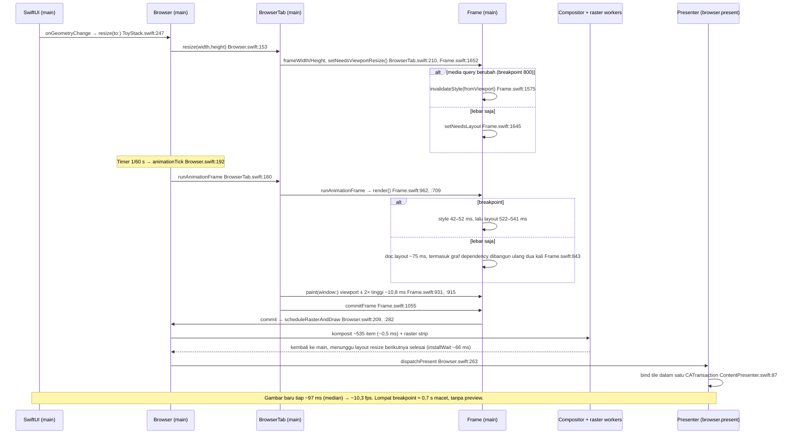
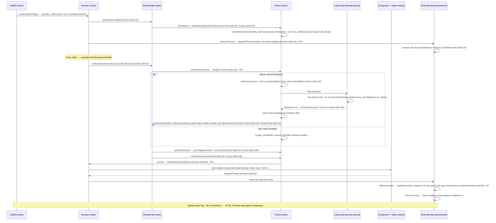

# Resize Flow: bbee952 → HEAD (1072def)

Rentang: `bbee952 perf(resize-window-phase11): paint only what the viewport shows` sampai `1072def docs: remove issues` (255 commit).
Data ukur: `browser.trace-mid` (build bbee952) dan `browser.trace-fast` (build HEAD).

Kedua trace dicocokkan ke commit lewat nama event: `paint.nodes.culled` dan `raster.composite.flatten` hanya ada di `trace-mid`, sedangkan `layout.async.start`, `view.presentation`, dan `view.staging` hanya ada di `trace-fast`. Dua trace ini sama dengan yang dipakai di [resize-flow-d653b1a-to-bbee952.md](./resize-flow-d653b1a-to-bbee952.md) dan [resize-flow-d653b1a-to-head.md](./resize-flow-d653b1a-to-head.md).

## 1. Ringkasan

| | bbee952 (`trace-mid`) | HEAD (`trace-fast`) |
|---|---|---|
| Halaman | halaman besar, 1.773 blok | halaman besar yang sama, 1.773 blok |
| Lebar yang dilewati saat drag | 1387 → 465 → 1440 → 489 → 1440 (melewati breakpoint 800 empat kali) | 1415 → 424 → 969 → 1440 (melewati breakpoint 800 dua kali) |
| Event resize yang sampai ke engine | 90 event dalam 14,8 detik (~6 per detik) | 268 event dalam 4,8 detik drag aktif (~55 per detik) |
| Tempat layout | main thread | thread `browser.layout` |
| Layout per resize | median 75 ms (main) | median 16 ms (thread lain) |
| Resize → gambar baru tampil | median 155 ms (p90 200 ms, maks 700 ms) | median 38 ms (p90 54 ms, maks 108 ms) |
| **Konten baru di layar** | **~10,3 fps** | **~47 fps** |

Commit bbee952 mencapai **~10,3 fps** untuk konten baru selama window di-drag di halaman besar. Itu ~42× lebih cepat dari d653b1a (~0,24 fps), tapi baru ~17% dari target 60 fps.

HEAD mencapai **~47 fps**, kira-kira **4,5× lebih cepat** dari bbee952. Kalau kedua trace dihitung dengan metode yang persis sama, rasionya **5,3–5,5×** (lihat §2).

## 2. Cara menghitung fps

"fps" di sini artinya **berapa kali per detik gambar halaman yang benar-benar baru (hasil layout lebar baru) muncul di layar**. Gambar lama yang hanya diskalakan (preview di HEAD) tidak dihitung.

- **bbee952**: layout masih sinkron di main thread. Satu frame dengan `BrowserTab.layout` dan `layout.visited.count > 0` = satu gambar baru, dan gambar itu tampil saat `present.main` untuk frame itu jalan. 87 gambar baru, jarak antar `present.main` median 96,8 ms → **10,3 fps**.
- **HEAD**: layout jalan di thread lain, dan tile gambar baru di-upload bertahap. Gambar baru dianggap tampil saat counter `view.staging` punya `completed = 1`. 226 gambar dalam 4,83 detik drag aktif → **46,8 fps**.
- Segmen drag dipisah kalau jarak antar `BrowserTab.resize` > 300 ms.

Dua angka di atas memakai metode yang sedikit berbeda (median jarak vs jumlah per durasi). Dengan metode yang sama untuk kedua trace:

| Metode | bbee952 | HEAD | Rasio |
|---|---:|---:|---:|
| Median jarak antar gambar baru | 96,8 ms → 10,3 fps | 18,4 ms → 54,4 fps | 5,3× |
| Jumlah gambar / durasi segmen drag | 60 / 7,0 s → 8,6 fps | 226 / 4,83 s → 46,8 fps | 5,5× |

Metode segmen merugikan bbee952: main thread yang terblokir membuat event resize datang dengan jeda > 300 ms (p90 jarak resize 507 ms, lompat breakpoint ~0,7 s), sehingga sebagian drag aktif terpotong keluar dari segmen. Karena itu ringkasan memakai angka per-trace yang sudah dipakai di dua dokumen sebelumnya (10,3 dan ~47), dan rasio ~4,5× adalah batas bawah.

"Resize → gambar baru tampil":
- bbee952: dari `BrowserTab.resize` ke `present.main` frame layout pertama yang mulai setelah event itu.
- HEAD: dari `BrowserTab.resize` ke `layout.async.start` berikutnya → `layout.async.document` → `layout.async.finish` → `view.staging completed = 1` pertama sesudahnya.

Skrip analisis: parse `traceEvents`, pasangkan `B`/`E` per `tid` dan nama, kelompokkan per `args.frame`, lalu hitung hanya setelah halaman besar dimuat (`BrowserTab.load` kedua). Tidak ada kode engine yang diubah.

## 3. Biaya per tahap (dari trace)

### Per gambar baru, selama drag

| Tahap | Thread | bbee952 median (p90) | HEAD median (p90) |
|---|---|---:|---:|
| Mulai job layout (`layout.async.start`) | main | – | 0,04 ms (0,06) |
| Layout | bbee952: main, HEAD: `browser.layout` | 75,5 ms (88,8) | 16,0 ms (19,7) |
| ↳ yang tercatat di `layout.visit.us` | sama | 29,6 ms | 11,2 ms |
| Pasang hasil layout (`layout.async.finish`) | main | – | 0,04 ms (0,05) |
| Paint | main | 10,8 ms (11,3) | 4,9 ms (5,5) |
| `raster.plan` | compositor | 0,9 ms (1,1) | 0,8 ms (1,7) |
| `raster.composite` | compositor | 0,53 ms | 0,03 ms |
| `raster.installWait` (raster selesai → main sempat present) | main | 65,7 ms (92,7) | 0,05 ms (0,9) |
| `view.commit` | browser.present | 0,13 ms (25,2) | 0,14 ms (0,31) |
| **Main thread sibuk per gambar** | main | **~86 ms** (layout + paint) | **~5 ms** (start + finish + paint) |
| Jarak antar gambar baru di layar | – | 96,8 ms (583) | 18,4 ms (32,4) |

### Saat melewati breakpoint 800 px

| Tahap | bbee952 (4×) | HEAD (2×) |
|---|---:|---:|
| Style | 42–52 ms | 10,2–10,9 ms |
| Layout | 522–541 ms (main) | 34,5–35,9 ms (thread lain) |
| Efek di layar | jeda ~0,7 s, window macet | preview tetap jalan, gambar baru ~2 frame display kemudian |

### Counter per resize (frame biasa, median)

| Counter | bbee952 | HEAD |
|---|---:|---:|
| `layout.visited.count` | 1.773 | 1.773 |
| `layout.text.count` | 0 | 0 |
| `text.measureCalls.count` | 11 | 11 |
| `layout.inline.place.count` | 128 | 60 |
| `layout.inline.place.us` | 16,4 ms | 6,4 ms |
| `layout.line.place.us` | 13,5 ms | 1,2 ms |
| `layout.field.set.count` | ~23.000 | ~9.600 |
| `layout.field.mark.count` | ~9.700 | ~10.600 |
| `paint.nodes.count` | 2.380 (2.911 di-cull) | 1.884 (dilewati saat scene dibangun) |
| `paint.own.items.count` | 535 | 282 |

Catatan:
- Di bbee952, `BrowserTab.layout` 75 ms tapi `layout.visit.us` hanya ~30 ms. Selisih ~45 ms sebagian besar adalah pembangunan ulang graf dependency dua kali per resize, yang dihapus di `4e70cfb` dan `750f5b1` (§4.A). [INFERENCE — dari isi commit, trace bbee952 tidak punya counter untuk bagian itu.]
- `layout.field.mark.count` sedikit naik di HEAD. Penurunan waktu bukan dari jumlah mark, tapi dari biaya tiap tulis/baca (§4.B) dan dari baris yang dilewati (`layout.inline.place.count` 128 → 60).
- 238 dari 243 job layout di HEAD memakai ulang input layout lama (`layout.inputs.decision.reused = 1`), dan 204 dari 243 selesai untuk lebar yang sudah lewat (`layout.async.superseded`), tapi tetap dipasang dan ditampilkan.

## 4. Daftar optimasi resize bbee952 → HEAD

Dikelompokkan per tahap pipeline. Sekitar 70 commit refactor (`b90fc8f` … `432df5f`: display list jadi data, DOM dan layout di arena, frame state per pemilik, raster payload aman dikirim, layout di value tree) tidak dicatat satu per satu. Refactor itulah yang membuat layout bisa dipindah ke thread lain (§4.F). Commit docs dan test juga tidak dicatat.

### A. Graf dependency tidak dibangun ulang

| Commit | Efek |
|---|---|
| `4e70cfb` | Graf dependency tidak dibangun ulang di awal **dan** akhir layout. Rebuild di awal dibuang. |
| `750f5b1` | Graf diperbarui hanya di link yang berubah. Layout halaman besar ~130 ms → ~33 ms, konten 5,5 → 11,5 fps. |
| `32bd028` | Reindex anak hanya kalau daftar anak berubah, dan edge dihapus sekaligus. Mengurangi biaya lompat breakpoint yang hampir 1 detik. |
| `00ce844`, `150592c`, `dbf6557`, `30662d2` | Edge dependency diperbarui lewat selisih (diff), tidak dihapus lalu dibuat ulang. |
| `e81e8cb` | Perubahan font-size tidak me-reindex 12.012 edge (93,5 → 5,5 ms). |
| `3295672` | Teks yang pindah baris hanya mengganti edge zoom ke parent baru, bukan reindex penuh. |
| `61de3c6` | Layout membaca daftar style yang berubah langsung, tanpa scan seluruh dokumen. |

### B. Layout per node lebih murah

| Commit | Efek |
|---|---|
| `ad03248` | Node baris dipakai ulang saat reflow. |
| `0b65023`, `1389680`, `b397f10`, `e974bf1`, `6496cff`, `56970e5` | Satu kali tulis per node, bukan beberapa setter terpisah. |
| `23bedc2` | Font teks yang tidak berubah tidak ditulis ulang. |
| `23991e7` | Indeks objek inline ditulis sekali per blok, bukan sekali per kata. |
| `44eee58`, `2e7791a` | Posisi x dan y anak baris dihitung dalam satu putaran. |
| `80d632c` | Profiler tidak membuka span per kata. Reuse baris memakai key indeks awal + jumlah, bukan hash seluruh rentang. |
| `2a8772c` | Resize lebar saja tidak membangun ulang input layout (hemat 12–25 ms). |
| `5f614f8`, `61abb3d` | Baris dengan rentang kata yang sama dipakai ulang. Baris yang hanya bergeser tidak di-layout ulang. |
| `b91094a`, `1e0a2e3`, `3689eb9` | Satu fragmen per run font. Run teks dibagi bersama antar fragmen baris. |
| `4daa6f5` | Teks baris disimpan sebagai nilai, jadi reflow tidak membuat node teks. |
| `410fed0` | Node dibaca/ditulis di tempat, tanpa menyalin 413 byte per akses. Layout ~½ waktu. |
| `4c60f53` | Baris yang hanya turun tidak membangun ulang kotak teks. |
| `af8773d` | Titik putus baris disimpan bersama rentang lebar yang masih cocok. Hanya ~41 dari 1.407 paragraf yang dihitung ulang. |
| `15f3171` | Node yang dibuang dibebaskan tanpa menelusuri seluruh pohon. |
| `3a499ae` | Profiler cukup murah untuk tetap menyala selama layout. |

Hasil gabungan di trace: `layout.visit.us` 29,6 → 11,2 ms, `layout.line.place.us` 13,5 → 1,2 ms, `layout.inline.place.us` 16,4 → 6,4 ms.

### C. Lompat breakpoint (font-size berubah)

| Commit | Efek |
|---|---|
| `6e755ff` | Anak blok hanya bergantung ke `display`/`position` anak langsung, jadi ID blok dan cache-nya bertahan. Layout breakpoint 770 → 565 ms. |
| `1cf7c04` | Objek text layout dipakai ulang kalau hanya ukuran font yang berubah. 565 → 423 ms. |
| `5b417ef` | Item inline diperbarui di tempat, tanpa memecah ulang kata. |
| `5766b2c` | Font di-resolve sekali per node DOM, bukan sekali per kata. |
| `eadaaeb` | Rencana baris dipakai ulang setelah font-size berubah. |
| `24658d2`, `3982e69` | Kata tidak diukur dua kali. Lebar kata diskalakan saat hanya ukuran font yang berubah. |
| `2d7e8c6` | Hanya subtree yang terkena media query yang di-restyle. |
| `eff320a`, `2f2d06b`, `9bea78c`, `8c3fd35`, `fa92df9`, `2576e7f`, `d118f90` | Pewarisan teks tidak menjalankan cascade penuh, dan berhenti di subtree yang tidak berubah. |
| `56dd642`, `8a15adc`, `cd44c70` | Snapshot DOM dibuat sekali dan disimpan sampai DOM berubah. |
| `da766df` | Spike style saat resize 37 → 17 ms. |
| `eb2307a` | Satu event trace per tag, bukan per node. |
| `2b028bb` | Mengurangi biaya breakpoint per node. |

Hasil gabungan di trace: style 42–52 → 10,2–10,9 ms, layout breakpoint 522–541 ms → 34,5–35,9 ms.

### D. Paint

| Commit | Efek |
|---|---|
| `5cf3c8e` | Node di luar jendela paint tidak disalin ke scene sama sekali, bukan dibuang belakangan. `paint.nodes.culled` 2.911 → 0, paint 10,8 → 4,9 ms. |
| `73b02ef` | Cache paint per blok/baris, bukan satu epoch global. |
| `91ca9cc` | Restyle yang hanya mengubah warna tidak menjalankan layout. |

### E. Raster dan komposit

| Commit | Efek |
|---|---|
| `268660e` | Layer tidak dikomposit ulang kalau display list tidak berubah. Halaman tanpa efek memakai satu layer. `raster.composite` 0,53 → 0,03 ms. |
| `8d2f139` | Tile dilukis langsung di color space layar. `view.commit` p90 25 → 0,3 ms. |

### F. Layout di thread terpisah

| Commit | Efek |
|---|---|
| `fe876e2` (+ `23a3d79`, `ef7a788`, `23cd67a`) | Layout pindah dari main thread ke `Task.detached`. Pohon lama tetap tampil sampai pohon baru dipasang. |
| `534410b` | Layout untuk lebar terbaru dimulai selama drag, tidak menunggu pointer berhenti. Satu job berjalan sekaligus. |
| `6c712b0`, `fa05723`, `059babd` | Hasil layout untuk lebar yang salah atau usang ditangani dengan benar. |
| `2071d29` → `e259535` | Pertama: job usang dibatalkan. Lalu diganti: job usang **tetap diselesaikan dan dipasang**, lalu lebar terbaru di-layout berikutnya. Sebelumnya 963 dari 1.013 layout dibuang. |
| `00a48a5`, `8775ddc`, `93caefb` | Job lebar saja memakai ulang input (main thread ~8 ms → ~0,04 ms). |
| `9ac37fe` | Job mengambil alih pohon lewat handoff, tanpa menyalin seluruh pohon atau indeks dependency. |
| `ac0b3ee` | Begitu layout dipasang, paint + commit langsung jalan tanpa menunggu tick 60 Hz. |
| `a8fc4b1` | Pohon lama dibebaskan di thread lain. |
| `044c41c` (+ `9da851c`) | Install tidak memindai ulang scroll box kalau revisinya sama. |
| `bd8c3f6`, `c6ba71d`, `899d131` | Perbaikan kebenaran: edit DOM selama job tetap diterapkan, teks lama tidak di-paint, baris yang hanya bergeser tetap punya teks. |

Efek di trace: `raster.installWait` median 65,7 → 0,05 ms, karena main thread tidak lagi sibuk layout saat raster selesai. Main thread per gambar ~86 ms → ~5 ms.

### G. Preview selama drag

| Commit | Efek |
|---|---|
| `2977a4b` | Frame terakhir dipertahankan dan diskalakan selama layout belum selesai. |
| `7344d1c`, `2dac1bc` | Preview stabil, dan tidak meregangkan teks. |
| `9ec5654` | Preview dikirim langsung dari event resize, tidak menunggu tick. |
| `12fe79d`, `e94e82d` | Preview digabung jadi satu per frame display. |
| `902d829`, `f825de1`, `d1a0c72`, `15c0086`, `d2b50a6`, `77ec7a2`, `6a44867`, `a0c22a9` | Ukuran dan posisi preview benar (skala, zoom, scroll, garis tile). |

Preview tidak dihitung sebagai fps, tapi itulah sebabnya AppKit bisa mengirim ~55 event resize per detik di HEAD (bbee952: ~6 per detik).

### H. Upload tile ke layar

| Commit | Efek |
|---|---|
| `9ed0800`, `fe683d5` | Generasi tile baru di-upload bertahap ke layer tersembunyi (2 MP per present), lalu ditukar sekaligus. |
| `f7ebba0` → `60c5b68` | Tile 256 px dicoba lalu dibatalkan: jumlah layer turun, tapi pixel yang di-upload naik dan commit makin lambat. |
| `aacdef7` | Upload yang sudah mulai selalu diselesaikan. Hanya generasi terbaru yang mengantre. |
| `7802ab7` | Layout yang lebih baru dari yang tampil selalu di-upload, walaupun lebarnya tidak sama persis (5–10 → ~29 kali/detik). |
| `1e312b9`, `6483f3e` | Setelah drag berhenti, upload yang usang dibuang dan window tetap terisi. |
| `53033a1`, `92bfbbd` | Jeda antar langkah upload 23 → 17 ms. Budget 2× setelah drag berhenti. |
| `24cceaf`, `3ae25e3`, `550d00b` | Budget upload saat scroll (berpengaruh ke resize lewat aturan batch). |

## 5. Diagram resize flow — bbee952

Semua tahap berat masih sinkron di **main thread**, dipicu timer 60 Hz. Nomor baris mengacu ke kode di commit bbee952.

## 6. Diagram resize flow — HEAD

Main thread hanya menerima event, mengirim preview, memulai/memasang job layout, dan paint bagian yang terlihat. Layout berjalan di `browser.layout`. Tile di-upload bertahap oleh presenter.

## 7. Perbedaan utama

| Aspek | bbee952 | HEAD |
|---|---|---|
| Tempat layout | main thread | thread `browser.layout` |
| Biaya layout halaman besar | ~75 ms | ~16 ms |
| Graf dependency per resize | dibangun ulang dua kali | diperbarui per selisih |
| Lompat breakpoint 800 px | style ~47 ms + layout ~530 ms, window macet ~0,7 s | style ~10,5 ms + layout ~35 ms di thread lain |
| Main thread per gambar baru | ~86 ms (layout + paint) | ~5 ms (sebagian besar paint) |
| Paint | node di luar jendela dibangun lalu dibuang, ~10,8 ms | node di luar jendela tidak dibangun, ~4,9 ms |
| Komposit | ~0,5 ms | ~0,03 ms (satu layer, dipakai ulang) |
| Raster selesai → present | menunggu layout berikutnya (~66 ms) | langsung (~0,05 ms) |
| Saat layout belum selesai | window macet | preview gambar lama yang diskalakan |
| Upload tile | semua dalam satu commit (`view.commit` p90 25 ms) | bertahap 2 MP per present, tukar sekaligus (p90 0,3 ms) |
| Event resize yang diterima | ~6 per detik | ~55 per detik |
| **Konten baru** | **~10,3 fps** | **~47 fps** |

## 8. Yang membatasi HEAD di bawah 60 fps

Dari `trace-fast`:

1. **Layout job ~16 ms** (median), hampir satu frame display (16,7 ms). `p90` 19,7 ms dan maks 36 ms (saat breakpoint). Job berikutnya baru mulai setelah job ini dipasang.
2. **Paint ~4,9 ms di main** setelah install, ditambah raster ~3,8 ms, sebelum tile bisa mulai di-upload.
3. **Upload bertahap**: jarak antar gambar baru p90 32 ms, artinya sebagian gambar butuh dua frame display untuk selesai di-upload.

Angka di atas diukur dengan profiler menyala. `9ac37fe` mencatat layout di thread latar 14,7 ms dengan profiler vs 8,6 ms tanpa profiler, jadi fps tanpa profiler kemungkinan lebih tinggi. [INFERENCE — tidak diukur di trace ini.]

## 9. Batasan perbandingan

- Dua trace berasal dari sesi drag yang berbeda (gerakan tangan, durasi, dan jalur lebar tidak sama). Keduanya di halaman 1.773 blok yang sama dan sama-sama melewati breakpoint 800 px (bbee952 4×, HEAD 2×).
- Di bbee952, sedikitnya event resize (~6 per detik) adalah **akibat** main thread yang terblokir ~86 ms per gambar, bukan karena drag-nya pelan. AppKit menggabungkan event saat main thread sibuk.
- fps bbee952 dan HEAD dihitung dengan definisi "tampil" yang berbeda (`present.main` vs `view.staging completed = 1`), karena bbee952 belum punya upload bertahap. Keduanya menandai saat gambar dari layout baru sudah lengkap di layer yang terlihat.
- Rasio 4,5× memakai angka per-trace dari dua dokumen sebelumnya. Dengan metode yang sama rasionya 5,3–5,5× (§2).
- Semua angka diukur dengan profiler menyala.
