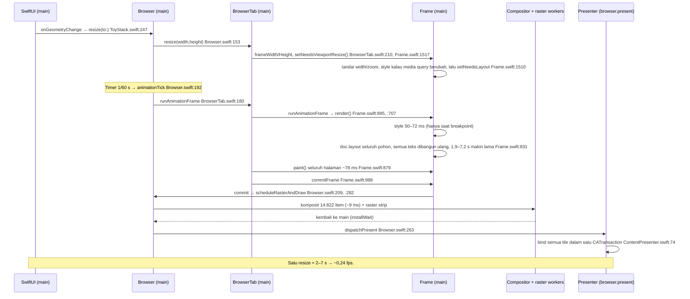
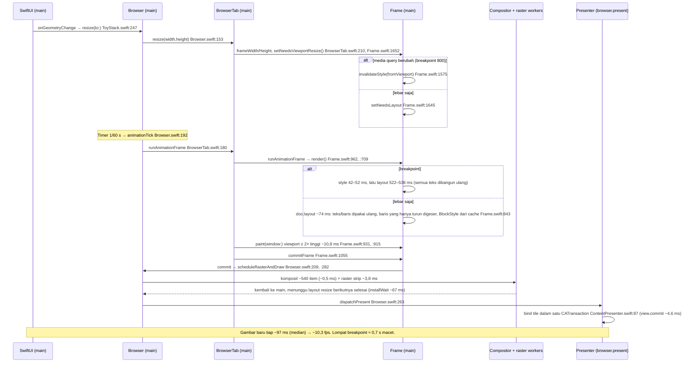

# Resize Flow: d653b1a → bbee952

Rentang: `d653b1a perf(exercise-16-9): optimizing protected field` sampai `bbee952 perf(resize-window-phase11): paint only what the viewport shows` (15 commit, 11 di antaranya optimasi resize phase 1–11).
Data ukur: `browser.trace-slow` (build d653b1a) dan `browser.trace-mid` (build bbee952).

Kedua trace dicocokkan ke commit lewat nama counter: `layout.block.style.cache.*` (phase10), `layout.line.place.verticalOnly` (phase9), dan `paint.nodes.culled` (phase11) hanya ada di `trace-mid`. `trace-slow` adalah trace yang sama dengan yang dipakai di [resize-flow-d653b1a-to-head.md](./resize-flow-d653b1a-to-head.md).

## 1. Ringkasan

| | d653b1a (`trace-slow`) | bbee952 (`trace-mid`) |
|---|---|---|
| Halaman | halaman besar, 1.773 blok | halaman besar yang sama, 1.773 blok |
| Lebar yang dilewati saat drag | 1396 → 366 → 1430 (melewati breakpoint 800) | 1387 → 465 → 1440 → 489 → 1440 (melewati breakpoint 800 empat kali) |
| Event resize yang sampai ke engine | 8 event dalam ~29 detik | 90 event dalam 14,8 detik (~6 per detik) |
| Waktu satu resize sampai tampil | 1,97–7,41 detik, median ~4,1 detik | median 158 ms (p90 200 ms, maks 700 ms) |
| **Konten baru di layar** | **~0,24 fps** | **~10,3 fps** |
| Layout per resize (main thread) | 1,9–7,2 s, makin lama | median 74 ms, stabil |

Commit bbee952 mencapai **~10,3 fps** untuk konten baru selama window di-drag di halaman besar. Itu kira-kira **42× lebih cepat** dibanding d653b1a (~0,24 fps), tapi baru ~17% dari target 60 fps.

Di halaman kecil (113 blok) naiknya dari **~17 fps** ke **~58 fps** (~3,3×), lihat §3.

## 2. Cara menghitung fps

"fps" di sini artinya **berapa kali per detik gambar halaman yang benar-benar baru (hasil layout lebar baru) muncul di layar**.

- Di kedua commit, layout masih jalan **sinkron di main thread**. Jadi satu frame dengan `BrowserTab.layout` (dan `layout.visited.count > 0`) = satu gambar baru. Gambar itu dianggap tampil saat `present.main` untuk frame itu jalan.
- **d653b1a**: jarak antar event resize: 1960, 2434, 4100, 4973, 4094, 6172, 5078 ms → median 4100 ms → **0,24 fps**. Kalau dihitung dari jarak antar `present.main`, median 4562 ms → 0,22 fps.
- **bbee952**: 86 gambar baru dari 90 event resize. Jarak antar `present.main` median 96,8 ms → **10,3 fps**. Jarak antar event resize median 96,2 ms → 10,4 fps, jadi kedua cara cocok.
- Rasio: 10,3 / 0,24 ≈ **42×** (cara jarak resize) atau 10,3 / 0,22 ≈ 47× (cara jarak present). Angka yang dipakai di ringkasan adalah yang lebih rendah.
- Angka lain untuk bbee952: kalau hanya jarak < 300 ms yang dihitung (drag aktif, tanpa jeda tangan dan tanpa lompatan breakpoint), 74 jarak → **11,2 fps**. Kalau seluruh 14,9 detik dihitung termasuk jeda tangan → 5,8 fps. Angka terakhir ini dipengaruhi gerakan tangan, jadi tidak dipakai.

Skrip analisis: parse `traceEvents`, pasangkan `B`/`E` per `tid` dan nama, kelompokkan per `args.frame`, lalu hitung per frame layout. Tidak ada kode engine yang diubah.

## 3. Biaya per tahap (dari trace)

### d653b1a — halaman besar, per resize

| Lebar | Style | Layout (main) | Paint (main) | Resize → layar |
|---:|---:|---:|---:|---:|
| 1396 | – | 1.870 ms | 77 ms | 1.970 ms |
| 989 | – | 2.329 ms | 78 ms | 2.436 ms |
| 499 | 53 ms | 3.893 ms | 79 ms | 4.098 ms |
| 366 | – | 3.469 ms | 79 ms | 3.668 ms |
| 386 | – | 3.987 ms | 80 ms | 4.091 ms |
| 742 | – | 4.460 ms | 79 ms | 4.558 ms |
| 768 | – | 4.981 ms | 78 ms | 5.088 ms |
| 1430 | 72 ms | 7.178 ms | 79 ms | 7.414 ms |

"Resize → layar" = dari `BrowserTab.resize` sampai `present.main` frame itu.

Jumlah kerja tiap resize sama persis, tapi waktunya terus naik:

| Counter (per resize) | d653b1a |
|---|---:|
| `layout.text.count` (TextLayout dibangun ulang) | 14.775 |
| `text.measureCalls.count` | 59.107 |
| `text.font.count` | 23.620 |
| `layout.inline.refresh.count` | 1.572 |
| `layout.field.set.count` / `field.mark.count` | ~142.000 / ~42.000 |
| `layout.text.us` | 0,59 → 2,10 s (naik terus) |
| `paint.nodes.count` / `paint.own.items.count` | ~19.550 / 14.822 |
| `raster.composite` (compositor) | ~9 ms (karena 14.822 item) |

Di luar resize, ada 6 restyle karena hover yang masing-masing ~96–104 ms style + ~78 ms paint (frame 141, 148, 172, 186, 193, 202). Waktu itu ikut memblokir main thread.

### bbee952 — halaman besar, seluruh drag

82 frame biasa + 4 frame yang melewati breakpoint 800 px.

| Tahap | Thread | Median | p90 | Maks |
|---|---|---:|---:|---:|
| Layout (`BrowserTab.layout`) | main | 73,8 ms | 86,6 ms | 109,5 ms |
| ↳ yang tercatat di `layout.visit.us` | main | 29,6 ms | 34,8 ms | 43,3 ms |
| Paint (hanya sekitar viewport) | main | 10,8 ms | 11,3 ms | 12,6 ms |
| `raster.plan` | compositor | 0,9 ms | 1,1 ms | 1,2 ms |
| Raster strip (rentang semua worker) | worker | 3,8 ms | 6,2 ms | 9,7 ms |
| `raster.installWait` (raster selesai → main sempat present) | main | 66,9 ms | 92,7 ms | 590 ms |
| `view.commit` | browser.present | 4,6 ms | 25,9 ms | 38,1 ms |
| Jarak antar gambar baru di layar | – | 96,8 ms | 583 ms | 1.273 ms |
| Resize → layar | – | 158 ms | 200 ms | 700 ms |

Frame yang melewati breakpoint 800 px (840→710, 786→979, 830→774, 746→835):

| Tahap | Nilai |
|---|---:|
| Style | 42–52 ms |
| Layout | 522–538 ms (`layout.visit.us` 324–337 ms) |
| Resize → layar | 709–730 ms |

Counter per resize, dibanding d653b1a:

| Counter | d653b1a | bbee952 (frame biasa, median) | bbee952 (breakpoint) |
|---|---:|---:|---:|
| `layout.text.count` | 14.775 | **0** | 14.775 |
| `text.measureCalls.count` | 59.107 | **11** | 29.550 |
| `text.font.count` | 23.620 | **7** | 8.845 |
| `layout.inline.refresh.count` | 1.572 | **0** | 1.572 |
| `layout.inline.place.count` | 1.572 | **128** | 1.572 |
| `layout.inline.place.us` | 0,78–2,62 s | **16 ms** | 173 ms |
| `layout.field.set.count` | ~142.000 | **~23.000** | ~131.000 |
| `layout.field.mark.count` | ~42.000 | **~9.700** | ~44.000 |
| `layout.line.place.us` | ~118 ms | **13,5 ms** | 30 ms |
| `layout.line.place.verticalOnly.count` | – | 1.571 | 0 |
| `layout.block.style.cache.hit.count` | – | 5.112 (miss 0) | 3.339 (miss 1.773) |
| `paint.nodes.count` | ~19.550 | **2.397** (2.943 di-cull) | ~2.630 |
| `paint.own.items.count` | 14.822 | **540** | ~780 |
| `raster.composite` | ~9 ms | **0,5 ms** | – |

Restyle karena hover di bbee952 hanya 0,3–0,7 ms style + 6–11 ms paint (frame 95–102, 235–243).

### Halaman kecil (113 blok), awal kedua trace

| | d653b1a | bbee952 |
|---|---:|---:|
| Layout per resize | 41–53 ms (naik terus) | 2,0–8,6 ms |
| Paint per resize | 2,6–3,6 ms | 0,7–1,9 ms |
| Jarak antar gambar baru (median) | 58 ms | 17,4 ms |
| **fps** | **~17** | **~58** |

## 4. Daftar optimasi resize d653b1a → bbee952

Semua optimasi di rentang ini masih **di main thread**. Belum ada layout di thread lain, belum ada preview. Commit non-kode (`54656d8`, `8e7b784`, `f328f0c` docs, `e1145cc` refactor) tidak dicatat.

### A. Resize tidak lagi makin lambat

| Commit | Efek | Bukti di trace |
|---|---|---|
| `8ee3097` phase1 | Ref dependency yang sudah mati dibersihkan, dan back-reference parent/DOM dibuat `weak`. Sebelumnya tiap resize menumpuk ref mati di `StyleFields.dependents`, jadi setiap baca style makin lama (O(frame²)). | d653b1a: layout 1,87 → 7,18 s dengan counter yang sama persis. bbee952: layout median 74 ms tanpa tren naik dari awal sampai akhir drag. |
| `cd99818` phase4 | Daftar dependency diganti registry dengan key (`FieldDependencyKey`), jadi tidak ada scan linear dan copy-on-write tiap kali edge didaftarkan. Lebar tidak lagi memicu pendaftaran ulang semua edge. | `layout.field.mark.count` ~42.000 → ~9.700 (gabungan dengan phase 8). |

### B. Layout teks tidak dibangun ulang

| Commit | Efek | Bukti di trace |
|---|---|---|
| `7242526` phase2 | Lebar bukan lagi input dari isi inline (`inlineContentInputs`, `BlockLayout.swift:96` di bbee952). Resize lebar saja tidak memecah ulang teks menjadi kata. | `layout.inline.refresh.count` 1.572 → 0. |
| `2746be6` phase3 | Objek `LineLayout`/`TextLayout`/embed dipakai ulang, tidak dibuang lalu dibuat ulang tiap resize. | `layout.text.count` 14.775 → 0, `text.measureCalls` 59.107 → 11, `text.font.count` 23.620 → 7. |

### C. Biaya per node layout lebih murah

| Commit | Efek | Bukti di trace |
|---|---|---|
| `21fe9bc` phase6 | `LayoutFieldStore` tidak disalin setiap kali dibaca, cek dependency khusus debug tidak jalan di release, dan kerja string/ukur per kata di rencana baris dihapus. Bench: layout 215 → 110 ms. | Masuk ke `layout.visit.us` ~2,3 s → ~30 ms (gabungan). |
| `a2b6ccc` phase7 | Penempatan inline lebih murah: edge dihapus di tempat, tidak detach dari baris yang dibuang, satu kali assign `children` per baris, lebar spasi di-cache (`InlinePlacement`). Bench: 324 → 264 ms. | `layout.inline.place.us` 0,78–2,62 s → 16 ms (gabungan). |
| `e21786b` phase8 | Field layout dibaca/ditulis lewat `LayoutFieldValue` (switch per field) tanpa key path dan closure per akses. Posisi x kata dipegang oleh barisnya, jadi tiap kata tinggal punya 2 edge, bukan 8. | `layout.field.mark.count` ~42.000 → ~9.700. |
| `8bafcef` phase9 | Baris yang tidak berubah dilewati. Baris yang hanya bergeser ke bawah cukup menyimpan `inlineYOffset`, tidak menempatkan ulang anak-anaknya (`LineLayout.swift:52`). | `verticalOnly` 1.571 per resize, `layout.line.place.us` ~118 → 13,5 ms. |
| `269fa4e` phase10 | Style blok (`display`, `position`, padding, margin, …) di-parse sekali ke `BlockStyle` lalu dipakai ulang, tidak di-parse dari string tiap resize. | `layout.block.style.cache.hit` 5.112, miss 0 di frame biasa. |

### D. Style dan paint

| Commit | Efek | Bukti di trace |
|---|---|---|
| `1bb7106` phase5 | Hover hanya restyle elemen yang kena (`RuleIndex` tahu selector hover mana yang menyentuh turunan). `paintEpoch` hanya naik kalau properti yang memengaruhi gambar berubah, jadi cache paint per baris tetap terpakai. | Restyle hover ~100 ms + paint 78 ms → 0,3–0,7 ms + 6–11 ms. `paint.cache.hit.lines` 0 → ~77 per resize. |
| `bbee952` phase11 | Paint hanya baris/teks yang masuk jendela viewport ± 2× tinggi window (`PaintWindow`, `PaintTree.swift`). Kalau scroll keluar jendela itu, `repaintForScroll` paint ulang. | `paint.nodes` ~19.550 → 2.397 (2.943 di-cull), item 14.822 → 540, paint 78 → 10,8 ms. Display list kecil juga membuat `raster.composite` ~9 → 0,5 ms. |

## 5. Diagram resize flow — d653b1a

Semua tahap berat jalan berurutan di **main thread**. Selama layout berjalan, AppKit tidak bisa mengirim event resize berikutnya, sehingga hanya 8 event yang sampai dalam ~29 detik.

## 6. Diagram resize flow — bbee952

Alurnya **sama** dengan d653b1a: semua masih sinkron di main thread, dipicu timer 60 Hz. Yang berubah adalah biaya tiap kotak. Nomor baris di bawah mengacu ke kode di commit bbee952.

## 7. Perbedaan utama

| Aspek | d653b1a | bbee952 |
|---|---|---|
| Tempat layout | main thread | main thread (belum berubah) |
| Biaya layout halaman besar | 1,9–7,2 s, makin lama | ~74 ms, stabil |
| Teks saat resize lebar saja | 14.775 kata dibangun ulang, 59.107 ukur | tidak dibangun ulang, 11 ukur |
| Baris yang hanya turun | ditempatkan ulang | digeser saja (`inlineYOffset`) |
| Style blok | di-parse dari string tiap resize | `BlockStyle` dari cache |
| Paint | seluruh halaman, ~78 ms, 14.822 item | viewport ± 2× tinggi, ~10,8 ms, ~540 item |
| Komposit | ~9 ms | ~0,5 ms |
| Restyle karena hover | ~100 ms style + ~78 ms paint | ~0,5 ms style + 6–11 ms paint |
| Lompat breakpoint 800 px | sama mahalnya dengan resize biasa (semuanya mahal) | ~0,7 s, jauh lebih mahal dari resize biasa |
| Event resize yang diterima | 8 dalam ~29 s | ~6 per detik |

## 8. Yang membatasi bbee952 di ~10 fps

Dari `trace-mid`:

1. **Layout masih di main thread, ~74 ms per resize.** Main thread butuh layout ~74 ms + paint ~11 ms ≈ 85 ms per gambar, jadi batas atasnya ~11–12 fps. Angka terukur 10,3–11,2 fps sudah dekat batas itu.
2. **Sebagian besar waktu layout tidak punya counter.** `BrowserTab.layout` 74 ms, tapi `layout.visit.us` hanya ~30 ms. Sisa ~44 ms ada di dalam `doc.layout` (`Frame.swift:843`), dan trace tidak bisa menunjukkan bagian mana. [INFERENCE — perlu profiler tambahan atau `sample` untuk memastikan.]
3. **Gambar tampil terlambat satu layout.** Raster selesai cepat (~4 ms), tapi `present.main` harus menunggu main thread menyelesaikan layout resize berikutnya (`raster.installWait` median 67 ms). Akibatnya resize → layar median 158 ms, walaupun satu frame hanya ~85 ms.
4. **Lompat breakpoint 800 px membangun ulang semua teks.** Perubahan style membuat 14.775 kata, 29.550 ukur, dan 1.773 `BlockStyle` dihitung ulang: style ~47 ms + layout ~530 ms. Terjadi 4× di trace, masing-masing jeda ~0,7 s.
5. **Paint masih mengunjungi semua blok.** Culling hanya untuk baris dan teks. `paint.cache.store.blocks` tetap 1.769 per resize.
6. `view.commit` p90 26 ms (maks 38 ms) di thread present. Tidak memblokir main, tapi ikut menambah jeda sampai gambar terlihat.

Poin 1–4 diselesaikan setelah bbee952 (lihat [resize-flow-d653b1a-to-head.md §4](./resize-flow-d653b1a-to-head.md)): layout pindah ke thread lain (`fe876e2`), restyle breakpoint hanya ke subtree yang kena (`2d7e8c6`), titik putus baris disimpan per paragraf (`af8773d`), dan graf dependency tidak dibangun ulang dua kali (`4e70cfb`, `750f5b1`). Dibanding HEAD (~47 fps), bbee952 masih ~4,5× lebih lambat.

## 9. Batasan perbandingan

- Dua trace berasal dari sesi drag yang berbeda (gerakan tangan, durasi, dan jalur lebar tidak sama). Keduanya di halaman 1.773 blok yang sama dan sama-sama melewati breakpoint 800 px.
- Di d653b1a, sedikitnya event resize adalah **akibat** main thread yang terblokir, bukan karena drag-nya pelan. AppKit menggabungkan event saat main thread sibuk. Hal yang sama masih berlaku di bbee952, hanya dengan blokir ~85 ms, bukan detik.
- d653b1a hanya punya 8 sampel di halaman besar, jadi median 0,24 fps punya sebaran lebar (0,14–0,51 fps).
- Angka phase 4/6/7 yang disebut "bench" berasal dari catatan `plans/issues/resize-flow.md` di commit bbee952 (halaman `www/bench/large.html`), bukan dari dua trace ini.
- Semua angka diukur dengan profiler menyala.
