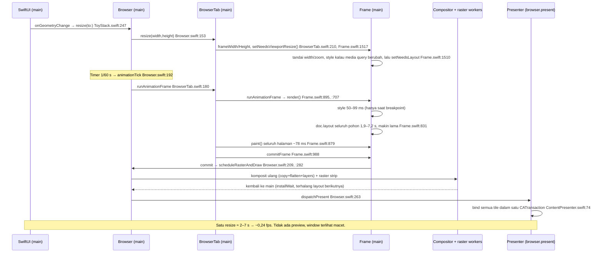
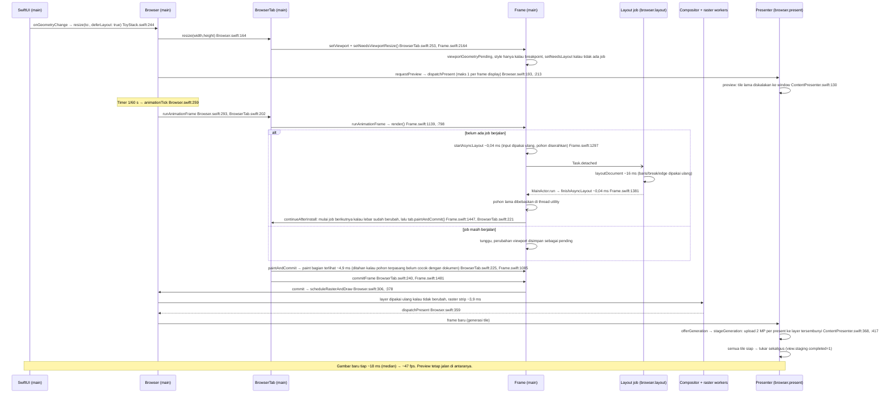

# Resize Flow: d653b1a → HEAD (1072def)

Rentang: `d653b1a perf(exercise-16-9): optimizing protected field` sampai `1072def docs: remove issues` (270 commit).
Data ukur: `browser.trace-slow` (build d653b1a) dan `browser.trace-fast` (build HEAD).

Kedua trace dicocokkan ke commit lewat nama event: `raster.composite.flatten` hanya ada di d653b1a, sedangkan `layout.async.start`, `view.presentation`, dan `view.staging` hanya ada di HEAD.

## 1. Ringkasan

| | d653b1a (`trace-slow`) | HEAD (`trace-fast`) |
|---|---|---|
| Halaman | halaman besar, 1.773 blok | halaman besar yang sama, 1.773 blok |
| Lebar yang dilewati saat drag | 1396 → 366 → 1430 (melewati breakpoint 800) | 1415 → 424 → 969 → 1440 (melewati breakpoint 800) |
| Event resize yang sampai ke engine | 8 event dalam ~36 detik | 268 event dalam 4,8 detik (~55/detik) |
| Waktu satu resize sampai tampil | 1,97–7,34 detik, median ~4,1 detik | median 17,9 ms (p90 33 ms) |
| **Konten baru di layar** | **~0,24 fps** (0,14–0,51) | **~47 fps** (44,6–48,4 per drag) |
| Layout baru selesai | ~0,22 per detik | 48,6 per detik |

Commit terkini mencapai **~47 fps** untuk konten baru selama window di-drag. Itu kira-kira **200× lebih cepat** dibanding d653b1a (~0,24 fps), dan ~78% dari target 60 fps.

## 2. Cara menghitung fps

"fps" di sini artinya **berapa kali per detik gambar halaman yang benar-benar baru (hasil layout lebar baru) muncul di layar**. Gambar lama yang hanya diperbesar atau diperkecil (preview) tidak dihitung.

- **d653b1a**: tiap resize memblokir main thread sampai layout, paint, dan raster selesai. Jadi satu resize = satu frame, dan fps = 1 / jarak antar resize. Jarak antar event: 1960, 2434, 4100, 4973, 4094, 6172, 5078 ms → median 4100 ms → **0,24 fps**.
- **HEAD**: layout jalan di thread terpisah, dan gambar baru dikirim ke layar bertahap. Gambar baru dianggap tampil saat counter `view.staging` punya `completed = 1`. Hasilnya 226 gambar dalam 4,83 detik waktu drag → **46,8 fps**. Untuk pembanding, `layout.async.finish` (layout baru dipasang) = 235 kali → 48,6 per detik.
- Event `present` di HEAD ~198 per detik. Angka ini **bukan** fps, karena presenter juga mengirim present tambahan untuk tiap langkah upload tile ([`ContentPresenter.swift:108`](../Sources/ToyStack/ContentPresenter.swift)).
- Segmen drag dipisah kalau jarak antar `BrowserTab.resize` > 300 ms. HEAD punya 3 segmen: 3,01 s, 1,20 s, dan 0,63 s.

Skrip analisis: parse `traceEvents`, pasangkan `B`/`E` per `tid`, lalu hitung per segmen. Tidak ada kode engine yang diubah.

## 3. Biaya per tahap (dari trace)

### d653b1a — halaman besar, per resize

| Lebar | Style | Layout (main) | Paint (main) | Raster+draw | Resize → layar |
|---:|---:|---:|---:|---:|---:|
| 1396 | – | 1.870 ms | 77 ms | 16 ms | 1.970 ms |
| 989 | – | 2.329 ms | 78 ms | 18 ms | ~2.430 ms |
| 499 | 53 ms | 3.893 ms | 79 ms | 15 ms | ~4.100 ms |
| 366 | – | 3.469 ms | 79 ms | 60 ms | 3.668 ms |
| 386 | – | 3.987 ms | 80 ms | 14 ms | 4.091 ms |
| 742 | 99 ms | 4.460 ms | 79 ms | 16 ms | 4.558 ms |
| 768 | – | 4.981 ms | 78 ms | 15 ms | 5.088 ms |
| 1430 | 71 ms | 7.178 ms | 79 ms | 7.333 ms* | 7.343 ms |

\* Menunggu main thread yang masih sibuk layout (`raster.installWait` 7.327 ms).

Tiap resize **makin lambat**, padahal jumlah kerjanya sama persis (selalu 1.773 blok, 14.775 teks, 59.107 pengukuran teks). `layout.text.us` naik dari 0,37 detik ke 2,10 detik. Penyebabnya adalah bug "resize makin lambat" yang diperbaiki di phase 1 (lihat §4.A).

Paint 78 ms karena seluruh halaman dilukis ulang: 19.332 node, 14.822 item.

### HEAD — halaman besar, seluruh drag

| Tahap | Thread | Median | p90 | Maks |
|---|---|---:|---:|---:|
| Mulai job layout (`layout.async.start`) | main | 0,04 ms | 0,06 ms | 10,9 ms |
| Layout (`layout.async.document`) | browser.layout | 15,3–17,1 ms | 19–21 ms | 35,9 ms |
| Pasang hasil layout (`layout.async.finish`) | main | 0,04 ms | 0,05 ms | 0,09 ms |
| Paint (hanya bagian yang terlihat) | main | 4,9 ms | 5,5 ms | 6,1 ms |
| Style (hanya saat melewati breakpoint, 2×) | main | 10,6 ms | – | 10,9 ms |
| Raster + draw | compositor + worker | 3,9 ms | 6,2 ms | 17,2 ms |
| `view.commit` | browser.present | 0,14 ms | 0,31 ms | 0,83 ms |
| Jarak antar gambar baru di layar | – | 17,9 ms | 33 ms | 99,5 ms |

Catatan lain dari trace HEAD:
- 238 dari 243 job layout memakai ulang input layout lama (`layout.inputs.decision.reused = 1`).
- 241 dari 243 install tidak memindai ulang scroll box (`layout.async.scrollTargets.rebuilt = 0`).
- 204 dari 243 job selesai untuk lebar yang sudah lewat (`layout.async.superseded`). Hasilnya tetap dipasang dan ditampilkan, tidak dibuang.
- 942 dari 958 present selama drag adalah preview (`view.presentation.preview = 1`), yaitu gambar terakhir yang diskalakan ke ukuran window.

## 4. Daftar optimasi resize d653b1a → HEAD

Dikelompokkan per tahap pipeline. Commit refactor murni (OOP → data, arena, value tree) tidak dicatat satu per satu. Tapi refactor itulah yang memungkinkan layout dipindah ke thread lain (§4.F).

### A. Resize tidak lagi makin lambat

| Commit | Efek |
|---|---|
| `8ee3097` phase1 | Referensi dependency yang sudah mati dibersihkan, dan back-reference dibuat `weak`. Sebelumnya tiap resize menumpuk ref mati di `StyleFields.dependents`, jadi setiap pembacaan style makin lama (O(frame²)). |
| `cd99818` phase4 | Resize tetap cepat selama drag. |

### B. Layout lebih murah

| Commit | Efek |
|---|---|
| `7242526` phase2 | Perubahan lebar tidak lagi memecah ulang teks menjadi kata. |
| `2746be6` phase3 | Pohon teks tidak dibangun ulang seluruhnya. |
| `21fe9bc`, `a2b6ccc`, `e21786b` phase6–8 | Layout ~2× lebih cepat, reflow teks ~½ biaya, halaman besar ~2× lebih cepat. |
| `8bafcef` phase9 | Tidak menulis ulang setiap baris. |
| `269fa4e` phase10 | Style blok yang sudah di-parse dipakai ulang. |
| `4e70cfb`, `750f5b1` | Graf dependency tidak dibangun ulang dua kali. Layout ~130 ms → ~33 ms. |
| `ad03248` | Node baris dipakai ulang saat reflow. |
| `32bd028` | Reindex anak hanya kalau daftar anak berubah, dan edge dihapus sekaligus. |
| `00ce844`, `150592c`, `dbf6557`, `30662d2` | Edge dependency diperbarui lewat selisih (diff), tidak dihapus lalu dibuat ulang. |
| `0b65023`, `1389680`, `b397f10`, `e974bf1`, `6496cff`, `56970e5` | Satu kali tulis per node, bukan 4 setter terpisah. |
| `e81e8cb` | Perubahan font-size tidak me-reindex 12.012 edge (93,5 → 5,5 ms). |
| `2a8772c` | Resize lebar saja tidak membangun ulang input layout (hemat 12–25 ms). |
| `5f614f8`, `61abb3d` | Baris dengan rentang kata yang sama dipakai ulang. Baris yang hanya bergeser tidak di-layout ulang. |
| `24658d2`, `3982e69` | Kata tidak diukur dua kali. Lebar kata diskalakan saat hanya ukuran font yang berubah. |
| `b91094a`, `1e0a2e3`, `3689eb9` | Satu fragmen per run font. Teks dibagi per blok, tidak per kata. |
| `4daa6f5` | Teks baris disimpan sebagai nilai, jadi reflow tidak membuat node teks. |
| `410fed0` | Node dibaca/ditulis di tempat, tanpa menyalin 413 byte per akses. Layout ~½ waktu. |
| `4c60f53` | Baris yang hanya turun tidak membangun ulang kotak teks. |
| `af8773d` | Titik putus baris disimpan bersama rentang lebar yang masih cocok. Hanya ~41 dari 1.407 paragraf yang dihitung ulang. |
| `15f3171` | Node yang dibuang dibebaskan tanpa menelusuri seluruh pohon. |
| `3a499ae` | Profiler murah, cukup untuk tetap menyala selama layout. |

### C. Style saat melewati breakpoint

| Commit | Efek |
|---|---|
| `2d7e8c6` | Hanya subtree yang terkena media query yang di-restyle. |
| `eff320a`, `2f2d06b`, `9bea78c`, `8c3fd35`, `fa92df9`, `2576e7f`, `d118f90` | Pewarisan teks tidak menjalankan cascade penuh, dan berhenti di subtree yang tidak berubah. |
| `56dd642`, `8a15adc`, `cd44c70` | Snapshot DOM dibuat sekali dan disimpan sampai DOM berubah. |
| `da766df` | Spike style saat resize 37 → 17 ms. |
| `eb2307a` | Satu event trace per tag, bukan per node (55.000 event → beberapa). |
| `2b028bb` | Mengurangi biaya breakpoint per node. |

### D. Paint

| Commit | Efek |
|---|---|
| `bbee952` phase11, `5cf3c8e` | Hanya yang terlihat di viewport yang dilukis (78 ms → ~5 ms). |
| `1bb7106` phase5, `73b02ef` | Cache paint per blok/baris, bukan satu epoch global. |
| `91ca9cc` | Restyle yang hanya mengubah warna tidak menjalankan layout. |

### E. Raster dan komposit

| Commit | Efek |
|---|---|
| `268660e` | Layer tidak dikomposit ulang kalau display list tidak berubah. Halaman tanpa efek memakai satu layer (88 ms → ~0). |
| `8d2f139` | Tile dilukis langsung di color space layar. `view.commit` saat drag ~12 ms → ~0,2 ms. |

### F. Layout di thread terpisah

| Commit | Efek |
|---|---|
| `fe876e2` (+ `ef7a788`, `23cd67a`, `23a3d79`) | Layout pindah dari main thread ke `Task.detached`. Pohon lama tetap tampil sampai pohon baru dipasang. |
| `6c712b0`, `fa05723`, `059babd` | Hasil layout untuk lebar yang salah atau usang ditangani dengan benar. |
| `2071d29` → `e259535` | Pertama: job usang dibatalkan. Lalu diganti: job usang **tetap diselesaikan dan dipasang**, lalu lebar terbaru di-layout berikutnya. Sebelumnya 963 dari 1.013 layout dibuang. |
| `00a48a5`, `8775ddc`, `93caefb` | Job lebar saja memakai ulang input (main thread ~8 ms → ~0,04 ms). |
| `9ac37fe` | Job mengambil alih pohon lewat handoff, tanpa menyalin seluruh pohon atau indeks dependency. |
| `ac0b3ee` | Begitu layout dipasang, paint + commit langsung jalan tanpa menunggu tick 60 Hz (konten 50 ms → 20 ms tertinggal). |
| `a8fc4b1` | Pohon lama dibebaskan di thread lain. |
| `044c41c` | Install tidak memindai ulang scroll box kalau revisinya sama. |
| `bd8c3f6` | Edit DOM yang terjadi selama job tetap diterapkan (perbaikan kebenaran, bukan kecepatan). |

### G. Preview selama drag

| Commit | Efek |
|---|---|
| `2977a4b` | Frame terakhir dipertahankan dan diskalakan selama layout belum selesai. |
| `7344d1c`, `2dac1bc` | Preview stabil, dan tidak meregangkan teks. |
| `9ec5654` | Preview dikirim langsung dari event resize, tidak menunggu tick. |
| `12fe79d`, `e94e82d` | Preview digabung jadi satu per frame display. |
| `902d829`, `f825de1`, `d1a0c72`, `15c0086`, `d2b50a6`, `77ec7a2`, `6a44867`, `a0c22a9` | Ukuran dan posisi preview benar (skala, zoom, scroll, garis tile). |

### H. Upload tile ke layar

| Commit | Efek |
|---|---|
| `9ed0800`, `fe683d5` | Generasi tile baru di-upload bertahap ke layer tersembunyi (2 MP per present), lalu ditukar sekaligus. |
| `aacdef7` | Upload yang sudah mulai selalu diselesaikan. Hanya generasi terbaru yang mengantre. |
| `7802ab7` | Layout yang lebih baru dari yang tampil selalu di-upload, walaupun lebarnya tidak sama persis (5–10 → ~29 kali/detik). |
| `1e312b9`, `6483f3e` | Setelah drag berhenti, upload yang usang dibuang dan window tetap terisi. |
| `53033a1`, `92bfbbd` | Jeda antar langkah upload 23 → 17 ms. Budget 2× setelah drag berhenti. |
| `24cceaf`, `3ae25e3`, `550d00b` | Budget upload saat scroll (berpengaruh ke resize lewat aturan batch). |

## 5. Diagram resize flow — d653b1a

Semua tahap berat jalan berurutan di **main thread**. Selama layout berjalan, AppKit tidak bisa mengirim event resize berikutnya, sehingga hanya 8 event yang sampai dalam ~36 detik.

## 6. Diagram resize flow — HEAD

Main thread hanya menerima event, mengirim preview, memulai/memasang job layout, dan paint bagian yang terlihat. Layout berjalan di `browser.layout`. Tile di-upload bertahap oleh presenter.

## 7. Perbedaan utama

| Aspek | d653b1a | HEAD |
|---|---|---|
| Tempat layout | main thread | thread `browser.layout` |
| Biaya layout halaman besar | 1,9–7,2 s, makin lama | ~16 ms, stabil |
| Biaya main thread per resize | seluruh pipeline (detik) | ~5 ms (sebagian besar paint) |
| Paint | seluruh halaman, ~78 ms | hanya viewport, ~4,9 ms |
| Komposit | dibangun ulang tiap frame | dipakai ulang; satu layer kalau tanpa efek |
| Saat layout belum selesai | window macet | preview gambar lama yang diskalakan |
| Hasil layout untuk lebar usang | – (sinkron) | tetap dipasang, lalu lebar terbaru di-layout |
| Upload tile | semua dalam satu commit | bertahap 2 MP per present, tukar sekaligus |
| Event resize yang diterima | 8 dalam ~36 s | ~55 per detik |

## 8. Yang membatasi HEAD di bawah 60 fps

Dari `trace-fast`:

1. **Layout job ~16 ms** (median), hampir satu frame display (16,7 ms). Ada `p90` 19–21 ms dan maks 36 ms. Job berikutnya baru mulai setelah job ini dipasang.
2. **Paint ~4,9 ms di main** setelah install, ditambah raster ~3,9 ms, sebelum tile bisa mulai di-upload.
3. **Upload bertahap**: jarak antar gambar baru p90 33 ms, artinya sebagian gambar butuh dua frame display untuk selesai di-upload.

Angka di atas diukur dengan profiler menyala. `9ac37fe` mencatat layout di thread latar 14,7 ms dengan profiler vs 8,6 ms tanpa profiler, jadi fps tanpa profiler kemungkinan lebih tinggi. [INFERENCE — tidak diukur di trace ini.]

## 9. Batasan perbandingan

- Dua trace berasal dari sesi drag yang berbeda (gerakan tangan, durasi, dan jalur lebar tidak sama). Keduanya di halaman 1.773 blok yang sama dan sama-sama melewati breakpoint 800 px.
- `trace-slow` juga berisi resize di halaman kecil (113 blok) sebelum halaman besar dibuka. Di sana d653b1a mencapai ~16 fps (layout 41–53 ms). `trace-fast` tidak punya resize di halaman kecil, jadi angka itu tidak dibandingkan.
- Di d653b1a, sedikitnya event resize adalah **akibat** main thread yang terblokir, bukan karena drag-nya pelan. AppKit menggabungkan event saat main thread sibuk.
