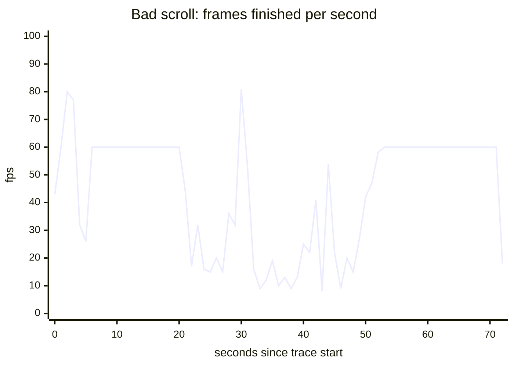
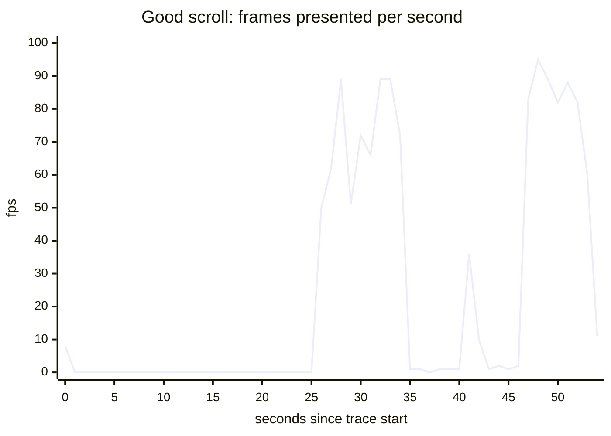
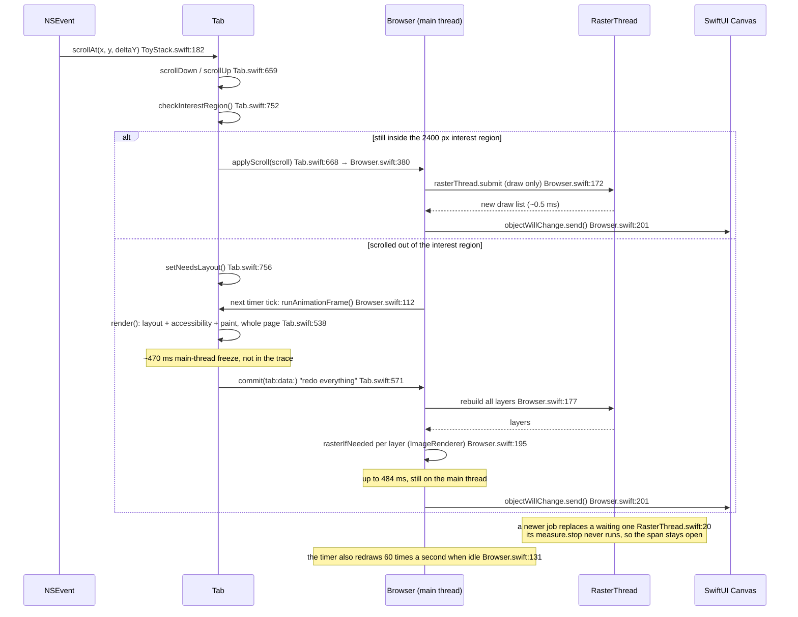
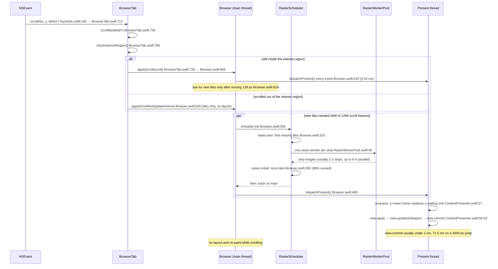

# Scroll trace comparison: `browser.trace-bad-scroll` vs `browser.trace-good-scroll`

Both files are Chrome trace files (open them in `chrome://tracing` or <https://ui.perfetto.dev>).
All numbers below were computed from the two files with a small Python script. Anything not measured
is marked **[guess]**.

## Words used in this file

| Word | Meaning here |
| ---- | ------------ |
| frame | one new picture shown on the screen |
| fps | frames per second |
| gap | time between two frames; a long gap is a visible freeze |
| median | the middle value: half of the values are smaller, half are bigger |
| 95th percentile | 95% of the values are smaller than this — "how slow the slow cases are" |
| main thread | the one thread that handles clicks, keys and scrolling; if it is busy, the app freezes |
| worker thread | an extra thread that does heavy work so the main thread stays free |
| tile | a 128 × 128 px square piece of the page, drawn once and reused |
| layer | a picture that macOS (Core Animation) can move around on screen without redrawing it |
| interest region | the part of the page the bad build has already drawn (2400 px tall) |

## Which code made which trace

Found by matching the trace event names with the source code, plus `git reflog --date=iso`:

| Trace | Recorded at (local time) | ToyStack commit checked out at that moment |
| ----- | ------------------------ | ------------------------------------------ |
| `browser.trace-good-scroll` | 12:01:43 → 12:02:37 | `5377322` (checked out at 12:01:16) |
| `browser.trace-bad-scroll`  | 12:03:59 → 12:05:11 | `e8da50c` (checked out at 12:03:16) |

- `5377322` is 151 commits after `e8da50c`. Its `present` counter writes the key `"dropped"`, which
  exactly matches the trace (`main` renamed it to `"coalesced"` in `b7d4242`).
- You are on `main` again now (since 12:33:18), so neither build's code is in the working tree.
  Read the referenced files with `git show e8da50c:<path>` (bad) or `git show 5377322:<path>` (good).

## TL;DR

| Metric (scroll window only)                                   | Bad scroll        | Good scroll | Change                |
| ------------------------------------------------------------- | ----------------- | ----------- | --------------------- |
| Slow gap between frames (95th percentile)                     | 253.9 ms          | ≈21 ms      | ≈12× shorter          |
| Gaps longer than 100 ms (visible freeze)                      | 50                | 6           | −44                   |
| Gaps longer than 300 ms                                       | 34 (15.9 s total) | 0           | gone                  |
| Longest gap between frames                                    | 837.1 ms          | 227.6 ms    | 3.7× shorter          |
| fps, counting at most 1 frame per 1/60 s slot                 | **20.3**          | **52.4**    | **+32.1 fps (≈2.6×)** |
| fps, raw frame count                                          | 24.6              | 77.5        | +52.9 fps (≈3.1×)     |
| Typical gap between frames (median)                           | 16.6 ms           | 12.4 ms     | −4.2 ms               |
| `composite_raster_and_draw` 95th percentile                   | 55.3 ms           | 3.9 ms      | ≈14× faster           |
| `composite_raster_and_draw` slowest                           | 484.4 ms          | 11.4 ms     | ≈42× faster           |
| Frames thrown away because a newer one was already waiting    | 90                | 35          | see findings 2 and 8  |

**X = +32.1 fps** on a fair 60 fps scale (20.3 → 52.4, ≈2.6×).
The raw count says +52.9 fps (24.6 → 77.5), but that number flatters the good build: it can show more
than 60 frames per second, while the bad build can never go above 60.

During the bad scroll, the screen was frozen for **15.9 s out of 30.6 s** — more than half the time.

## How the numbers were measured

- **Bad trace** (72.3 s long): it only contains one event name, `composite_raster_and_draw`.
  One finished event = one new picture handed to SwiftUI.
  - The animation timer redraws 60 times per second even when nothing happens
    (seconds 6–20 and 53–71 show exactly 60.0 fps, median gap 16.7 ms).
    So **any gap longer than ~17 ms means the main thread was busy** — it cannot be "the user stopped scrolling".
  - Scroll window = 21.42 s → 52.07 s (from the first long freeze to the last slow frame).
- **Good trace** (54.2 s long): one `present` counter event = one picture shown on screen
  (written at `ContentPresenter.swift:49` after `CATransaction.commit()`).
  Two scroll windows were found automatically (frames closer than 250 ms together):
  26.35 s → 35.01 s (73.9 raw fps) and 46.98 s → 54.21 s (81.8 raw fps). Combined: 77.5 raw fps.
  - This build does **not** redraw when idle (seconds 1–25 have 0 frames), so some of its gaps
    are just the user pausing. Its fps is therefore a *lower* bound.
  - It goes above 60 fps because a frame is shown for every scroll event instead of on a fixed 60 fps
    timer. **[guess]** the Mac has a 120 Hz screen.
- **Fair fps:** each window is split into 16.67 ms slots (1/60 s). A slot counts once if at least one
  frame landed in it, so neither build can score above 60.
- Both windows lean the *same* way: the bad window includes calm moments where the idle timer still
  produces 60 fps (makes bad look better), and the good window includes short scroll pauses with no
  frames (makes good look worse). The real difference is, if anything, bigger.

## Frames per second over time

The bad build sits at a flat 60 when *idle* and collapses to 8–20 when *scrolling*.
The good build is silent when idle and jumps to 80–95 when scrolling.

## Findings

### 1. Bad: the screen freezes ~470 ms every time you scroll past the interest region

34 gaps of 300–837 ms (average 469 ms) appear, roughly every 0.5–0.7 s while scrolling.
**No trace event covers that time**, so the work is invisible in the trace — but the code explains it:

1. `Tab.swift:752` `checkInterestRegion()` — once the scroll leaves the already-drawn area
   (`interestTop` … `interestTop + 4 * HEIGHT`, i.e. 2400 px), it moves the area
   (`Tab.swift:755`) and calls `setNeedsLayout()`.
2. On the next tick, `Tab.swift:538` → `render()` runs **layout + accessibility tree + paint of the
   whole page** on the main thread.
3. The update says "redo everything" (`compositedUpdates == nil`), so `Browser.swift:177` rebuilds
   **all layers**, and then `Browser.swift:195` calls `layer.rasterIfNeeded(scale:)` for every layer — on the
   **main thread**, using SwiftUI `ImageRenderer` (`CompositedLayer.swift:77`), which is slow.

Only step 3 is inside the traced span, which is why the slowest traced
`composite_raster_and_draw` is 484 ms but the slowest gap is 837 ms.

### 2. Bad: 90 frames were thrown away, and their trace spans never close

The trace has 3320 `B` (begin) events but only 3228 `E` (end) events; 90 of the 92 missing ends fall
inside the scroll window. Cause: `RasterThread.swift:20` (`pending = job // newest wins`) throws away a
job that was still waiting, so its `then:` block — which calls `measure.stop(...)` at `Browser.swift:203` —
never runs.

Throwing away an old frame is fine (a newer one replaces it), but the trace is left with open spans,
and you see overlapping `B B E E` patterns because a new `measure.start` (`Browser.swift:168`) happens
before the previous frame ended. **Side effect: the time of each single frame in the bad trace is
approximate** (a begin can get paired with the wrong end).

### 3. Bad: the build redraws 60×/s even when nothing changes

`Browser.swift:131` sets `needsAnimationFrame = true` on *every* commit, and `Browser.swift:107`
then lets the next tick run, which commits again → `composite_raster_and_draw` again.
The result is a never-ending 60 fps loop (each frame ~0.5 ms). Not a scroll problem, but wasted battery,
and it caps the build at 60 fps (`Browser.swift:11`, `FRAME_BUDGET = 1/60`).

### 4. Good: scrolling never touches style, layout, or paint

In the whole good trace, `BrowserTab.style`, `BrowserTab.layout` and `BrowserTab.paint` run **once**
(at page load: layout 46.9 ms, paint 90.9 ms). During 15.9 s of scrolling they run **zero** times —
even though the page was scrolled to 22 085 px. In `5377322`, leaving the interest region calls
`Browser.swift:826` `applyScrollAndUpdateInterest`, which only asks for new tiles (`setNeedsDrawOnly()`),
not a new layout.

### 5. Good: most scroll frames just move the tiles that are already drawn

`Browser.swift:806` `applyScroll` immediately calls `dispatchPresent()` (`Browser.swift:220`, the
`present.main` event) with the tiles it already has. It only asks for new tiles when the page moved at
least one tile (128 px) since the last time (`Browser.swift:814–815`).
Measured: **1266** `present.main` events vs **468** `composite_raster_and_draw` jobs in the scroll windows —
about 63% of scroll frames needed no drawing at all. The main thread's part of a frame (`present.main`)
takes **0.04 ms** at the 95th percentile, so it is always free for input.

### 6. Good: tiles are cached and reused

`tiles` counter during scroll (`Browser.swift:410`): **53 190 reused vs 7 304 drawn new (87.9% reused)**.
A typical job draws only 12–24 new tiles (the row that just came into view). The first frame drew
136 tiles; after that, most jobs report "136 reused, 0–24 new".

### 7. Good: new tiles are drawn off the main thread, in parallel

When tiles are needed, the work runs like this (all verified in `5377322`):

1. Main thread: `composite_raster_and_draw` starts (`Browser.swift:300`) and hands the job to
   `RasterScheduler` (`Browser.swift:306`).
2. `RasterScheduler` thread (`browser.compositor`): `raster.plan` (`Browser.swift:310`) finds which tiles are
   missing and groups them into strips.
3. `RasterWorkerPool` (`RasterWorkerPool.swift:48`): one `raster.worker` per strip, running at the same time.
4. Back on the `RasterScheduler` thread: `raster.install` (`Browser.swift:392`) stores the new tiles.
5. Main thread: `dispatchPresent()` (`Browser.swift:485`) shows the result, then
   `composite_raster_and_draw` ends (`Browser.swift:510`).

Most jobs need only 1–2 strips (`strips: 1` → 210 jobs, `strips: 2` → 162 jobs); `raster.worker` takes
2.7 ms at the 95th percentile.
Note: the `pool` counter always says `workers: 4`, but the pool uses an unlimited parallel queue
(`RasterWorkerPool.swift:26–30`). In the trace, up to **8** workers ran at once on 9 different threads.

### 8. Good: showing the frame is done on its own thread, using macOS layers

`ContentPresenter` (`ContentPresenter.swift:25` `enqueue`, `:35` `drain`) runs on its own
`browser.present` queue — 0 of 2590 `view.apply` events ran on the main thread. For each frame:
`view.apply` (`:56`) → `view.updateSublayers` (`:84`, 0.16 ms at the 95th percentile, 136–200 layers)
→ `view.commit` (`:62`, `CATransaction.commit()`, hands the layers to macOS) → `present` counter (`:49`).

If a newer frame arrives while one is still waiting, the waiting one is replaced (`:27`,
`if latest != nil { dropped += 1 }`). That is what the 35 `dropped` frames are — the same idea as the
bad build's 90 thrown-away frames, but here the trace span still closes properly.

**Remaining slow spot:** `view.commit` when many tiles change at once. At 29.66 s the page jumped
14 501 → 16 450 px in a single scroll event, all 156 tiles were new, and `view.commit` took **71.5 ms**.
Most `dropped` frames are around such jumps.

## Diagrams

Every arrow is one function call or hand-off, with the `file:line` where it happens in that build.

### Bad build: one scroll step (`browser.trace-bad-scroll`, commit `e8da50c`)

### Good build: one scroll step (`browser.trace-good-scroll`, commit `5377322`)

## What the good build does differently (in plain words)

| Idea                          | Bad build (`e8da50c`)                                 | Good build (`5377322`)                                   |
| ----------------------------- | ----------------------------------------------------- | -------------------------------------------------------- |
| Leaving the already-drawn area | Redo layout + paint of the whole page               | Only draw the new tiles                                  |
| Unit of drawing               | Whole layer as one big image                          | 128 px tiles, cached and reused (88% reuse)              |
| Who draws pixels              | Main thread (`ImageRenderer`)                         | Parallel worker threads                                  |
| Who shows pixels              | SwiftUI redraw of the whole canvas                    | macOS layers moved on a separate `browser.present` thread |
| Idle                          | Redraws 60×/s forever                                 | Draws nothing                                            |
| Frame-rate limit              | 60 fps timer                                          | One frame per scroll event (up to ~95 fps seen)          |
| Tracing                       | Only `composite_raster_and_draw`, spans can stay open | Every step traced + counters (`tiles`, `pool`, `view`, `present`) |

## Caveats

- The good trace loads a page with 3 049 elements / 9 729 words (`profile.style`, `profile.layout`).
  The bad trace has no page info, so it is **[guess]** the same page.
- "Frame" means a slightly different thing in each trace (finished `composite_raster_and_draw` vs
  `present` counter), but both mark "a new picture reached the screen". The fair fps row deals with
  the difference in frame rate limits.
- The `workers: 4` value in the good trace's `pool` counter does not match the real number of
  parallel workers (up to 8 seen); see finding 7.
