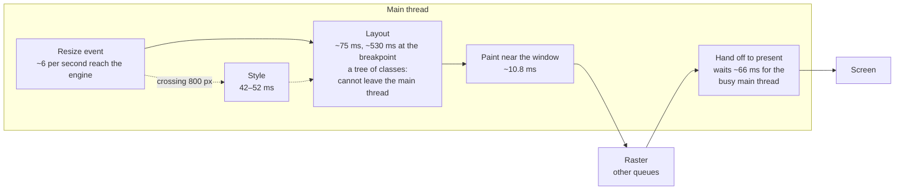
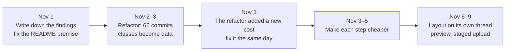
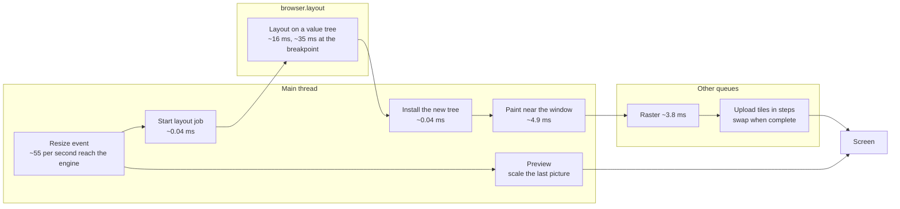

# Everything Is Not an Object

*How a toy browser engine in Swift went from ~10 to ~47 new pictures per second while resizing a long page: first a 66-commit refactor that turned classes into plain data, then layout on its own thread. 255 commits, Nov 2 – Nov 12, 2026, `bbee952..1072def`.*

This story picks up where the resizing story ended. At `bbee952`, layout still ran on the main thread, and that capped resizing at about 12 new pictures per second. The obvious fix was "move layout to another thread". It could not be done, because of how the engine was shaped. The reason goes back to a sentence in the README.

The traces in this story are `browser.trace-mid` (recorded at `bbee952`) and `browser.trace-fast` (recorded at `1072def`). Both drag the window on the same long page (1,773 layout blocks) and both cross the page's 800 px CSS breakpoint. The full analysis is in `plans/resize-flow-bbee952-to-head.md`.

---

## 1. Before: the flowchart

This is what one resize did at `bbee952`. Everything that matters ran on the main thread.



### The symptoms, box by box

| Box | What you see | Measured in `trace-mid` |
|---|---|---|
| Layout: "~75 ms" | About 10 new pictures per second | Layout median 75.5 ms; the main thread is busy ~86 ms per new picture (layout + paint); new pictures arrive every 96.8 ms (median) |
| Layout: "~530 ms at the breakpoint" | The window freezes for ~0.7 s when it crosses 800 px | Style 42–52 ms plus layout 522–541 ms, all on the main thread |
| Resize event: "~6 per second" | The drag feels sticky | 90 resize events in 14.8 s. macOS merges resize events while the main thread is busy |
| Hand off: "waits ~66 ms" | Finished pictures show up late | `raster.installWait` median 65.7 ms: raster is done, but the main thread is already in the next layout |
| Paint: "~10.8 ms" | Paint costs more than it should | 2,911 nodes per frame are built into the paint scene and then thrown away |
| Layout: "a tree of classes" | The real fix, layout on another thread, is impossible | See below |

#### Layout: why it could not leave the main thread

To run layout on another thread, that thread needs a copy of the page that only it owns. Then the main thread can keep drawing the old picture while the new layout is being built.

At `bbee952`, the layout tree was a graph of objects:

```swift
@MainActor
protocol LayoutObject: AnyObject, FieldOwner {
    var node: any DOMNode { get }
    var parent: (any LayoutObject)? { get }
    var fields: LayoutFieldStore { get }
    var hasDirtyDescendants: Bool { get set }
    // ...
}

class BlockLayout: LayoutObject { /* ... */ }
class LineLayout: LayoutObject { /* ... */ }
class TextLayout: LayoutObject, InlineLayoutItem { /* ... */ }
class EmbedLayout: LayoutObject, InlineLayoutItem { /* ... */ }
```

Every box pointed at a DOM node (also a class), at its parent, and at its children. The `Frame` class held all of it. Copying a graph of objects means walking every pointer and rebuilding the graph by hand. Sharing it with another thread means locks everywhere. So everything was marked `@MainActor`, and the raster input was marked `@unchecked Sendable`: "trust me, nobody changes this while the workers read it."

#### Where that shape came from

The README listed my reasons for building a browser engine. Reason #2 was:

> **2. Everything is object.**
>
> The web has Document Object Model (DOM). Swift has Object Oriented Programming. There's correlation between those terms.

The word "object" in *Document Object Model* and the word "object" in *object-oriented programming* don't mean the same thing. The DOM is a tree made of a few fixed kinds of nodes. But I read it as "the DOM is made of objects, Swift has objects, so model everything as classes". That premise produced the class tree above, and the class tree kept layout on the main thread.

---

## 2. The approach to fix the symptoms

First fix the shape, then move layout off the main thread, then make every step cheaper.



### Step 1: write down what is wrong with the shape

Before touching the code, I wrote `plans/refactoring/oop-findings.md` (`f328f0c`, Nov 1) and replaced the README's reason #2 (`8e7b784`). The findings lean on two talks:

- **Casey Muratori, *The Big OOPs*:** a class hierarchy hides data inside the most specific class, so an operation that must touch many kinds of data at once (paint, invalidation) turns into downcasts.
- **Apple, WWDC15 *Protocol-Oriented Programming in Swift*:** classes share by default, and a forced downcast means "some important type relationship has been lost". Prefer values.

Their shared rule became the rule for the refactor:

> **Protocols are for open seams. Sum types are for closed data. Flat arrays are for hot passes.**

And a two-question test for every protocol in the engine:

1. Can I list every case today?
2. Does anyone outside the engine add a case?

If the answers are *yes* and *no*, the set is closed, and it should be an `enum`. `Renderer` passed the test as an open seam (Core Graphics, SwiftUI and test renderers all implement it), so it stayed a protocol. The draw commands, the effects, and the layout and DOM node kinds were closed sets pretending to be open.

| # | Area | Shape at `bbee952` | Target shape |
|---|---|---|---|
| 1 | Draw commands | `[any DisplayItem]`, a protocol with 8 conforming structs | `enum DisplayOp` |
| 2 | Paint output | a tree of effect classes, flattened again by raster | one flat list with `beginEffect` / `endEffect` |
| 3 | Layout and DOM | class hierarchies, `as?` in every pass | tagged nodes in an array, addressed by `NodeID` |
| 4 | Invalidation | each node finds its dependencies while reading | one table of inputs, declared once |
| 5 | Style and animation | `[String: String]`, parsed again in paint and hit testing | typed `ComputedStyle`, animations return typed values |
| 6 | Frame state | one big `Frame` class that everything points at | grouped value state and frozen snapshots |

### Step 2: pick the order

`plans/refactoring/oop-refactor-order.md` fixed the order: **1 → 2 → 5 → 3 → 4 → 6**. The rule was: rewrite a pass only after its inputs are final.

- Draw commands first: they are the smallest closed set, and paint, style and frame state all consume them.
- Typed style before layout: layout reads style everywhere, so the layout rewrite should land once, against the final typed style.
- Layout and DOM before invalidation: the invalidation table is keyed by `NodeID`, which doesn't exist before item 3.
- Frame state last: it needs all of the above to hand out real snapshots.

### Step 3: the refactor, 66 commits in two days

| Order | What changed | Commits |
|---|---|---|
| 1 | Draw commands become one `enum DisplayOp` | `b90fc8f`, `54786fb`, `383725b` |
| 2 | Effects become values; paint writes one flat list; raster composes layers from one scan | `791535e`, `072ada2`, `f5e53c4`, `3eb2b1e` |
| 5 | Style gets a typed shape, computed once; animations return values, not strings; the raw string dictionary is gone | `ab7e139`, `5771a49`, `7e41445`, `a941d70`, `869c077`, `af33c9f` |
| 3 | DOM and layout nodes get stable IDs and live in flat arrays ("arenas"); layout runs by node ID on a value tree | `ba2b8b2`, `3843180`, `65678fb`, `6ff87c8`, `fbec86c`, `633ae46`, `461d0ed`, `ee4ed85` |
| 4 | Layout dependencies are declared in one table; reading no longer adds edges | `fad88e6`, `62cb288` |
| 6 | `Frame` state is grouped into document, layout, display and runtime parts; raster gets a frozen snapshot that is really safe to send; paint walks a frozen scene | `6b16a10`, `40639c9`, `ccf9500`, `e9baa8a`, `3dd2d4e`, `c9dac7c`, `46caee4`, `7e87d92` |

Two shapes, before and after:

```swift
// bbee952: a protocol for a set nobody outside the engine extends
public protocol DisplayItem {
    var rect: Rect { get }
}
public protocol DisplayCommand: DisplayItem { /* ... */ }
public struct DrawRect: DisplayCommand { /* ... */ }
public struct DrawText: DisplayCommand { /* ... */ }
// ...and six more, plus a class tree for effects
```

```swift
// 1072def: every case listed in one place
public enum DisplayOp: Sendable {
    case rect(rect: Rect, color: BrowserColor)
    case rrect(rect: Rect, radii: CornerRadii, color: BrowserColor)
    case line(from: Point, to: Point, color: BrowserColor, width: CGFloat)
    case outline(rect: Rect, color: BrowserColor, width: CGFloat)
    case text(text: String, font: BrowserFont, color: BrowserColor, rect: Rect)
    case image(image: CGImage, rendering: ImageRendering, rect: Rect, version: UInt64)
    case clippedImage(image: CGImage, rendering: ImageRendering, rect: Rect, clip: Rect)
    indirect case compositedLayer(layer: RasterLayer, rect: Rect, visibleTop: CGFloat, visibleBottom: CGFloat)
    case beginEffect(EffectScope)
    case endEffect
}
```

```swift
// 1072def: a layout node is data; the tree is an array of these
enum LayoutKind {
    case document(DocumentData)
    case block(BlockData)
    case line(LineData)
    case text(TextData)
    case embed(EmbedData)
}

struct LayoutNode {
    var kind: LayoutKind
    var dom: NodeID
    var links: LayoutLinks
    var state: LayoutState
}
```

A new draw command or node kind is now a compile error in every `switch` that forgets it, instead of an `as?` that silently returns `nil`. And `RasterInput` lost its `@unchecked`: it is now plain `Sendable`, checked by the compiler.

### Step 4: the refactor added a new cost

The new invalidation table (`fad88e6`) rebuilt the whole dependency graph at the start **and** at the end of every layout pass. `bbee952` had no such rebuild; the refactor added it. On the long test page, one resize paid about 130 ms of layout, and the content showed only 5.5 new pictures per second.

The tests passed. The shape was right. But I hadn't measured a resize after the refactor. I found it the same evening:

- `4e70cfb`: drop the rebuild at the start; the one at the end already leaves the graph current.
- `750f5b1`: update only the links that changed. Layout ~130 → ~33 ms, content 5.5 → 11.5 fps, identical pixels.

### Step 5: values aren't free either

Plain data is easy to copy, and that turned out to be the next problem.

- **`410fed0`: a 413-byte node was copied on every read and every write.** A CPU sample put 83% of layout time in copying memory and reference counting. Reading and writing nodes in place, without copying them out of the array, cut layout roughly in half (15.8 → 5.8 ms on a 1,000-paragraph page).
- **`9ac37fe`: the background job copied the whole tree on its first write.** The job's tree and the installed tree shared memory, so the first write copied the node array and the dependency index. A one-shot handoff gives the job sole ownership instead: background layout 12.1 → 8.6 ms.

### Step 6: the payoff, layout on its own thread

With the tree as a value, the move off the main thread is short (`fe876e2`, Nov 6): copy the tree, lay it out in a `Task.detached`, and install the finished tree in one step. The old tree stays on screen until then.

Then the drag had to actually show the results:

- `534410b`: start a layout for the latest width during the drag, one job at a time.
- `e259535`: a layout started at an older width is still a complete layout. Let it finish and show it, instead of cancelling it. Before this, 963 of 1,013 layouts in a trace were thrown away.
- `ac0b3ee`: when a layout installs, paint and commit at once instead of waiting for the next 60 Hz tick.
- `00a48a5`, `8775ddc`, `93caefb`: a width-only job reuses its inputs, so starting a job costs the main thread ~0.04 ms instead of ~8 ms.
- `2977a4b`, `9ec5654`: while layout runs, show the last picture scaled to the new window size.

### Step 7: make every step cheaper

| Area | Key commits | Effect |
|---|---|---|
| Dependency graph | `750f5b1`, `00ce844`, `e81e8cb`, `3295672` | Update edges by difference instead of rebuilding; a font-size change no longer reindexes 12,012 edges (93.5 → 5.5 ms) |
| Line breaking | `af8773d` | A paragraph keeps its line breaks while the new width still fits them; only ~41 of 1,407 paragraphs are recomputed per step |
| Breakpoint | `6e755ff`, `1cf7c04`, `2d7e8c6` | Blocks and text layout survive a font-size change (770 → 565 → 423 ms on the test page); only the subtree a media query touches is restyled |
| Paint | `5cf3c8e` | Off-window nodes are never built into the scene: paint 10.8 → 4.9 ms |
| Composite | `268660e` | Layers are reused when the display list didn't change: 0.53 → 0.03 ms |
| Upload | `8d2f139`, `9ed0800`, `7802ab7` | Tiles are drawn in the screen's color space (`view.commit` p90 25 → 0.3 ms); a new picture is uploaded in steps to hidden layers and swapped in at once; any newer layout is shown even if its width is a frame behind |

---

## 3. Before flowchart vs after flowchart

**After (`1072def`)**



The big box moved. Layout left the main thread, and the main thread only starts a job, installs the result, and paints.

| Box | Before (`bbee952`) | After (`1072def`) | Commits |
|---|---|---|---|
| Layout: where | Main thread | `browser.layout` thread | `fe876e2` |
| Layout: shape | Tree of classes | Array of tagged nodes, a value | refactor items 3, 4 |
| Layout: cost | ~75 ms | ~16 ms | `750f5b1`, `410fed0`, `af8773d` |
| Main thread per new picture | ~86 ms (layout + paint) | ~5 ms (start + install + paint) | `fe876e2`, `00a48a5` |
| Breakpoint | Style ~47 ms + layout ~530 ms, window frozen ~0.7 s | Style ~10.5 ms + layout ~35 ms on the layout thread | `2d7e8c6`, `6e755ff`, `1cf7c04` |
| While layout runs | Window frozen | Last picture, scaled | `2977a4b` |
| Hand off to present | Waits ~66 ms for the main thread | ~0.05 ms | `fe876e2` |
| Paint | ~10.8 ms | ~4.9 ms | `5cf3c8e` |
| Upload | All tiles in one commit (`view.commit` p90 25 ms) | In steps, swapped at once (p90 0.3 ms) | `9ed0800`, `8d2f139` |
| Resize events reaching the engine | ~6 per second | ~55 per second | follows from a free main thread |

---

## 4. How much fps we get

| While dragging the long page | `bbee952` | `1072def` |
|---|---:|---:|
| **New pictures per second** | **~10.3 fps** | **~47 fps** (≈4.5×) |
| Resize → new picture on screen, median | 155 ms | 38 ms |
| Resize → new picture on screen, slowest | 700 ms | 108 ms |
| Main thread busy per new picture | ~86 ms | ~5 ms |

**How it was counted.** A frame counts only when it shows a picture from a **new** layout. The scaled preview doesn't count.

- `bbee952`: one new picture is one frame with a real layout, shown at its `present.main`. 87 new pictures, median gap 96.8 ms → 10.3 fps.
- `1072def`: a new picture is shown when the staged upload completes (`view.staging completed = 1`). 226 new pictures in 4.83 s of active drag → 46.8 fps.

The two numbers above use slightly different methods. With the same method for both traces:

| Method | `bbee952` | `1072def` | Ratio |
|---|---:|---:|---:|
| Median gap between new pictures | 96.8 ms → 10.3 fps | 18.4 ms → 54.4 fps | 5.3× |
| New pictures ÷ active drag time | 60 / 7.0 s → 8.6 fps | 226 / 4.83 s → 46.8 fps | 5.5× |

So ≈4.5× is the low end; measured the same way, it's 5.3–5.5×.

**What still keeps it below 60.** From `trace-fast`:

- A layout job takes ~16 ms (p90 19.7 ms), almost a whole 16.7 ms display frame, and the next job starts only after this one installs.
- After install, paint (~4.9 ms) and raster (~3.8 ms) run before the upload can begin.
- The staged upload sometimes needs two display frames: the gap between new pictures is 32 ms at p90.
- Both traces ran with the profiler on. `9ac37fe` measured background layout at 14.7 ms with the profiler and 8.6 ms without, so the real fps is probably higher. [INFERENCE — not measured in these traces.]

**Limits of this comparison.**

- The two traces come from different drags: hand movement, duration and widths differ. Both use the same 1,773-block page and both cross the 800 px breakpoint (`bbee952` four times, `1072def` twice).
- The few resize events at `bbee952` (~6 per second) are a result of the busy main thread, not of a slow drag.
- "Shown" means different things in the two builds (`present.main` vs `view.staging completed = 1`), because `bbee952` has no staged upload. Both mark the moment a new layout is fully on the visible layers.
- The resizing story measured `bbee952` at 12.2 fps on a different page (1,587 layout boxes) and a different trace (`browser.trace-good-resize`). The two numbers are not from the same recording.

---

## Appendix

### The numbers for the whole range

| | |
|---|---|
| Commits | 255 (78 perf, 68 refactor, 46 docs, 42 fix, 14 feat, 7 other) |
| The refactor | 66 commits on Nov 2–3 (55 refactor, 9 docs, 2 test), +11,506 / −7,294 lines in `Sources` and `Tests` |
| Whole range | +20,892 / −8,417 lines in `Sources` and `Tests` |
| New pictures per second while dragging | ~10.3 → ~47 |
| Main thread per new picture | ~86 ms → ~5 ms |
| Breakpoint layout | 522–541 ms → 34.5–35.9 ms |

Honest notes:

- `Frame` is still a class, and `Frame.swift` grew from 1,766 to 2,310 lines: its state is now grouped (`FrameDocumentState`, `FrameLayoutState`, `FrameDisplayState`, `FrameRuntimeState`), but the background-layout coordination landed in the same file. That is the next room to clean.
- `LayoutTree` is marked `@unchecked Sendable`. The tree is a value and the handoff gives the job sole ownership, but the compiler doesn't check it yet. `RasterInput`, the one the findings called out, is now plain `Sendable`.

### What I'd tell someone starting this

1. **Check the premise, not just the code.** "Everything is object" sounded like a design idea. It was a word coincidence, and it decided the shape of the whole engine.
2. **Ask two questions of every protocol.** Can I list every case? Does anyone outside add one? If yes and no, it's an `enum`.
3. **Fix the order before you refactor.** Rewrite a pass only after its inputs are final, or you rewrite it twice.
4. **Measure after a refactor, not only test.** The tests passed, and the new table rebuilt the dependency graph twice per layout: 5.5 fps on the test page until the same evening.
5. **Values aren't free.** A 413-byte node copied on every access cost more than the layout math. Values make sharing safe; borrowing in place makes them fast.
6. **The shape decides what's possible.** Layout couldn't leave the main thread while it was a graph of objects. As a value, the first version of the move was one commit (`fe876e2`).

### Talk outline (≈25 min)

| # | Slide | Talking point | Evidence |
|---|---|---|---|
| 1 | **Everything is not an object** | Resizing stuck at ~10 fps; the fix needed a different shape | Screen recording of `bbee952` dragging |
| 2 | The before flowchart | Layout ~75 ms on the main thread; main thread ~86 ms per picture | `browser.trace-mid` |
| 3 | Symptoms | ~6 events/s, 66 ms wait to present, 0.7 s freeze at the breakpoint | `browser.trace-mid` |
| 4 | Why layout can't move | A graph of classes can't be handed to another thread | `LayoutObject` at `bbee952` |
| 5 | The README premise | "Everything is object": a word coincidence | `8e7b784` |
| 6 | Two talks, one rule | Protocols for open seams, sum types for closed data, flat arrays for hot passes | Muratori, WWDC15 408 |
| 7 | The two-question test | `Renderer` stays a protocol; draw commands become an enum | `oop-findings.md` |
| 8 | The order | 1 → 2 → 5 → 3 → 4 → 6, rewrite a pass once | `oop-refactor-order.md` |
| 9 | 66 commits in two days | `DisplayOp`, flat list, `ComputedStyle`, `LayoutKind` + `NodeID`, input table, frame state | `b90fc8f` … `432df5f` |
| 10 | **The refactor added a new cost** | Graph rebuilt twice per layout: 5.5 fps; fixed the same evening | `fad88e6`, `4e70cfb`, `750f5b1` |
| 11 | Values aren't free | 413-byte node copied per access; whole-tree copy at job start | `410fed0`, `9ac37fe` |
| 12 | **The payoff** | Copy the tree, lay out in `Task.detached`, install at once | `fe876e2` |
| 13 | Show the results while dragging | Finish stale jobs instead of cancelling (963 of 1,013 thrown away) | `e259535`, `ac0b3ee` |
| 14 | Cheaper steps | Line breaks kept (41 of 1,407), paint 10.8 → 4.9 ms, staged upload | `af8773d`, `5cf3c8e`, `9ed0800` |
| 15 | Before vs after flowchart | The big box left the main thread | Diagrams |
| 16 | How much fps | ~10.3 → ~47 fps; 5.3–5.5× with the same method | Both traces |
| 17 | What's left | Layout job ~16 ms, staged upload p90 32 ms, `Frame.swift` grew | `trace-fast` |
| 18 | Six takeaways | From "What I'd tell someone" | — |

### Demo suggestions

- Side-by-side recording: `bbee952` vs `1072def` dragging the same long page across the 800 px breakpoint.
- Open both traces in Perfetto: at `bbee952`, `BrowserTab.layout` blocks sit on the main thread; at `1072def`, the main thread shows only `layout.async.start` and `layout.async.finish`, and the layout runs on `browser.layout`.
- Show `git show bbee952:Sources/Engine/Layouts/LayoutObject.swift` next to `LayoutKind.swift` and `LayoutNode.swift` at `1072def`.
