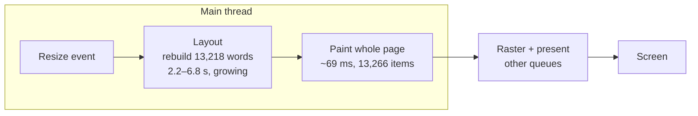
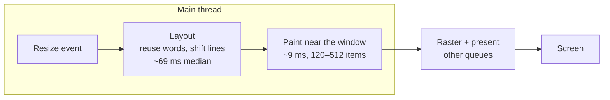

# Take Old Words Off the Invalidations List

*How a toy browser engine in Swift went from freezing for seconds on every window resize to about 12 new pictures per second: 11 resize phases, 3 days (Oct 31 – Nov 2, 2026), `d653b1a..bbee952`.*

Both traces in this story were recorded with the same steps: load the browser.engineering home page (113 layout boxes), open a long page (1,587 layout boxes), then drag the window narrower and wider. `browser.trace-bad-resize` comes from `d653b1a`, `browser.trace-good-resize` from `bbee952`.

This story picks up a month after the scrolling story. In between, ToyStack worked through chapter 16 of *Web Browser Engineering*, "Reusing Previous Computation", so that layout keeps its old results and redoes only what changed. The tool for that is `ProtectedField` (`e6984c6`, Oct 25 → `d653b1a`, Oct 30). The resize problem lives inside it, so section 1 explains `ProtectedField` before using it.

---

## 1. Before: the flowchart

This is what one resize did at `d653b1a`. The whole path ran on the main thread, one step after another.

### The symptoms, box by box

| Box | What you see | Measured in the bad trace |
|---|---|---|
| Layout: "2.2–6.8 s" | The window freezes on every new width | Layout median 4,489 ms; resize → new picture median 4,657 ms |
| Layout: "growing" | Every resize is slower than the one before | Same 13,218 words each time, but 54.5 → 198.1 µs per word |
| Resize event | Dragging feels like it does nothing | Only 11 width changes reached the engine in 54 s of dragging |
| Paint whole page | Paint costs the same as if the whole page were visible | ~17,200–17,800 nodes painted, 13,266 draw items |
| Not in the flowchart: hover | Moving the mouse over a link stutters | 9 style passes of 75–87 ms, each followed by ~60–70 ms of paint [INFERENCE] |

"Resize → new picture" runs from the `BrowserTab.resize` event to the end of the `view.commit` that shows the new layout.

#### Layout: same work, more time

Before changing any code, I wrote down what a resize actually does (`54656d8`, `plans/issues/resize-flow.md`). One table in that note gave the problem away: on every resize, the engine did **exactly the same amount of work**, yet each resize took **longer**.

From the bad trace, the 11 resizes on the long page:

| Resize | Words rebuilt | Layout | Time per word |
|---:|---:|---:|---:|
| 1st | 13,218 | 2.15 s | 54.5 µs |
| 4th | 13,218 | 4.49 s | 95.8 µs |
| 8th | 13,218 | 6.79 s | 154.1 µs |
| 11th | 13,218 | 6.73 s | 198.1 µs |

When the count stays flat but the time keeps growing, something is piling up. The note reproduced this in the headless CLI with 60 resize steps on a test page: the same words and lines cost about 18× more by the last step.

What was piling up sits inside the Layout box, so the flowchart doesn't show it: the **invalidations** list of each `ProtectedField`.

##### Background: `ProtectedField`

A `ProtectedField` wraps one value that layout computes or reads, such as a font size or a word's width. It holds three things:

| Part | Meaning |
|---|---|
| value | The result, e.g. a word's width |
| dirty flag | `true` when the value is out of date and must be computed again |
| invalidations | The other fields to mark dirty when this value changes |

Two methods tie them together:

- `read(notify:)` returns the value **and adds `notify`, the field doing the reading, to this field's invalidations**.
- `set(_:)` stores a new value. If it differs from the old one, every field in invalidations is marked dirty.

Example: a word's width depends on its element's font size. Computing the width calls `fontSize.read(notify: width)`, so the font size's invalidations now include that word's width. If the font size changes later, `set` marks the width dirty, and the next layout measures that word again. Everything else stays clean and is reused.

At `d653b1a` the class itself was already gone. Exercise 16-9 ("optimizing protected field", `d653b1a`) replaced the `ProtectedField` objects with lighter handles (`LayoutFieldHandle`, `FieldRef`), and style values keep their invalidations in `StyleFields.dependents`. The idea is unchanged: reading adds the reader to a list, and a changed value marks everyone on that list dirty.

##### What went wrong on a resize

1. Throw away every word box on the page and build new ones (13,218 of them).
2. Each new word box reads its element's font, so `read(notify:)` adds it to that font's invalidations.
3. Nothing removes the old word boxes. `StyleFields` only cleaned out dead entries when the font value changed (`notifyDependents`), and a resize never changes a font.

So every resize added another 13,218 entries for words that no longer exist, and every style read had to walk past all of them. The list got longer with every resize, so reading it got slower with every resize.

#### Resize event: why so few arrived

That's not because the drag was slow. macOS delivers window resize events on the main thread. While the main thread is busy with a 4-second layout, new events can't be delivered, so macOS merges them and hands over only the latest size when the main thread is free again. Back to the restaurant from the scrolling story: when the cashier is busy, customers can't even place an order, so they shout only their latest one when the cashier looks up.

#### Hover: outside the flowchart

[INFERENCE] The 9 slow style passes that don't line up with a resize are hover restyles; that build doesn't record why a style pass ran.

---

## 2. The approach to fix the symptoms

Two questions drove every phase: *what is piling up?* and *what does a width change actually change?* A wider window doesn't change the words, their fonts, or their measured sizes. It only changes where lines break.

### Phase 1 (Layout, "growing"): take old words off the invalidations list

`8ee3097` removes entries for words that no longer exist whenever new ones are added, adds a `removeDependency` so objects can take themselves off the list, and turns back-references (a layout box's `parent`, a DOM node's `layoutObject`) into `weak` references, so old boxes can actually be freed. This had to come first: tuning per-word cost while the list kept growing would have made every measurement drift.

### Phases 2–3 (Layout, "rebuild 13,218 words"): stop redoing work that width doesn't change

- **Phase 2** (`7242526`) splits the inputs of a block's text into two groups: content (DOM, font, white-space, zoom) and width (`inlineContentInputs` in `BlockLayout.swift`). A width change no longer splits the text into words again.
- **Phase 3** (`2746be6`) keeps the existing line and word boxes and reuses them instead of building new ones.

| Per resize | `d653b1a` | `bbee952` |
|---|---:|---:|
| Words rebuilt | 13,218 | 0 |
| Text measurements | 52,880 | 11 |
| Font lookups | 20,643 | 8 |

### Phase 4 (Layout, "growing", for good): turn the invalidations list into a lookup table

Even a clean list was read from top to bottom every time an entry was added, and every width change made every block add itself again. `cd99818` replaces the lists with a lookup table keyed by `FieldDependencyKey`, and a width change no longer adds everything again. Measured in `plans/issues/resize-flow.md`: full rebuilds on the test page went from **3.39 → 7.32 → 11.37 s (growing)** to **1.098 → 1.091 → 1.071 s (flat)**.

### Phase 5 (hover): hover touches only what it can change

`1bb7106` makes a hover restyle only the elements a hover rule can touch (`RuleIndex`), and only bumps the paint revision when a property that affects drawing actually changed, so cached lines stay valid.

### Phases 6–10 (Layout, "2.2–6.8 s"): make each box cheaper

With the waste gone, the remaining cost was the price of each layout step. These commits came from profiling a test page (`www/bench/large.html`), and each one was measured there:

| Phase | What changed | Measured on the test page |
|---|---|---|
| 6 `21fe9bc` | Stop copying the layout field store on every read; a debug-only check no longer runs in release builds | layout 215 → 110 ms |
| 7 `a2b6ccc` | Cheaper line placement: remove links in place, one `children` write per line, remember the width of a space (`InlinePlacement`) | layout 324 → 264 ms |
| 8 `e21786b` | Read and write layout fields through `LayoutFieldValue` instead of key paths and closures; a word's x position belongs to its line, so each word has 2 links instead of 8 | layout 264 → 183 ms |
| 9 `8bafcef` | A line that only moved down is shifted (`inlineYOffset`) instead of placing every word again | — |
| 10 `269fa4e` | Parse block styles (display, padding, margin…) once into `BlockStyle` and reuse them | — |

Phases 9 and 10 show up directly in the good trace:

| Per resize | `d653b1a` | `bbee952` |
|---|---:|---:|
| Line placement time | 100–109 ms | 10–18 ms |
| Lines only shifted down | — | ~1,100–1,600 |
| Block styles reused from cache | — | 4,575 |

### Phase 11 (Paint whole page): paint only what's near the window

`bbee952` adds a `PaintWindow`: paint only lines and words within the visible area plus two window heights above and below. Scrolling outside that range repaints (`repaintForScroll`).

| Per resize | `d653b1a` | `bbee952` |
|---|---:|---:|
| Paint time | 67–70 ms | ~9 ms |
| Nodes painted | ~17,200–17,800 | ~1,800–2,200 |
| Nodes skipped (off-screen) | — | ~2,400–3,000 |
| Draw items produced | 13,266 | 120–512 |

### The safety net: tests for the risky phases

The scrolling story ended with a lesson: my cleanup broke `Transform` for four days because nothing tested it. This range went differently. 6 of the 11 phases added tests (509 test lines in 6 test files): `StyleFieldsTests`, `LayoutDependencyTests`, `InlineTextLayoutTests`, `LayoutIdempotenceTests`, `ViewportResizeTests`, `PaintCullingTests`. The risky part of "reuse instead of rebuild" is reusing something stale. Most of the new resize tests end with `expectIncrementalMatchesFull(page)`, which lays the page out again from scratch and checks that the reused result matches. That helper already existed (`d4d56a4`, Oct 28), so each phase could lean on it. Phases 4–8 added no new tests (phase 4 changed one test line); they relied on the existing ones.

---

## 3. Before flowchart vs after flowchart

**After (`bbee952`)**

The path is the same in both builds. Everything still runs on the main thread, one step after another. What changed is the cost of each box.

| Box | Before | After | Commits |
|---|---|---|---|
| Resize event | 11 width changes in 54 s; macOS merges the rest | 54 width changes in 14 s | (follows from Layout) |
| Layout: invalidations lists | Grow every resize, read top to bottom | Cleaned, looked up by key | `8ee3097`, `cd99818` |
| Layout: words on a width change | All 13,218 rebuilt and measured again | Reused; 0 rebuilt | `7242526`, `2746be6` |
| Layout: lines that only moved down | Every word placed again | Shifted | `8bafcef` |
| Layout: block styles | Parsed from strings every resize | Parsed once, cached | `269fa4e` |
| Layout: each step | Copies, key paths, 8 links per word | Direct field access, 2 links per word | `21fe9bc`, `a2b6ccc`, `e21786b` |
| Paint | Whole page, ~69 ms | Near the window, ~9 ms | `bbee952` |
| Hover (not in the flowchart) | ~80 ms restyle + ~65 ms paint [INFERENCE] | 0.3–3 ms restyle | `1bb7106` |

The good build still merges events when the main thread is busy, on a smaller scale: two events (872 and 884 px wide) share one layout because they arrived during the same busy stretch. During the first continuous drag in the good trace, the main thread was busy for 1,285 ms out of 1,380 ms (93%). The main thread, not the drag, sets the pace.

---

## 4. How much fps we get

| While dragging the long page | `d653b1a` | `bbee952` |
|---|---:|---:|
| **New pictures per second** | **0.18 fps** | **12.2 fps** (~67×) |
| Time between width changes, median | 5,518 ms | 82 ms |
| Resize → new picture on screen, median | 4,657 ms | 84 ms |
| Layout per resize, median | 4,489 ms | 69 ms |
| Paint per resize, median | 69 ms | 9 ms |

**How it was counted.** Each width change (`BrowserTab.resize` with `widthChanged: 1`) on the long page gets one layout and one new picture, so fps = 1000 ÷ the median time between width changes.

- Bad trace: 11 width changes, 10 gaps of 2,245–8,323 ms, median 5,518 ms → 0.18 fps (one new picture every 2–8 s).
- Good trace: 54 width changes, median gap 82 ms → 12.2 fps. Counting only the active drag (gaps under 300 ms, so hand pauses and the breakpoint jumps are left out): 45 gaps, median 80 ms → 12.4 fps.
- Cross-check: an earlier pair of recordings in `plans/resize-flow-d653b1a-to-bbee952.md` measured 0.24 → 10.3 fps the same way.

**Why it stops at ~12 and not 60.** 60 fps leaves 16.7 ms per picture. At `bbee952` the main thread still spends ~69 ms on layout plus ~9 ms on paint per resize, ≈ 78 ms, so it can't do better than about 1000 ÷ 78 ≈ 12.8 pictures per second. The measured 12.2 sits right under that limit. What still stands in the way:

- **Layout still runs on the main thread.** That ~78 ms per resize is the cap above.
- **Crossing the 800 px breakpoint rebuilds all words.** The page has a CSS media query at 800 px. Crossing it changes styles, so all 13,218 words are rebuilt: ~40–50 ms of style plus ~460–470 ms of layout, about half a second before the new picture appears. It happened twice in the good trace.
- **Paint still visits every block.** Culling skips lines and words outside the window, but `paint.cache.store.blocks` is still 1,583 per resize.

These became the next chapter: moving layout off the main thread (`fe876e2`) and keeping line breaks per paragraph (`af8773d`) came later.

**Limits of this comparison.**

- The traces come from two different drags: hand movement, duration and widths differ. Both use the same long page and both cross the 800 px breakpoint.
- The bad trace has only 11 resizes on the long page, so its medians rest on few samples.
- The traces don't record the page URL; "long page" means the page with 1,587 layout boxes opened after the home page.
- The profiler was on in both runs.
- Phase 4 and phases 6–8 numbers come from `plans/issues/resize-flow.md` (test page and earlier traces), not from these two traces.

---

## Appendix

### The numbers for the whole range

| | |
|---|---|
| Commits | 15 (11 resize phases, 4 docs/refactor) |
| Source and test lines changed | +1,700 / −378 in 38 files |
| Test lines added | 509 in 6 test files |
| Layout per resize, long page | 4,489 ms → 69 ms median (~65×) |
| Paint per resize, long page | 69 ms → 9 ms |
| Resize → screen, long page | 4,657 ms → 84 ms median |

### What I'd tell someone starting this

1. **Flat counts, growing time means something is piling up.** The counters said "same work every time", the clock said "slower every time". That contradiction pointed straight at the leak.
2. **Ask what the input actually changes.** A wider window doesn't change words or fonts, only where lines break. Splitting inputs by what they affect removed most of the work.
3. **Take off what you add.** Anything that adds itself to a list needs a way to take itself off, or the list grows forever.
4. **Reuse needs a test that compares with a fresh build.** Reusing is only safe if a test proves the reused result matches building it from scratch.
5. **Fix the leak before tuning the speed.** Phase 1 had to come first. Tuning per-word cost while the list kept growing would have made every measurement drift.

### Talk outline (≈20 min)

| # | Slide | Talking point | Evidence |
|---|---|---|---|
| 1 | **Take old words off the invalidations list** | Window resize froze for seconds on a long page | Screen recording of `d653b1a` dragging |
| 2 | The before flowchart | Resize event → Layout → Paint whole page, all on the main thread | Before diagram |
| 3 | Layout: "growing" | Same 13,218 words each time, 54.5 → 198.1 µs per word | Table from the bad trace; `54656d8` |
| 4 | `ProtectedField` and its invalidations | `read(notify:)` adds the reader; each word adds itself to its font's invalidations; old entries are never removed | `e6984c6`, `StyleFields.dependents` at `d653b1a` |
| 5 | Resize event | Busy main thread → macOS merges resize events; 11 updates in 54 s | `browser.trace-bad-resize` |
| 6 | Phase 1: remove old entries | Clean out entries for words that no longer exist, `removeDependency`, `weak` back-references | `8ee3097` |
| 7 | Width doesn't change words | Split content inputs from width; reuse word boxes | `7242526`, `2746be6`; 13,218 → 0 words, 52,880 → 11 measurements |
| 8 | List → lookup table | Keyed lookup; 3.39 → 7.32 → 11.37 s became flat ~1.09 s | `cd99818` |
| 9 | Hover | ~80 ms restyle + ~65 ms paint → 0.3–3 ms | `1bb7106` |
| 10 | Cheaper boxes | 215 → 110, 324 → 264, 264 → 183 ms on the test page | `21fe9bc`, `a2b6ccc`, `e21786b` |
| 11 | Lines that only move down | Shift instead of placing again; 100 → 10–18 ms | `8bafcef` |
| 12 | Paint near the window | 69 → 9 ms; 13,266 → 120–512 items | `bbee952` |
| 13 | Tests for the risky phases | 509 test lines; reused result must match a fresh layout (`expectIncrementalMatchesFull`) | 6 test files, `d4d56a4` |
| 14 | Before vs after flowchart | Same path, different cost per box | Diagrams |
| 15 | How much fps | 0.18 → 12.2 fps; capped by ~78 ms of main-thread work | Both traces |
| 16 | What's left | Main-thread layout; 800 px breakpoint ~0.5 s | Good trace |
| 17 | Five takeaways | From "What I'd tell someone" | — |

### Demo suggestions

- Side-by-side recording: `d653b1a` vs `bbee952` dragging the same long page.
- Open both traces in Perfetto and line up `BrowserTab.layout` spans: seconds long and growing vs ~70 ms and flat.
- Show the `profile.layout` counters for the 1st and 11th resize in the bad trace: identical counts, 3× the time.
