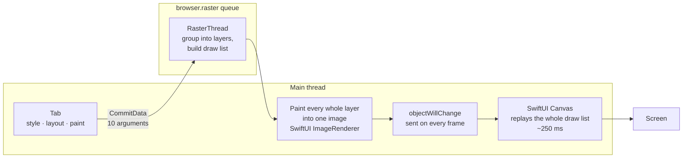
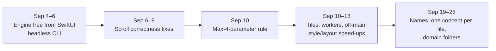
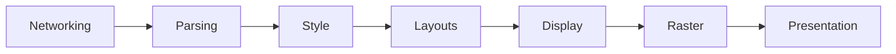
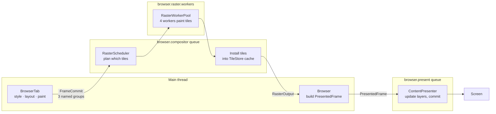
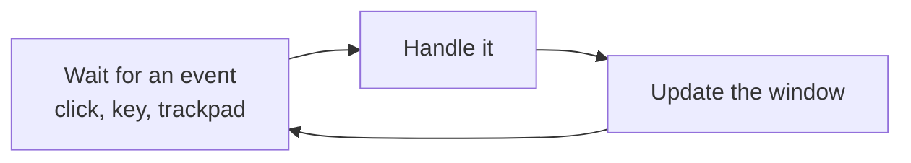
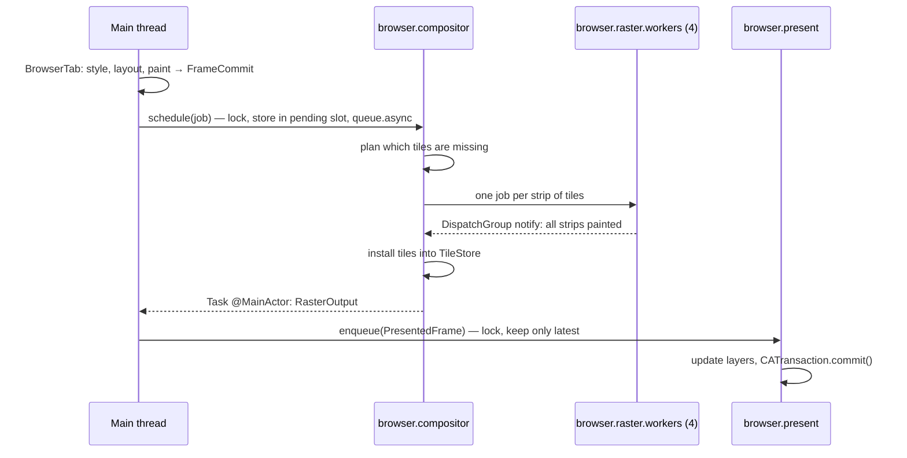

# Clean the Room Before You Move the Furniture

*How a toy browser engine in Swift went from stuttering on long pages to scrolling smoothly — 152 commits, 24 days (Sep 4 – Sep 28, 2026), `e8da50c..5377322`.*

ToyStack is a browser engine I build in Swift to learn how real browsers work. Short pages were fine. Long pages were not. The traces in this story are `browser.trace-bad-scroll` (recorded at `e8da50c`) and `browser.trace-good-scroll` (recorded at `5377322`); the full analysis is in `plans/scroll-trace-comparison.md`.

---

## 1. Before: the flowchart

This is what one scroll step did at `e8da50c`.



Every scroll step (a fixed 100 px) went through the whole chain. Only grouping layers and building the draw list left the main thread; painting pixels and redrawing the screen both ran on the main thread, the same thread that handles your trackpad.

### The symptoms, box by box

| Box | What you see | Evidence |
|---|---|---|
| Tab: style · layout · paint | The page freezes ~470 ms every 0.5–0.7 s while scrolling; parts of a long page went blank | Each time the scroll left the 2,400 px already-drawn area, the Tab laid out and painted the whole page again. 34 gaps of 300–837 ms in the bad trace; the screen was frozen 15.9 s out of 30.6 s of scrolling |
| Paint every whole layer into one image | The slowest frames take half a second | Slowest traced `composite_raster_and_draw` 484.4 ms, 95th percentile 55.3 ms |
| SwiftUI Canvas replays the whole draw list | Stutter even when nothing new was painted | SwiftUI re-ran the whole page drawing (~250 ms), pinning the main thread at ~4 visible updates per second (`eb5cd01`) |
| objectWillChange sent on every frame | The engine works even when the page is still | Bad trace shows exactly 60.0 fps while idle |
| "a fixed 100 px" (under the chart) | Scrolling jumps in steps and ignores how fast you swipe | Every wheel event restarted a scroll animation (`64cea66`) |
| CommitData, 10 arguments; RasterThread | I couldn't read the code well enough to fix any of the above | See below |

#### CommitData and RasterThread: why I didn't just start fixing

The obvious move was to open the scrolling code and start fixing. I didn't, because I couldn't really *read* the scrolling code:

- **The engine knew about the screen.** 10 files under `Sources/Engine/` did `import SwiftUI`. Paint commands drew straight into SwiftUI's `GraphicsContext`. The engine could not run without a window, so it could not be tested or debugged without one.
- **Functions took everything.** The data handed from a tab to the browser for each frame looked like this:

  ```swift
  init(
      url: WebURL, scroll: CGFloat, height: CGFloat, displayList: [Any],
      compositedUpdates: [ObjectIdentifier: VisualEffect]?, accessibilityTree: AccessibilityNode?,
      focus: DOMNode?, interestTop: CGFloat, prefersDark: Bool, forcedColors: Bool
  )
  ```

  Ten arguments, by the time the scroll fixes landed thirteen. Nobody can tell which of those belong together, which are still used, or which one is wrong.
- **Names hid intent.** `RasterThread` was not a thread. `NetworkingThread` was not a thread either. `Tab` collided with SwiftUI's own `Tab`. `EngineColor`, `ThemeState`, `StyleContext`, `CommitData`, `PaintResult`… each name said where it was first written, not what it was.
- **Everything lived in one folder.** 32 files flat in `Sources/Engine/` (plus a `Layouts/` subfolder), with `Tab.swift` at 1,062 lines.

---

## 2. The approach to fix the symptoms

Clean first, so the scroll code becomes readable. Then fix, measure, and clean the mess the fixes made. The order that actually happened:



### Step 1 (for CommitData and the engine's ties to SwiftUI): cut the engine away from the screen

The first real commit was `2242392 make engine free from SwiftUI`. I introduced a small `Renderer` protocol (fill a rect, draw text, save/restore state…) and two implementations: `CGRenderer` (Core Graphics, inside the engine) and `SwiftUIRenderer` (inside the app). The engine now only talks to the protocol.

That one change unlocked two things:

1. **A headless CLI** (`10e4fcd`). The engine can render a page to a PNG with no window. Now I can *look* at a frame without clicking around.
2. **The browser chrome moved out** (`57a024e`). The address bar and tabs bar are app code, not engine code. Removing the `import` only split the engine from the UI *framework*; moving `Chrome` split it from the UI *logic*.

At the end of the range, `git grep 'import SwiftUI' -- Sources/Engine` returns nothing.

### Step 2 (for Canvas, the 100 px step, and Tab): finally look at scrolling

With the engine separated, the scroll code became readable.

- **SwiftUI Canvas: the UI was redrawing for nothing.** Only signal a change when the painted output actually changed (`eb5cd01`).
- **The fixed 100 px step: scrolling ignored the trackpad.** Use the real trackpad delta, and let scrolling inside a scroll container repaint without re-running style and layout (`64cea66`).
- **Tab: leaving the drawn area re-ran layout.** Leaving the 2,400 px area no longer asks for a new layout, only for new pictures (`4f6a4d4`, Sep 8). Step 4 removes the rest of that cost.

**My own cleanup broke scrolling.** Before the cleanup, `Transform` moved the drawing by `+t`, drew its children, then moved back by `-t`. When I switched to the new `Renderer` protocol (`2242392`), I replaced that pair with save/restore, and got it wrong:

```swift
if let t = translation {
    renderer.saveState()
    renderer.translateBy(x: t.x, y: t.y)
}
// ... draw children ...
renderer.restoreState()   // runs even when nothing was saved
```

Every block on the page is wrapped in a `Transform`, and most have no translation, so most restores undid a state that some *other* code had saved. The SwiftUI renderer hid this: restoring with nothing saved did nothing. Four days later (`1a1a0c0`), I moved page drawing to Core Graphics, where the scroll offset and the vertical flip are saved states too. Now each stray restore threw them away: the page content stopped following the scroll, while the scrollbar, drawn separately, looked fine. The fix moved one line, so every restore has a matching save:

```diff
+renderer.saveState()
 if let t = translation {
-    renderer.saveState()
     renderer.translateBy(x: t.x, y: t.y)
 }
```

There was no test for `Transform`. A test that draws a nested transform and checks where the result lands would have caught this on Sep 5 instead of Sep 9.

### Step 3 (for CommitData): clean again, because the fixes made new mess

The first scroll fixes worked, but they piled more arguments onto already crowded functions:

```swift
func rasterIfNeeded(scale: CGFloat, store: TileStore, hintTop: CGFloat, hintBottom: CGFloat,
                    visibleTop: CGFloat, visibleBottom: CGFloat, budget: RasterBudget, visibleOnly: Bool = false)
```

So I paused and set a rule: **at most four parameters per function, at most four stored properties per struct** (`d348182`). The rule is not about the number four. It forces the question *"which of these values belong together?"*

- `hintTop / hintBottom / visibleTop / visibleBottom` became one `RasterWindow`.
- The 13-argument `CommitData` became three named groups: scroll state, paint result, theme (`47cf03b`). Some arguments turned out to be dead and were deleted.

The important part is the second half of the rule, written into `AGENTS.md`: *don't create a catch-all `Context` struct just to satisfy the count.* Grouping by count gives you a junk drawer; grouping by meaning gives you a concept.

### Step 4 (for Tab and "Paint every whole layer"): make it fast, with numbers

Now the code was readable enough to measure. Two of these commits record before/after numbers in their message; I show those below.

**Tiles instead of one big picture** (`e3d397c`). The page is split into 128×128 tiles, each its own Core Animation layer. A pure scroll only moves the container; the CPU draws only tiles that come into view.

**Effects on their own layers, and no rebuild when leaving the drawn area** (`42e7e7c`, `b60d384`). Pages with opacity, blur, transforms, or blend modes still redrew the whole window. Now they get their own layers, tiles are cached, and tile jobs are batched across layers. Leaving the drawn area keeps the layers and their tiles alive and only asks for the missing tiles.

**Separate the planner from the painters** (`33d1b6e`). One queue was both deciding *what* to draw and *drawing* it, and it blocked until every pixel was done. Now a scheduler plans on one queue and a fixed pool of 4 workers paints. (Four, because Core Graphics and Core Text already use multiple threads inside.)

**A sort hiding in the cache** (`1d60e3a`). The tile cache sorted all entries on every insert to find the oldest one. While scrolling, the cache sits right at its limit, so it sorted once per tile. Replacing the sort with a single scan for the oldest entry:

| Measurement | Before | After |
|---|---|---|
| Install tiles per pass | 23.9 ms | 0.74 ms |
| Frame latency | 31.7 ms | 13.8 ms |
| Cache hit ratio | ~90% | ~90% |

**Get off the main thread** (`eda4d1a`). Updating layers and committing them happened on the main thread. A new `ContentPresenter` does it on its own queue and keeps only the latest frame if several pile up.

| Measurement (21.6 s session) | Before | After |
|---|---|---|
| Main thread busy | ~1.9 s | 33 ms |
| Frame latency | 13.35 ms | 6.86 ms |

**Then the work before painting: style and layout** (`1709920` → `bd197b7`). Painting is the last step. Before it, the engine matches CSS rules to elements (style) and measures text to place words on lines (layout). I first added trace spans and counters for these steps (`1709920`, `f3bb081`): how many elements × rules style had to check, and how many times layout measured a word. Then I fixed what they pointed at:

- Remember text measurements instead of measuring the same word again (`1247311`).
- Look up the font once per text node instead of once per word (`1247311`, `c5413f3`, `bd197b7`).
- Group CSS rules by tag, class and id, so an element is only checked against rules that could match it (`9aea139`).
- Skip a rule like `nav a` right away when the element has no `nav` above it (`5b90ad6`).

These commits don't record before/after numbers.

### Step 5 (for RasterThread and the other names): the long tail of naming

About half the commits in this range are renames and moves (Sep 19 – Sep 28). A sample:

| Before | After | Why |
|---|---|---|
| `RasterThread` | `RasterScheduler` | It schedules; it is not a thread |
| `NetworkingThread` | `NetworkTaskRunner` | Same reason |
| `Tab` | `BrowserTab` | Collided with `SwiftUI.Tab` |
| `CommitData` | `FrameCommit` | What a frame hands over |
| `FrameEpoch` | `FrameRevision` | It counts revisions |
| `ThemeState` | `ColorPreferences` | It is the user's color preferences |
| `StyleContext` | `MediaFeatures` | Matches the CSS term |
| `ScrollAnimation` | `ScrollTween` | It tweens between two values |
| `animate()` | `nextValue()` | Says what it returns |
| `splitTopLevel` | `splitOutsideParentheses` | Says what it does |

The flat folder became domains that follow the order a page is built:



`Core` orchestrates. `Animation` pushes new style values into the line every frame. `Accessibility` reads the laid-out page and adds highlight outlines to the drawing. `Platform`, `Scheduling`, `Diagnostic` support. When you know a bug is "a tile is wrong", you know which folder to open.

Last, I added explicit types everywhere (`bb6ca2b`, `53f7580`, 43 files) so the Swift compiler spends less time guessing.

---

## 3. Before flowchart vs after flowchart

**After (`5377322`)**



Style, layout and paint still run on the main thread, in both versions. What moved off it is the expensive part: painting pixels (now 4 workers) and updating the screen layers (now the present queue). The main thread's share of each frame is a small hand-off, measured by the `present.main` span. A pure scroll moves the tile container; only tiles coming into view get painted. In the good trace, 1,266 frames were shown but only 468 tile jobs ran, so about 63% of scroll frames needed no drawing at all.

| Box (before → after) | Before | After | Commits |
|---|---|---|---|
| Scroll step (caption) | Fixed 100 px + restarted animation | Real trackpad delta | `64cea66` |
| Tab → BrowserTab, when leaving the drawn area | Layout + paint of the whole page, then rebuild all layers | Only the missing tiles are drawn; style, layout and paint run zero times while scrolling | `4f6a4d4`, `b60d384` |
| Paint every whole layer → RasterWorkerPool + TileStore | Whole layer, one big image, on the main thread | 128×128 tiles, cached, painted by 4 background workers | `e3d397c`, `b60d384`, `33d1b6e` |
| RasterThread → RasterScheduler | Groups layers and builds the draw list | Plans which tiles are missing; workers do the painting | `33d1b6e` |
| objectWillChange + SwiftUI Canvas → ContentPresenter | SwiftUI Canvas on main, every frame, even when idle | `ContentPresenter` on its own queue, only when the paint changed; nothing drawn when idle | `eb5cd01`, `eda4d1a` |
| CommitData → FrameCommit | 10 loose arguments | 3 named groups: scroll state, display output, color preferences | `47cf03b`, `c958bcb` |

---

## 4. How much fps we get

| While scrolling the long page | `e8da50c` | `5377322` |
|---|---:|---:|
| **fps, at most 1 frame per 1/60 s slot** | **20.3** | **52.4** (+32.1, ≈2.6×) |
| fps, raw frame count | 24.6 | 77.5 |
| Typical gap between frames (median) | 16.6 ms | 12.4 ms |
| Slow gap between frames (95th percentile) | 253.9 ms | ≈21 ms |
| Gaps longer than 300 ms | 34 (15.9 s frozen out of 30.6 s) | 0 |
| Longest gap | 837.1 ms | 227.6 ms |
| Main thread busy (21.6 s session, `eda4d1a`) | ~1.9 s | 33 ms |

**How it was counted** (details in `plans/scroll-trace-comparison.md`):

- Bad trace: one finished `composite_raster_and_draw` = one new picture. Scroll window 21.42 s → 52.07 s.
- Good trace: one `present` counter event = one picture shown on screen, written after `CATransaction.commit()`. Two scroll windows, 26.35 s → 35.01 s and 46.98 s → 54.21 s.
- **Fair fps:** each window is split into 16.67 ms slots (1/60 s). A slot counts once if at least one frame landed in it, so neither build can score above 60. The raw count flatters the good build: it shows one frame per scroll event and can go above 60, while the bad build is held at 60 by its timer.
- Both windows lean the same way: the bad window includes calm moments where the idle timer still produces 60 fps (makes bad look better), and the good window includes short scroll pauses with no frames (makes good look worse). The real difference is, if anything, bigger.
- The "~4 visible updates per second" in the SwiftUI Canvas symptom comes from the `eb5cd01` commit message, measured on a different build and page. The bad trace here measures 20.3 fps.
- The good trace loads a page with 3,049 elements / 9,729 words. The bad trace has no page info, so it is [INFERENCE] the same page.

**What still keeps it from a steady 60.** From `b60d384` and the good trace, written down on purpose:

- A very fast fling on a heavy page can still show a short blank band (~130 ms at p90). Drawing the pixels is the wall.
- When the page jumps far in one event (14,501 → 16,450 px at 29.66 s), all 156 tiles are new and `view.commit` takes 71.5 ms. Most of the 6 gaps over 100 ms sit around such jumps.
- Tried and reverted: drawing a whole row strip and slicing it into tiles. It didn't help, which proved the cost is in drawing, not in setup.
- The next lever, if needed: lower-resolution tiles during fast scroll, sharpened when scrolling stops.

Writing down what didn't work is as valuable as the win: it stops future-me from trying it again.

---

## Appendix

### Side note: what "commit" means here

This post uses "commit" in three ways, and it is easy to mix them up. Short version: **a commit means the work is done, and the result is handed to someone else.**

#### Where the word comes from

"Commit" comes from the Latin *committere*: *com-* ("together") + *mittere* ("to send, to put"). It meant "to send something into someone's hands" or "to entrust it to someone". The same root is in *mission*, *transmit*, and *submit*. "Commitment" is simply the act of committing.

Every modern use mixes two ideas:

1. **Hand it over:** the thing leaves your hands.
2. **It's final:** the other side can now rely on it.

#### In daily life

| Situation | Hand it over | It's final |
|---|---|---|
| Handing in an exam paper | The teacher has your answers | You can't fix a mistake after handing it in |
| Posting a letter | The post office has it | It's on its way; you can't edit it |
| Paying at a shop checkout | The shop gets your money and order | The cashier starts packing your order |
| Wedding vows | You give your promise to another person | They plan their life around it |
| "I'm committed to the project" | You give your time to the team | The team plans around you |
| "Commit it to memory" | You put a fact into your memory | You can recall it later without looking |

#### The three commits in this story

| | Git commit | Frame commit (`FrameCommit`) | Core Animation commit (`CATransaction.commit()`) |
|---|---|---|---|
| What gets finalized | Your staged file changes | One frame's style, layout and paint result | A batch of layer changes |
| Who receives it | The repository history | `Browser`, then the painting workers | The screen |
| How long it lives | Forever | Until the next frame replaces it | Until the next batch |
| Where in ToyStack | `git log` | `BrowserTab.swift:645` → `Browser.swift:166` | `ContentPresenter.swift:62` |

The frame commit works like handing in an exam. The tab finishes its frame (style, layout, paint), packs the result into a `FrameCommit`, and hands it to `Browser`. After that it doesn't touch that snapshot again, so the painting workers never see a page that is half old and half new. The tab is free to start the next frame. Unlike wedding vows, a frame commit only has to hold for a very short time: the next frame replaces it, maybe 16 ms later.

The Core Animation commit is the last step. `ContentPresenter` changes many screen layers (moves tiles, swaps images), then calls `CATransaction.commit()` so all the changes appear together and the user never sees a frame where only some tiles have moved.

The name comes from the *Web Browser Engineering* book this project follows. Its `Browser.commit(tab, CommitData(...))` became ToyStack's `CommitData`, later renamed `FrameCommit`. Chromium uses the same word for handing a finished frame from its main thread to the thread that puts it on screen. One difference in ToyStack: `BrowserTab` and `Browser` both run on the main thread, so the commit is a hand-off between two objects. The move to another thread comes one step later, when `scheduleRasterAndDraw` sends a copy to the `browser.compositor` queue.

### Side note: threads, and how they talk to each other

#### A thread is real

A thread is one line of work the computer follows step by step, in order. It is a real thing the operating system keeps track of: which instruction it is on, its own scratch memory for local variables (the stack), and whether it is running, ready, or sleeping. The system's scheduler keeps picking ready threads and running each one on a core for a moment. A MacBook Air M1 has 8 cores, so up to 8 threads run at the exact same instant; the rest wait their turn.

You can see them. On my Mac, `ps -M -p <Finder's pid>` listed 10 threads for Finder, all sleeping. Activity Monitor shows the same number in its "Threads" column.

All threads in one app share the same memory: every object, every array. That is what makes communication possible, and also what makes it dangerous.

#### The main thread

When an app starts, macOS gives it one thread: the main thread. In AppKit and SwiftUI it is the only thread allowed to handle input and update the window. It runs a loop that never stops:



The MacBook Air M1 screen refreshes 60 times per second, so each pass through the loop has about 16.7 ms. If the main thread spends 250 ms on one job, the loop stops for 250 ms: no scrolling, no clicks, no redraw. That was ToyStack's stutter at `e8da50c`.

Think of a restaurant with one cashier (the main thread) and several cooks (the other threads). If the cashier starts cooking, the queue stops moving even though the kitchen is free. The fix in this story was to send the cooking (painting pixels, updating layers) to the kitchen and leave the cashier with quick hand-offs only.

#### Main, compositor, worker: same thing, different jobs

All threads are the same kind of object. The names describe their job, not a different type:

| Name | What makes it special | Restaurant |
|---|---|---|
| Main thread | Simply the first thread; macOS requires input and window updates to happen on it | Cashier |
| A dedicated thread (e.g. Chrome's compositor thread) | A normal thread that does one job for the whole life of the app | Head chef |
| Worker threads (a pool) | Several normal threads that take whatever task is next, like painting any tile | Line cooks |

So Chrome's compositor thread is not "a worker". It is a dedicated thread whose job is scrolling and putting layers together, even while the main thread is busy running JavaScript. Chrome's tile painting happens on a separate pool of raster worker threads. Google's [Inside look at modern web browser, part 3](https://developer.chrome.com/blog/inside-browser-part3) shows a page process with a main thread, worker threads, a compositor thread and raster threads.

#### ToyStack uses queues, not threads

ToyStack never creates threads by hand. It creates queues (`DispatchQueue`), and the system's dispatch library (GCD) runs each queue's jobs on threads from its own pool.

- `browser.compositor` and `browser.present` are **serial queues**: one job at a time, in order. They *behave* like dedicated threads, though the thread underneath may change from one job to the next.
- `browser.raster.workers` is a **concurrent queue**: several jobs at once. This is the worker pool.

So the honest picture is: ToyStack has a main thread, plus queues that act like Chrome's compositor and raster threads.

#### How threads talk to each other

Since threads share memory, "talking" means one thread leaves data somewhere and another picks it up. Done carelessly, two threads change the same data at the same moment and the result is garbage. ToyStack uses five safe ways:

| Way | Restaurant | ToyStack code |
|---|---|---|
| **Hand over a job:** put a closure on another queue | Pin an order ticket on the kitchen rail | `queue.async { self.drain() }` in `RasterScheduler.swift:26` |
| **Send a copy, not the original:** pass a struct | Hand over a written order, not your notebook | `FrameCommit`, `PresentedFrame`, `RasterPlan` are structs, so each side has its own copy |
| **Lock a shared slot:** only one thread touches it at a time | One order slot with a key; whoever holds the key may swap the ticket | `lock.lock(); pending = job; lock.unlock()` in `RasterScheduler.swift:21-24`; `latest` in `ContentPresenter.swift:25-33` |
| **Wait for a group:** continue when everyone is done | Head chef waits until every dish for table 5 is ready | `DispatchGroup` with `enter`/`leave`/`notify` in `RasterWorkerPool.render` |
| **Hand back to the main thread** | The kitchen rings the bell; the cashier serves | `Task { @MainActor in job.then(output) }` in `RasterScheduler.swift:53` |

The locked slot also explains how ToyStack drops stale work. It holds only the newest job or frame; if a new one arrives before the old one starts, the old one is replaced. That is the `present.dropped` counter from `eda4d1a`. The cashier passes on only the latest order for a table, not every change the customer made.

#### One frame, as messages between threads



The main thread shows up only at the start and in the middle, for short hand-offs. Everything slow happens elsewhere, which is why the main thread's busy time fell from 1.9 s to 33 ms.

### The numbers for the whole range

| | `e8da50c` | `5377322` |
|---|---|---|
| Engine files importing SwiftUI | 10 | 0 |
| Swift files (incl. tests, Package.swift) | 46 | 139 |
| Engine folders | 1 flat (+ `Layouts`) | 14 domain folders (incl. `Style/Selectors`) |
| Commits | — | 152 (103 refactor, 15 perf, 12 fix, 6 feat, 12 docs, 3 chore) |
| Lines changed | — | +6,100 / −3,925 |

Honest note: `Browser.swift` grew from 550 to 1,011 lines because the scheduling and presenting hand-off landed there. `BrowserTab.swift` is still ~1,050 lines. Those are the next rooms to clean.

### What I'd tell someone starting this

1. **Separate the engine from the screen first, but test what you move.** A headless engine is a testable, debuggable engine. My own cleanup broke scrolling for four days because nothing tested `Transform`.
2. **Make a rule that forces the right question.** "Max four parameters" is arbitrary; "which of these belong together?" is not.
3. **Measure before every speed-up, and write the numbers in the commit.** The cache sort was invisible until a trace span pointed at it.
4. **Write down what didn't work.** A reverted experiment with a reason is a finding, not a failure.
5. **Cleaning isn't a phase.** I cleaned, fixed, cleaned the mess the fixes made, sped up, then cleaned again (see the timeline in section 2).

### Talk outline (≈25 min)

| # | Slide | Talking point | Evidence |
|---|---|---|---|
| 1 | **Clean the room before you move the furniture** | Toy browser in Swift; long pages stuttered | Screen recording of the stutter |
| 2 | The before flowchart | Painting and redrawing on the main thread; only the draw list leaves it | Before diagram |
| 3 | Tab and "Paint every whole layer" | ~470 ms freeze when leaving the drawn area; 484 ms slowest frame; frozen 15.9 of 30.6 s | `browser.trace-bad-scroll` |
| 4 | Canvas, objectWillChange, 100 px step | ~250 ms redraw for nothing; 60 fps while idle; 100 px steps | `eb5cd01`, `64cea66` |
| 5 | CommitData and RasterThread: why I didn't just fix it | Couldn't read the code; the 10-argument init | 10 `import SwiftUI` in engine; `e8da50c:Sources/Engine/CommitData.swift` |
| 6 | Cut the engine from the screen | `Renderer` protocol, two implementations; headless PNG | `2242392`, `10e4fcd` |
| 7 | **The refactor that broke scrolling** | `+t`/`-t` became save-inside-`if` / restore-outside; hidden by the SwiftUI renderer, exposed by Core Graphics | Introduced `2242392`, fixed `1a1a0c0` — live-code it |
| 8 | Fixes made new mess | 8-argument `rasterIfNeeded`; the four-parameter rule; no junk-drawer `Context` | `d348182`, `RasterWindow`, `47cf03b` |
| 9 | Tiles | 128×128 tiles; scroll moves a container; no rebuild when leaving the drawn area | `e3d397c`, `b60d384` |
| 10 | Planner vs painters | Scheduler + 4 workers | `33d1b6e` |
| 11 | **The hidden sort** | 23.9 → 0.74 ms (31×), latency 31.7 → 13.8 ms | `1d60e3a` |
| 12 | Off the main thread | Main busy 1.9 s → 33 ms; latency 13.35 → 6.86 ms | `eda4d1a` |
| 13 | Style and layout | Profile first (`1709920`, `f3bb081`), then text cache, font once per node, CSS rule index, `nav a` skip | `1247311`, `9aea139`, `5b90ad6`, `c5413f3` |
| 14 | Names and domains | Before/after table; pipeline diagram | Sep 19–28, README "Domain Architecture" |
| 15 | Before vs after flowchart | Same boxes, expensive parts moved off the main thread | Diagrams |
| 16 | How much fps | 20.3 → 52.4 fair fps; 34 → 0 gaps over 300 ms | `plans/scroll-trace-comparison.md` |
| 17 | What's left | ~130 ms blank on fast fling; 71.5 ms commit on big jumps; strip+slice reverted | `b60d384`, good trace |
| 18 | Five takeaways | From "What I'd tell someone" | — |
| 19 | What's next | `Browser.swift` 1,011 lines; low-res tiles during fling | — |

### Demo suggestions

- Side-by-side recording: `e8da50c` vs `5377322` scrolling the same long page.
- Open `browser.trace` before and after `1d60e3a` to show the `raster.install.tiles` span shrink.
- Run the headless CLI live to render a page to PNG.
